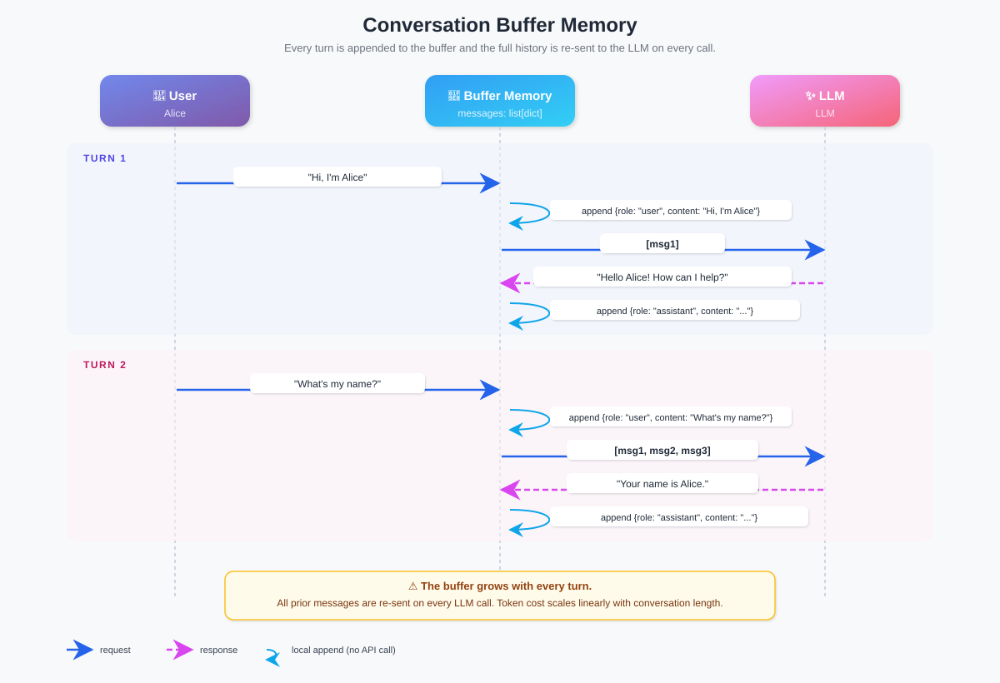
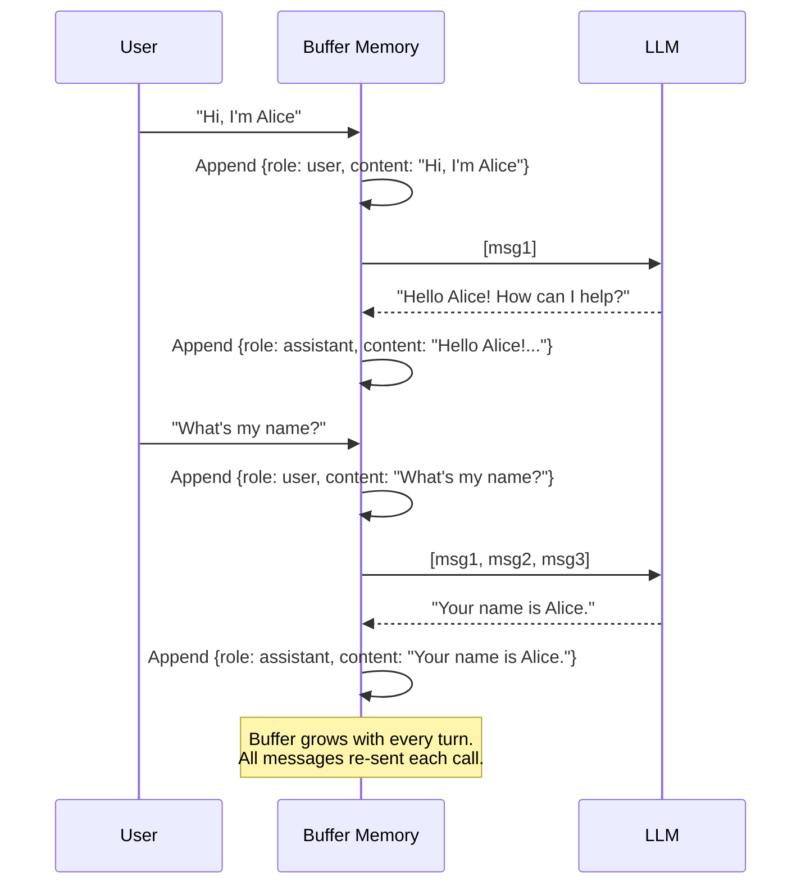

# 对话缓冲记忆（Conversation Buffer Memory）

  

## 📖 速览

| 难度 | 耗时 | 前置要求 |
|------------|------|---------------|
| 初级 | 约 15 分钟 | Python 3.11+、`LLM_API_KEY`（任意 OpenAI 兼容端点）、对 LLM 和聊天 API 的基本了解 |

这项技术面向正在构建第一个 LLM 聊天机器人的开发者，帮你理解所有其他记忆模式赖以构建的地基。

## TL;DR

- **是什么：** **对话缓冲记忆**把整段聊天历史一字不落地存下来，每次调用都重新发给 LLM。
- **什么时候需要：** 对话足够短，能宽裕地装进模型的上下文窗口。
- **代价：** token 成本随对话长度线性增长，最终会撑爆上下文窗口。
- **本仓库中最接近的替代：** 02 滑动窗口记忆只保留最近 K 条消息，而不是全部。

## 描述

想想一台从不暂停的录音机。它录下你和 AI 智能体对话中的每一个字。智能体要回复时，就把整盘带子从头重放。这给了智能体完美的记忆。但有个问题：磁带长度有限，而且这盘带子无法压缩。

对话缓冲记忆是 LLM 聊天应用里最直白的智能体记忆技术。它把完整对话历史（每条用户消息和每条助手回复）一字不落地存进上下文窗口。模型每次回答，都把整份消息列表当作输入来读。这让它天然适合短命聊天机器人、原型开发，以及任何需要完美记住每一轮的场景。代价是成本：token 预算（模型一次能处理的文本量）是有限的，无上限的缓冲区迟早会把它撑爆。

**关键词：** 智能体记忆、对话缓冲记忆、LLM 智能体、上下文窗口、对话历史、聊天记忆、token 预算、消息列表、短期记忆、聊天机器人记忆

智能体每次回答，都会收到整份消息列表作为上下文。这里的「上下文」指模型在生成回答前读到的文本。这种方法搭起来快、想得清楚。但它有一个关键限制：上下文窗口（模型一次能处理的最大文本量）是有限的。无上限的历史迟早会超出它。

理解这项技术很重要，因为几乎所有其他记忆模式都建立在它之上，或是对它的改进。

## 关键概念

- **消息列表：** 核心数据结构。一个有序的消息列表，每条带一个角色（system、user 或 assistant）和一段内容字符串。
- **角色跟踪：** 保持角色正确交替，让 LLM 在整场对话中知道谁说了什么。
- **上下文注入：** 把存储的消息历史插入每条新的 LLM 提示词。智能体就是这样跨轮次保持连贯的。
- **token 计数：** 监控历史消耗了多少 token（模型内部使用的词片段），对照模型上下文窗口的上限。
- **对话持久化：** 把消息列表存进持久存储（文件、数据库），让对话跨会话存活。序列化指把列表转成 JSON 这类可存储的格式。

## 架构

  

Mermaid source

---

## 工作原理

1. 你发送一条消息。
2. 系统把它以 `user` 角色追加到列表。
3. 整个列表作为提示词发给 LLM。
4. LLM 的回复以 `assistant` 角色追加进去。
5. 步骤 1-4 不断重复，直到对话结束或上下文窗口装满。

## 何时使用

- 总 token 量宽裕地落在模型上下文窗口内的短对话。
- 原型和开发阶段，简单性比效率更重要。
- 需要对对话中每个细节完美回忆的场景。

## 局限

- 没有任何机制处理超出上下文窗口的对话。
- 成本随对话长度线性增长。每个 token 每次调用都要重发。
- 不配合其他技术，就不适合长时间的智能体交互。

## Notebook

**[conversation_buffer_memory.ipynb](conversation_buffer_memory.ipynb)**：一个完整可运行的 notebook，涵盖：

- 用 **deepagents**（LangChain 团队开源的智能体框架）搭配任意 OpenAI 兼容端点，从零构建一个 `ConversationBufferMemory` 类。
- 多轮对话演示，展示跨轮次的完美回忆。
- 用 **matplotlib** 做 **token 增长可视化**，证明每轮成本线性、累计成本二次方。
- 基于 JSON 的持久化（保存/加载对话）。
- 对比不带缓冲与带缓冲的 deepagents，看清记忆层的价值。

## 常见问题

### 问：智能体记忆中的对话缓冲记忆是什么？

**答：** 对话缓冲记忆把聊天会话中的每条消息都存下来，每次调用都把完整历史发给 LLM。这让模型对至今说过的每句话都有完美回忆。代价是 token 线性增长：一场 100 轮、每轮约 50 token 的对话，要消耗约 5,000 个上下文 token。LangChain 把它实现为 `ConversationBufferMemory`。它最适合短对话（20 轮以内），且完整保真比成本更重要的场景。

### 问：什么时候该用对话缓冲记忆而不是滑动窗口记忆？

**答：** 当对话较短（20 轮以内）且每个细节都重要时，用对话缓冲记忆。滑动窗口记忆（技术 02）在 K 轮后丢弃较旧的消息，省 token 但丢掉早期上下文。如果你的智能体在第 15 轮还需要引用第一条消息，缓冲方案更稳妥。对话一旦超过 30-50 轮，就换用窗口或摘要方案来控制成本。

### 问：对话缓冲记忆有哪些局限或失败模式？

**答：** 主要失败模式是上下文窗口溢出。随着对话变长，token 用量线性上升，直到超过模型上限（依模型不同，4k 到 200k token）。到那时，调用要么直接失败，要么被静默截断。长对话还会拉高每次调用的延迟和成本。没有优雅的降级：撞墙之前你拥有完整回忆，撞墙之后什么都没有。

### 问：对话缓冲记忆能和其他记忆技术组合吗？

**答：** 能。常见做法是和技术 06（向量库记忆）搭配：缓冲区保存当前会话的完整历史，已结束的会话写入向量库。每一轮从向量库取回最相关的 3-5 段过往交流，插到缓冲区前面。这样既有完美的短期回忆，又有近似的长期回忆，token 也不会无限增长。

### 问：有什么库或框架能省掉自己实现的工作？

**答：** LangChain 提供 `ConversationBufferMemory`，一个即插即用的类，能接进任何 chain 或 agent。LlamaIndex 提供 `ChatMemoryBuffer`，功能等同。Mem0（技术 25）也能做缓冲式存储，并带自动持久化。要托管方案，Zep（技术 27）在服务端保存完整对话历史，替你处理检索。四种选择都支持 Python，接入代码都很少。

## 参考文献

- [LangChain ConversationBufferMemory](https://python.langchain.com/docs/modules/memory/types/buffer?utm_source=nirdiamant&utm_medium=github&utm_campaign=agent_memory_techniques)
- [OpenAI Chat Completions API: Message Format](https://platform.openai.com/docs/guides/text-generation?utm_source=nirdiamant&utm_medium=github&utm_campaign=agent_memory_techniques)
- Harrison Chase, "Memory in LLM Applications"（LangChain 文档）
- [LlamaIndex Chat Store 抽象层](https://docs.llamaindex.ai/en/stable/module_guides/storing/chat_stores/?utm_source=nirdiamant&utm_medium=github&utm_campaign=agent_memory_techniques)

## 相关技术

- [**02 滑动窗口记忆**](../02_sliding_window_memory/) - 只保留最近 *k* 条消息，加了大小上限。缓冲区长得太大时的自然下一步。
- [**03 摘要记忆**](../03_summary_memory/) - 把完整历史压缩成一份滚动摘要，而不是原样存储。用精确回忆换更低的 token 成本。
- [**04 摘要缓冲记忆**](../04_summary_buffer_memory/) - 把本技术与摘要记忆结合：旧消息做摘要，最近消息保留原文。
- [**05 token 缓冲记忆**](../05_token_buffer_memory/) - token 感知的近亲，按严格的 token 预算而非消息条数裁剪。

---

