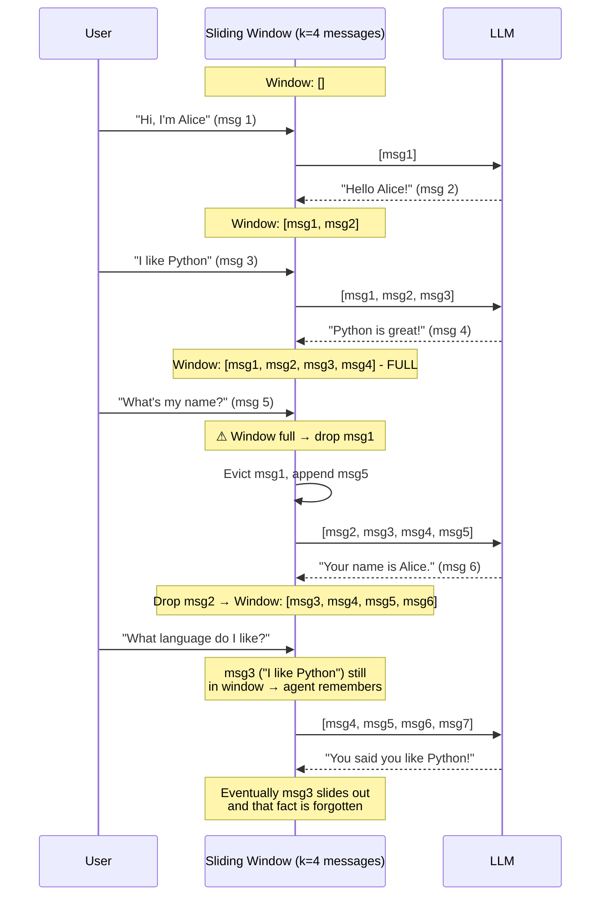

# 滑动窗口记忆（Sliding Window Memory）

  

## 📖 速览

| 难度 | 耗时 | 前置要求 |
|------------|------|---------------|
| 初级 | 约 20 分钟 | Python 3.8+、`LLM_API_KEY`，建议先了解 01 对话缓冲记忆 |

这项技术面向需要固定大小对话历史的开发者：既防止 token 溢出，又保住最近的上下文。

## TL;DR

- **是什么：** **滑动窗口记忆**只保留最近 K 条消息，用先进先出（FIFO）的方式淘汰更旧的消息。
- **什么时候需要：** 你想让记忆成本有上限，而且只关心最近的对话上下文。
- **代价：** 窗口之外的内容被永久遗忘，没有任何平滑过渡。
- **本仓库中最接近的替代：** 05 token 缓冲记忆按 token 数而不是消息数裁剪，控制更精细。

## 描述

想象一块只贴得下五张便利贴的白板。贴第六张时，你会撕掉最旧的那张扔掉。滑动窗口记忆就是这样：你总能看到最近的笔记，但更旧的永远消失。

滑动窗口记忆是一种智能体记忆技术，只在对话历史中保留最近 *k* 条消息。它采用 FIFO 淘汰（先进先出）：新消息到来且缓冲已满时，最旧的消息掉出。这把上下文窗口的用量限制在一个可预测的上限，让滑动窗口成为聊天界面和客服机器人最实用的 LLM 智能体记忆策略之一。代价是很硬的新近度偏差：智能体记得最近的轮次，但会永久忘记更早的对话历史。

**关键词：** 智能体记忆、滑动窗口记忆、LLM 智能体、FIFO 淘汰、上下文窗口、对话历史、新近度偏差、聊天记忆、消息窗口、短期记忆

## 关键概念

- **窗口大小 *k***：保留消息的最大数量。选 *k* 是一个调参决定。*k* 越大，保留的历史越多，token 成本也越高。
- **FIFO 淘汰**：新消息到来且缓冲已满时，最旧的消息掉出。窗口随时间向前「滑动」。
- **新近度偏差**：模型只能看到最近的上下文。对话较早的信息会永久丢失，除非在别处保存下来。
- **可配置的窗口**：你可以根据任务需求、模型上下文限制或对话复杂度，动态调整窗口大小。
- **按消息计数与按轮次计数的窗口**：大小为 *k* 的消息窗口逐条计数。大小为 *k* 的轮次窗口按「用户-助手」对话对计数。轮次窗口保持每段交流完整，避免孤立消息（只剩回答、没有提问）。

## 架构

  

Mermaid source

---

## 工作原理

1. 维护一个有序的消息列表。
2. 每来一条新消息（用户或助手），检查 `len(messages) > k` 是否成立。
3. 如果超限，从列表头部移除最旧的消息。
4. 下一次调用 LLM 时，只发送保留的消息。

## 何时使用

- 最近上下文最重要、更旧上下文可以舍弃的对话。
- 对成本敏感、需要限制每次请求 token 用量的应用。
- 用户很少引用对话较早部分的聊天界面。

## 局限

- 硬性的信息截断：窗口之外的内容一概丢失。
- 没有优雅降级：窗口之前的讨论没有摘要或痕迹。
- 选对 *k* 需要实验。太小会丢关键上下文，太大浪费 token。

## Notebook

**[sliding_window_memory.ipynb](sliding_window_memory.ipynb)**：一个动手 notebook，用 deepagents 和任意 OpenAI 兼容端点从零构建基于 `deque` 的滑动窗口记忆。包含跨不同窗口大小的受控回忆评估、token 成本对比图，以及如何选对 *k* 的讨论。

## 常见问题

### 问：智能体记忆中的滑动窗口记忆是什么？

**答：** 滑动窗口记忆只在对话历史中保留最近 K 条消息，用 FIFO（先进先出）淘汰丢弃更旧的消息。无论对话多长，token 用量都有可预测的上限。例如 K=10、每条消息约 50 token 时，历史部分始终只花约 500 token。LangChain 把它实现为 `ConversationBufferWindowMemory`，`k` 参数可配置。

### 问：什么时候该用滑动窗口记忆，而不是 token 缓冲记忆？

**答：** 当你想要最简单的有界记忆方案，且消息长度大致均匀时，用滑动窗口记忆。token 缓冲记忆（技术 05）按 token 数裁剪，消息长短不一时控制更精细。如果有的消息 10 token、有的 500 token，按消息计数的窗口要么浪费预算，要么不可预期地溢出。对轮次短而一致的聊天机器人来说，滑动窗口更好理解、更好配置。

### 问：滑动窗口记忆有什么限制或失败模式？

**答：** 主要失败模式是上下文失忆。消息一旦滑出窗口，就永远消失。智能体无法回忆早期的指令、用户在第 1 轮说的偏好，或之前达成的约定。K 太小，智能体会在对话中途丢失关键上下文；K 太大，成本问题就和对话缓冲记忆差不多了。没有优雅降级，只有在 K 条消息处的硬截断。

### 问：滑动窗口记忆能和其他记忆技术组合吗？

**答：** 可以。和技术 03（摘要记忆）搭配，就是一个轻量的混合方案：窗口里逐字保留最近 K 条消息，同时维护一份覆盖所有已滑出内容的滚动摘要。这正是技术 04（摘要缓冲记忆）的形式化版本。也可以和技术 06（向量库记忆）组合：窗口提供即时上下文，同时按需检索相关的较早消息。

### 问：有什么库或框架能省掉自己实现的工作？

**答：** LangChain 开箱提供 `ConversationBufferWindowMemory`，带 `k` 参数。LlamaIndex 的 `ChatMemoryBuffer` 提供 `token_limit` 选项，行为是有界记忆。托管方案方面，Zep（技术 27）和 Mem0（技术 25）都支持可配置的保留窗口。如果需要 token 级而不是消息级的精细控制，看技术 05（token 缓冲记忆）和 LangChain 的 `ConversationTokenBufferMemory`。

## 参考文献

- [LangChain ConversationBufferWindowMemory](https://python.langchain.com/docs/modules/memory/types/buffer_window?utm_source=nirdiamant&utm_medium=github&utm_campaign=agent_memory_techniques)
- OpenAI Best Practices: Managing Tokens
- Lilian Weng, "LLM Powered Autonomous Agents," 2023
- [LlamaIndex ChatMemoryBuffer](https://docs.llamaindex.ai/en/stable/api_reference/memory/chat_memory_buffer/?utm_source=nirdiamant&utm_medium=github&utm_campaign=agent_memory_techniques)

## 相关技术

- [**01 对话缓冲记忆**](../01_conversation_buffer_memory/) - 本技术的无上限版本。保存所有内容，不做淘汰。
- [**04 摘要缓冲记忆**](../04_summary_buffer_memory/) - 为滑动窗口丢掉的内容保留摘要，较早的上下文不会被彻底遗忘。
- [**05 token 缓冲记忆**](../05_token_buffer_memory/) - 按 token 数而不是消息数裁剪。消息长短差异大时更精确。

---

