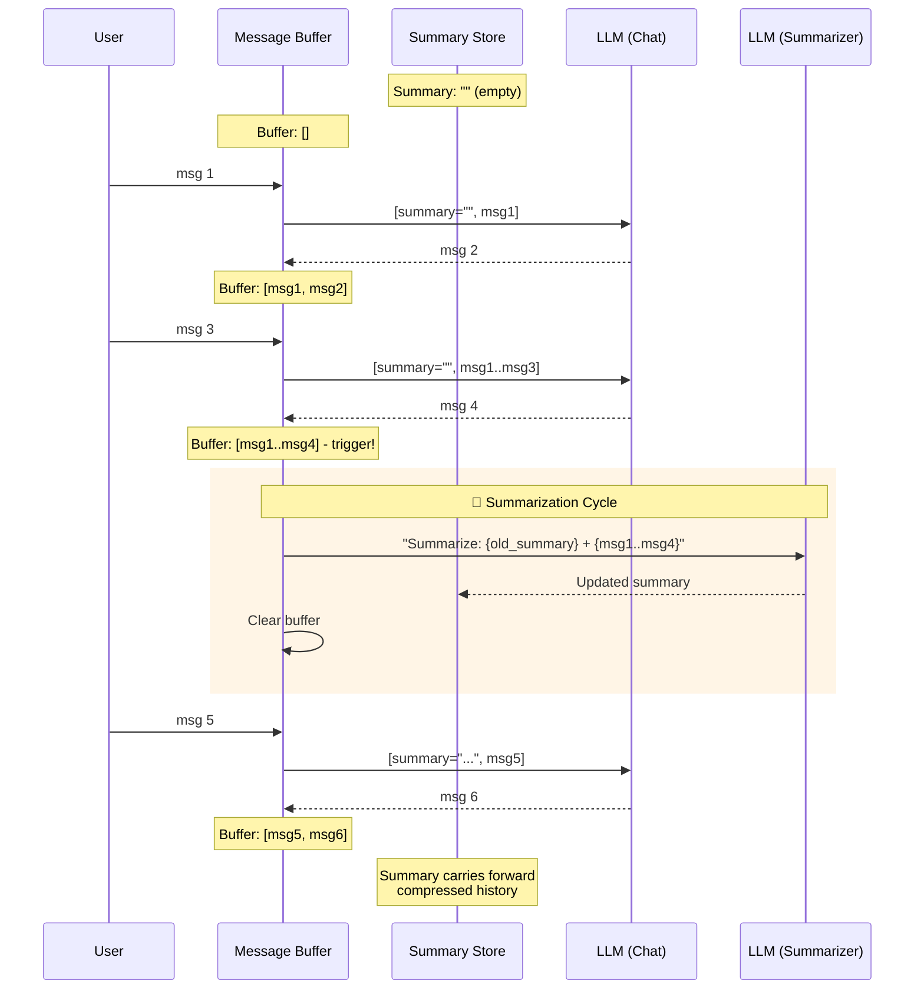

# 摘要记忆（Summary Memory）

  

## 📖 速览

| 难度 | 耗时 | 前置要求 |
|------------|------|---------------|
| 初级 | 约 20 分钟 | Python 3.8+、`LLM_API_KEY`、建议先理解 01 对话缓冲记忆 |

这项技术面向这样的开发者：你想通过把历史压缩成摘要来维持长对话，而不触及 token 上限。

## TL;DR

- **是什么：** **摘要记忆**用一份 LLM 生成的滚动摘要替代原始对话历史，把之前所有轮次压缩进去。
- **什么时候需要：** 对话经常超出上下文窗口，而你能容忍有损压缩。
- **代价：** 摘要会丢失细节，且每次摘要更新都是一次额外的 LLM 调用，有自己的 token 开销。
- **本仓库中最接近的替代：** 04 摘要缓冲记忆在摘要之外，为近期消息额外保留一个逐字缓冲区。

## 描述

想象读一本 300 页的书，每读完一章在结尾写一页摘要。你没法再逐字引用原书，但仍然知道发生了什么。摘要记忆就是这样工作的：它用高层理解换取空间，把精确措辞换成能装进小空间的要点。风险呢？摘要可能漏掉你之后需要的细节。

摘要记忆是一种智能体记忆技术，用 LLM 生成的滚动摘要替代原始对话历史。系统不保存每条消息，而是用抽象式压缩（abstractive compression，提炼含义并用更少的词重新表达）周期性地把对话浓缩成紧凑文本。这能大幅削减 token 用量，特别适合以要点为重、不追求逐字引用的长期运行聊天机器人和研究助手。代价是信息丢失：摘要有损，可能遗漏模型之后需要的细节。

**关键词：** 智能体记忆、摘要记忆、LLM 智能体、对话摘要、抽象式压缩、token 用量、长期记忆、渐进式摘要、聊天记忆、信息丢失

## 关键概念

- **渐进式摘要（progressive summarization）：** 系统随对话增长增量更新摘要，不每次都从头重新摘要。
- **摘要提示词（summarizer prompt）：** 精心编写的指令告诉 LLM 如何产出有用的摘要（比如「保留关键决策和未解决的问题」）。
- **信息丢失的权衡：** 每次摘要都丢弃细节。摘要提示词和策略决定保留什么、丢失什么。
- **摘要刷新触发器（refresh trigger）：** 决定何时重新生成摘要的规则。常见触发条件：每 *n* 条消息后、超过 token 阈值时，或应明确要求。
- **抽象式压缩：** 与截断（直接切掉文本）不同，摘要提炼含义并简洁地重新表达，因此压缩比高得多。

## 架构

  

Mermaid source

---

## 工作原理

1. 对话从空摘要开始。
2. 消息在一个临时缓冲区中累积。
3. 刷新触发器触发时（比如缓冲区达到 *n* 条消息），系统把当前摘要和新消息连同摘要提示词一起发给 LLM。
4. LLM 返回更新后的摘要，替换旧摘要。
5. 缓冲区清空，更新后的摘要作为上下文注入后续提示词。

## 何时使用

- 长时间运行的对话，完整历史会超出上下文上限。
- 要点比精确措辞更重要的应用。
- token 成本是首要考量，且你能容忍一定信息丢失的场景。

## 局限

- 摘要本身消耗 token。每次摘要刷新都是一次额外的 LLM 调用。
- 摘要提示词调得不好，重要细节可能丢失。
- 无法取回对话早期的精确引用。
- 摘要质量取决于摘要模型的能力。

## Notebook

[**summary_memory.ipynb**](summary_memory.ipynb) - 用 deepagents 和任意 OpenAI 兼容端点完整实现滚动摘要记忆。包含一项展示长对话中摘要漂移的受控实验、事实保留热力图、跨策略 token 成本对比，以及缓解信息丢失的实用方法。

## 常见问题

### 问：智能体记忆中的摘要记忆是什么？

**答：** 摘要记忆用 LLM 生成的滚动摘要替代原始对话历史。每轮之后，模型把之前所有上下文压缩成一段短文字。无论对话多长，token 用量大致恒定（摘要通常 200-500 token）。LangChain 把它实现为 `ConversationSummaryMemory`。代价是每轮多一次 LLM 调用来更新摘要，加上早期消息逐字细节的丢失。

### 问：什么时候该用摘要记忆而不是摘要缓冲记忆？

**答：** 当 token 预算极度紧张、且不需要近期消息的精确引用时，用纯摘要记忆。摘要缓冲记忆（技术 04）在摘要之外逐字保留最近 K 条消息，记忆开销随之翻倍。如果模型上下文窗口小（4k-8k token）、对话又长（50 轮以上），纯摘要有最高压缩比。近期轮次的保真度重要时，选缓冲区变体。

### 问：摘要记忆有哪些局限或失败模式？

**答：** 每步压缩都丢失细节。具体数字、名字和精确措辞常被丢弃或扭曲。质量取决于摘要模型：弱模型产出有损甚至幻觉的摘要。每轮需要一次额外 LLM 调用，增加延迟（200-500 毫秒）和成本。超长对话中摘要可能漂移，偏向近期话题、遗忘早期话题。细节一旦压缩就无法恢复。

### 问：摘要记忆能和其他记忆技术组合吗？

**答：** 能。和技术 06（向量库记忆）组合兼得两者：每条消息在摘要前先写入向量库，摘要负责一般上下文，向量库在需要时提供精确检索。也可以和技术 07（实体记忆）分层：摘要跟踪对话流程，实体记忆保留人物、地点和事物的结构化事实。

### 问：有什么库或框架能省掉自己实现的工作？

**答：** LangChain 提供 `ConversationSummaryMemory`，LLM 后端和提示词模板都可配置。LlamaIndex 通过 `ChatSummaryMemoryBuffer` 支持基于摘要的聊天记忆。Mem0（技术 25）在托管流程中自动处理摘要。Letta/MemGPT（技术 26）在其核心记忆层采用类似做法，把较早上下文压缩进归档存储。想要全托管方案，Zep（技术 27）在服务端运行异步摘要。

## 参考文献

- [LangChain ConversationSummaryMemory](https://python.langchain.com/docs/modules/memory/types/summary?utm_source=nirdiamant&utm_medium=github&utm_campaign=agent_memory_techniques)
- Anthropic, "Long Context Window Strategies," Claude Documentation
- [Recursive Summarization with LLMs: Best Practices](https://arxiv.org/abs/2301.13848)
- LlamaIndex Summary Index

## 相关技术

- [**04 摘要缓冲记忆**](../04_summary_buffer_memory/) - 混合方案：近期消息逐字保留，较早消息进摘要。弥补本技术丢失近期细节的弱点。
- [**14 记忆巩固**](../14_memory_consolidation/) - 更广义的长期压缩与重组记忆的方案，灵感来自人脑在睡眠中的巩固过程。
- [**15 记忆压缩**](../15_memory_compaction/) - 密切相关的压缩策略：合并并去重已存储的记忆来节省空间。

---

