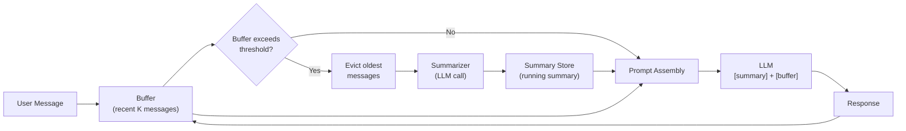

# 摘要缓冲记忆（Summary Buffer Memory）

  

## 📖 速览

| 难度 | 耗时 | 前置要求 |
|------------|------|---------------|
| 初级 | 约 25 分钟 | Python 3.8+、`LLM_API_KEY`，建议先理解 01 对话缓冲记忆和 03 摘要记忆 |

这项技术面向想要两全其美的开发者：近期消息精确回忆，加上压缩后的较早上下文。

## TL;DR

- **是什么：** **摘要缓冲记忆**把近期消息逐字保存在缓冲区里，同时把更早的历史压缩成一份滚动摘要。
- **什么时候需要：** 你需要对最近几轮的精确回忆，也需要对更早对话的大致记忆。
- **代价：** 调参更复杂，你要平衡缓冲区大小、摘要刷新频率和 token 预算。
- **本仓库中最接近的替代：** 03 摘要记忆用纯摘要，不为近期轮次保留逐字缓冲区。

## 描述

想想你怎么记住和朋友的一通长途电话。最后几句话你几乎能逐字复述。那是你的短期记忆。更早的部分？你记得大概意思，记不清原话。那是你的长期记忆。摘要缓冲记忆的工作方式相同：近期消息原样保留，较早的消息压缩成摘要。

摘要缓冲记忆是一种混合智能体记忆技术，把对话缓冲和摘要记忆合并成一个系统。它逐字保留近期消息，同时把更早的对话历史压缩成一份由 LLM 生成的滚动摘要。这种双区域设计天然适合客服智能体、长时间运行的聊天机器人，以及任何既需要精确近期上下文又需要历史感知的应用。工程上的难点在于调好转换阈值（消息从缓冲区移入摘要的临界点）和两个区域之间的 token 预算分配。

**关键词：** 智能体记忆、摘要缓冲记忆、LLM 智能体、混合记忆、对话历史、token 预算、增量摘要、上下文窗口、聊天记忆、双区域记忆

## 关键概念

- **缓冲区（buffer zone）：** 逐字存储的最近 *k* 条消息。它们为即时推理保留精确措辞、语气和细节。
- **滚动摘要（running summary）：** 一段短文字，概括所有已移出缓冲区的消息中的关键事实和主题。
- **增量摘要（incremental summarization）：** 每次不重新总结全部历史，而是用一次 LLM 调用把新淘汰的消息并入现有摘要。
- **转换阈值（transition threshold）：** 消息移出缓冲区、并入摘要的临界点。可以按消息条数触发，也可以按 token 数触发。
- **token 预算分配（token budget allocation）：** 决定给摘要多少 token、给缓冲区多少 token。典型分配是摘要留 20-30%，近期消息留 70-80%。

## 架构

  

Mermaid source

---

## 工作原理

1. 新消息追加进缓冲区。
2. 当缓冲区超过配置的阈值（比如 *t* 个 token），淘汰最旧的缓冲消息。
3. 这些消息通过一次 LLM 摘要调用并入滚动摘要。
4. 下一条 LLM 提示词按 `[system] + [较早历史的摘要] + [近期缓冲消息]` 组装。
5. 循环继续。摘要不断增长和压缩，缓冲区始终反映最近的交互。

## 何时使用

- 中等长度到长对话，既需要历史感知又需要精确的近期上下文。
- 客服机器人：既要引用完整的问题历史，又要准确回应最新消息。
- 纯摘要丢失太多近期细节、纯缓冲记忆又太贵的场景。

## 局限

- 比纯缓冲或纯摘要记忆都更难构建。
- 需要调缓冲区大小、摘要刷新频率和 token 预算分配。
- 多轮增量摘要之后，摘要可能丢失重要细节。
- 每次淘汰都触发一次额外的 LLM 调用，增加成本和延迟。

## Notebook

完整可运行的实现见 [配套 notebook](./summary_buffer_memory.ipynb)，使用 deepagents、任意 OpenAI 兼容端点和 tiktoken。

**notebook 内容：**
- 从零构建 `SummaryBufferMemory`，按 token 数淘汰。
- 用专门的摘要提示词做增量摘要。
- 一段 9 轮的示例对话，展示淘汰过程和摘要演进。
- 与纯缓冲记忆的 token 用量对比。

## 常见问题

### 问：智能体记忆里的摘要缓冲记忆是什么？

**答：** 摘要缓冲记忆是一种混合方案：近期消息逐字保存在缓冲区里，更早的历史压缩成一份由 LLM 生成的滚动摘要。这样你对最近 K 轮有精确回忆，对更早的内容有大致记忆。LangChain 把它实现为 `ConversationSummaryBufferMemory`，可配置 `max_token_limit`。它在缓冲记忆的保真度和摘要记忆的压缩率之间取得平衡。

### 问：什么时候该用摘要缓冲记忆而不是摘要记忆？

**答：** 当你既需要最近几轮的精确引文或细节，又想支持长对话时，用摘要缓冲记忆。纯摘要记忆（技术 03）压缩所有内容，包括近期消息，丢失逐字细节。缓冲变体完整保留最近 5-10 条消息，模型可以引用精确的措辞、代码片段或数字。只有当 token 预算连一点逐字缓冲都负担不起时，才选纯摘要。

### 问：摘要缓冲记忆有哪些局限或失效方式？

**答：** 缓冲区之外的部分仍受摘要漂移和细节丢失影响。每次从缓冲区淘汰消息都会触发一次 LLM 摘要调用，增加延迟（200-500ms）和成本。token 上限设得太高，缓冲区几乎不触发摘要，成本增长就和对话缓冲记忆一样快。设得太低，重要的近期消息会被过早压缩。为每个用例调好 `max_token_limit` 需要实验。

### 问：可以把摘要缓冲记忆和其他记忆技术组合吗？

**答：** 可以。搭配技术 06（向量库记忆）可以找回摘要时丢失的细节。每条消息在进入缓冲区之前先写入向量库。当智能体需要摘要部分里的某个具体事实时，用语义搜索从向量库检索。这样就有三层：逐字缓冲负责近期上下文，摘要负责整体脉络，向量搜索负责按需找回细节。

### 问：有什么库或框架能省掉自己实现的工作？

**答：** LangChain 提供 `ConversationSummaryBufferMemory`，配置 `max_token_limit` 即可开箱即用。这是最直接的实现。Letta/MemGPT（技术 26）在概念上类似：核心记忆（缓冲区）加归档记忆（压缩存储）。Zep（技术 27）提供托管式摘要和自动缓冲。自己实现的话，这个模式大约需要 50 行 Python，包住任意 LLM 客户端即可。

## 参考文献

- [LangChain ConversationSummaryBufferMemory](https://python.langchain.com/docs/modules/memory/types/summary_buffer?utm_source=nirdiamant&utm_medium=github&utm_campaign=agent_memory_techniques)
- [MemGPT / Letta: Tiered Memory Management](https://arxiv.org/abs/2310.08560)
- Packer et al., "MemGPT: Towards LLMs as Operating Systems," 2023
- [LlamaIndex ChatSummaryMemoryBuffer](https://docs.llamaindex.ai/en/stable/api_reference/memory/?utm_source=nirdiamant&utm_medium=github&utm_campaign=agent_memory_techniques)

## 相关技术

- [**01 对话缓冲记忆**](../01_conversation_buffer_memory/) - 这个混合方案的全缓冲一侧。对话短到不需要摘要时很有用。
- [**03 摘要记忆**](../03_summary_memory/) - 这个混合方案的摘要一侧。加缓冲区之前，先用它理解纯摘要。
- [**05 token 缓冲记忆**](../05_token_buffer_memory/) - 按 token 数修剪的替代方案。把它的精确控制和本技术的摘要结合，控制更细。
- [**26 Letta/MemGPT 模式**](../26_letta_memgpt_patterns/) - 在更大的架构尺度上实现类似的分层记忆思想。

---

