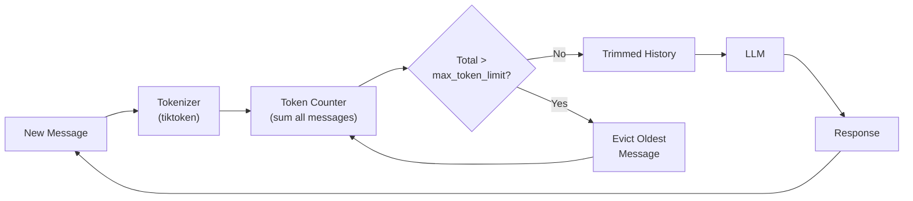

# token 缓冲记忆（Token Buffer Memory）

  

## 📖 速览

| 难度 | 耗时 | 前置要求 |
|------------|------|---------------|
| 初级 | 约 20 分钟 | Python 3.8+、`LLM_API_KEY`、建议先了解 01 对话缓冲记忆 |

这项技术面向需要精确控制记忆成本的开发者：给对话历史设定一个严格的 token 预算。

## TL;DR

- **是什么：** **token 缓冲记忆**通过统计 token，把对话历史裁剪到严格的 token 预算以内，并淘汰最旧的消息。
- **什么时候需要：** 你想精确控制成本，而且能拿到目标模型的分词器，计数才准确。
- **代价：** 需要与模型匹配的分词器；淘汰以整条消息为单位，可能提前丢掉较长的重要轮次。
- **本仓库中最接近的替代：** 02 滑动窗口记忆按消息条数裁剪，更简单，但不够精确。

## 描述

想象一个限重的行李箱。你不数物品件数，而是逐件称重，把最旧的先拿出来，直到全部装得下。token 缓冲记忆的做法一样：它按 token（而不是消息条数）度量对话历史，不断删掉最旧的消息，直到总量降到预算以内。

token 缓冲记忆是一种智能体记忆技术，它把对话历史裁剪到严格的 token 预算以内。token 是模型处理文本的最小单位（大约一个词或词片段）。滑动窗口记忆按条数丢消息，这项技术则用分词器（把文本切分成 token 的工具）精确度量每条消息。这让它成为对模型感知最强的短期记忆策略，适合生产级聊天系统、多模型应用，以及任何上下文窗口溢出会导致硬故障的 LLM 智能体。

**关键词：** 智能体记忆、token 缓冲记忆、LLM 智能体、token 预算、分词器、上下文窗口、对话历史、tiktoken、聊天记忆、提示词裁剪

## 关键概念

- **分词器集成（tiktoken）**：用分词器库（如 OpenAI 的 `tiktoken`）精确统计每条消息对特定模型消耗的 token。
- **max_token_limit**：对话历史总 token 数的硬上限。系统从最旧一端淘汰消息，直到总量不高于这个上限。
- **消息级裁剪**：删除整条消息，而不是部分截断内容。这保住了消息的完整性，但实际用量可能略低于上限。
- **token 计数准确性**：准确计数必须包含消息格式开销（角色 token、特殊 token、消息分隔符）。这些因模型和 API 而异。
- **按模型设定 token 预算**：不同模型的上下文窗口不同（4K、8K、32K、128K、200K token）。预算要对照目标模型来设，给系统提示词和模型回复留出空间。

## 架构

  

Mermaid source

---

## 工作原理

1. 设定适合目标模型的 `max_token_limit`（例如 4,096 token 的窗口里留 3,000 给历史）。
2. 每来一条新消息，就对所有消息分词，算出总 token 数。
3. 只要总量超过 `max_token_limit`，就从历史中删除最旧的消息。
4. 把裁剪后的历史发给 LLM。
5. 追加 LLM 响应，如此往复。

## 何时使用

- 需要精确控制上下文窗口占用时。
- 多模型应用：不同模型的上下文上限不同。
- 生产系统：超出上下文窗口会造成硬故障。
- 消息长度差异大的场景（例如有的消息包含代码块或长文档）。

## 局限

- 需要与目标模型匹配的分词器。用错分词器，计数就不准。
- 整条消息淘汰可能提前删掉恰好较旧的重要长消息。
- 不保留被淘汰消息的任何信息（没有摘要兜底）。
- 每轮的 token 计数会带来少量计算开销。

## Notebook

完整实现见 [配套 notebook](./token_buffer_memory.ipynb)，用 `tiktoken` 和 OpenAI SDK 逐步搭建。

## FAQ

### 问：智能体记忆里的 token 缓冲记忆是什么？

**答：** token 缓冲记忆通过统计真实 token，把对话历史裁剪到严格的 token 预算以内；超出上限时淘汰最旧的消息。它不像按条数的窗口那样把每条消息当成一样大，而是考虑消息长短的差异。LangChain 把它实现为 `ConversationTokenBufferMemory`，用 `max_token_limit` 参数控制上限。常见配置把上限设在 1,000-4,000 token，给系统提示词和模型回复留出空间。

### 问：什么时候该用 token 缓冲记忆，而不是滑动窗口记忆？

**答：** 消息长度差异大时用 token 缓冲记忆。滑动窗口记忆（技术 02）保留固定条数的消息，一条 500 token 的长消息和一条 10 token 的短消息在它眼里一样大。按 token 裁剪让你精确控制上下文占用。token 预算紧张，或者应用里既有短聊天轮次、又有内联粘贴的长代码块和文档时，这一点尤其重要。

### 问：token 缓冲记忆有哪些局限或故障模式？

**答：** 和滑动窗口记忆一样，淘汰的消息永久丢失，智能体无法回忆缓冲区里被裁掉的任何内容。token 计数每轮有少量开销（用 tiktoken 通常不到 1 毫秒）。如果 token 上限低于单条消息的长度，缓冲区可能完全清空，智能体失去全部历史。这种方法还要求分词器与目标模型匹配，计数才准确。

### 问：token 缓冲记忆能和其他记忆技术组合吗？

**答：** 能。与技术 03（摘要记忆）组合，可以摘要被淘汰的消息，而不是直接丢弃。技术 04（摘要缓冲记忆）做的本质上就是这件事，只是淘汰依据从消息条数换成了 token。也可以与技术 06（向量库记忆）搭配：淘汰前先把消息写进向量库，之后按需检索相关内容来补充缓冲区。

### 问：有什么库或框架能省掉自己实现的功夫？

**答：** LangChain 提供 `ConversationTokenBufferMemory`，内置 tiktoken 集成，token 计数准确。LlamaIndex 的 `ChatMemoryBuffer` 接受 `token_limit` 参数，行为等价。自己实现的话，tiktoken 库（OpenAI 模型）或 transformers 的分词器（开源模型）都能负责计数。Mem0 和 Zep 在托管记忆服务内部处理 token 管理。

## 参考资料

- [LangChain ConversationTokenBufferMemory](https://python.langchain.com/docs/modules/memory/types/token_buffer?utm_source=nirdiamant&utm_medium=github&utm_campaign=agent_memory_techniques)
- [tiktoken: OpenAI's Fast BPE Tokenizer](https://github.com/openai/tiktoken)
- [OpenAI Cookbook: How to Count Tokens](https://cookbook.openai.com/examples/how_to_count_tokens_with_tiktoken?utm_source=nirdiamant&utm_medium=github&utm_campaign=agent_memory_techniques)
- [Anthropic Token Counting API](https://docs.anthropic.com/en/docs/build-with-claude/token-counting?utm_source=nirdiamant&utm_medium=github&utm_campaign=agent_memory_techniques)

## 相关技术

- [**02 滑动窗口记忆**](../02_sliding_window_memory/) - 按条数计数的近亲。按消息条数而不是 token 裁剪。更简单，但不够精确。
- [**04 摘要缓冲记忆**](../04_summary_buffer_memory/) - 加了摘要兜底，淘汰的消息不会完全丢失。
- [**12 工作记忆 / 上下文窗口管理**](../12_working_memory_context_window/) - 更宏观的上下文窗口管理思路，不只管对话历史。

---

