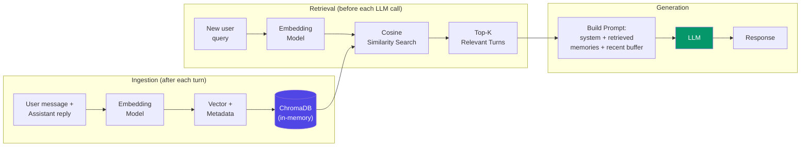

# 向量库记忆（Vector Store Memory）

  

## 📖 速览

| 难度 | 时间 | 前置要求 |
|------------|------|---------------|
| 初级 | 约 25 分钟 | Python 3.8+、`LLM_API_KEY`（任意 OpenAI 兼容端点）、对向量嵌入的基本了解 |

这项技术适合想跳出顺序聊天历史的开发者：按语义而不是按位置来检索相关记忆。

## TL;DR

- **它是什么：** **向量库记忆**把对话轮次嵌入成向量，通过相似度搜索取回最相关的历史对话。
- **什么时候需要它：** 智能体要从长对话或多主题对话里召回信息，光靠新近度（recency）不够。
- **代价：** 需要一个嵌入模型加一个向量数据库，而且语义相似不总是等于任务相关。
- **本仓库中最接近的替代：** 技术 20 记忆检索模式在向量搜索之上加了 BM25 融合、重排序（re-ranking）和多样性过滤。

## 描述

想象一座有几千本书却没有目录的图书馆：想找任何东西，你都得一排排书架走过去。再想象一位图书管理员，你每提一个问题，她都能立刻抽出最相关的几本书。向量库记忆就是给你的 LLM 智能体配上这样一位管理员。这项智能体记忆技术把对话轮次以嵌入（embedding，语义的数字指纹）的形式存进 ChromaDB 或 FAISS 这类向量数据库。智能体需要上下文时，就跑一次语义搜索，取回最相关的历史对话。因此它非常适合对话历史超出上下文窗口（context window）的长期聊天机器人和多会话助手。

这项技术把每一轮对话转换成数字指纹（称为嵌入），存进专门的数据库。智能体需要上下文时，就把当前问题和所有已存的指纹比对，取回最相关的历史对话。关键在于：检索按*语义*进行，而不是按*时间*。

嵌入是一串数字（一个向量），刻画一段文本的含义。意思相近的两句话会得到相近的向量。向量数据库（如 ChromaDB 或 FAISS）是一种存储系统，专门用来在百万级数据里快速找出最接近的向量。

这把记忆和上下文窗口（LLM 一次能读的有限文本）解耦了。你的智能体可以「记住」几千次过去的交互，每轮只浮现最相关的那些。

**关键词：** 智能体记忆、LLM 智能体、向量库记忆、嵌入、向量数据库、语义搜索、ChromaDB、FAISS、对话历史、上下文窗口

## 核心概念

- **嵌入模型（embedding model）：** OpenAI 的 `text-embedding-3-small` 或 Sentence Transformers 这类模型，把文本转换成定长向量。向量承载语义，所以相似的文本会得到相近的向量。
- **向量数据库（ChromaDB、FAISS、Pinecone）：** 为近似最近邻（ANN）搜索优化的存储系统。ANN 的意思是「快速找出最接近的结果，哪怕不是精确解」。
- **相似度搜索（similarity search）：** 找出与查询向量最接近的已存向量。常用度量有余弦相似度（向量间的夹角）、点积和欧氏距离。
- **Top-k 检索：** 返回最相似的 *k* 个结果。*k* 小省 token，但可能漏掉上下文；*k* 大覆盖更全，但成本更高。
- **分块策略（chunk strategy）：** 嵌入前怎么切分对话。可选：单条消息、用户-助手成对消息、滑动窗口，或按主题分块。
- **元数据过滤（metadata filtering）：** 给每个向量附加额外信息（时间戳、用户 ID、主题），之后就能按这些属性过滤结果，做更有针对性的检索。

## 架构

  

Mermaid 源码

---

## 工作原理

1. 每轮对话结束后，智能体用嵌入模型把消息（或消息对）嵌入成向量。
2. 把嵌入向量连同原文和元数据一起存进向量数据库。
3. 为下一次 LLM 调用构建提示词时，智能体把新的用户消息嵌入成向量。
4. 相似度搜索取回最相关的 top-*k* 个历史片段。
5. 这些片段连同近期对话一起注入提示词。
6. LLM 结合近期上下文和语义相关的历史，生成回复。

## 什么时候用

- 长期运行的智能体，完整历史远超上下文窗口。
- 用户会回头提起早前话题、智能体需要记起来的应用。
- 需要记住之前会话内容的多会话智能体。
- 把检索增强生成（RAG）式架构用在对话记忆上（生成前先取回相关文本）。

## 局限

- 嵌入质量直接决定检索质量。嵌入差，检索结果就不相关。
- 你需要额外的基础设施：一个嵌入模型和一个向量数据库。
- 每一轮都会增加检索延迟（通常 10-100ms，规模大了会更高）。
- 语义相似不等于相关。检索到的片段可能主题相近，但实际没用。

## Notebook

[**vector_store_memory.ipynb**](vector_store_memory.ipynb)：完整实现，使用可选向量端点（默认本地兜底向量）和 ChromaDB（内存模式）。包含从零编写的 `VectorStoreMemory` 类、比较语义召回与滑动窗口记忆的 50 轮合成对话实验、检索质量分析、top-K 调优图表和 token 成本对比。

## FAQ

### 问：在智能体记忆里，向量库记忆是什么？

**答：** 向量库记忆把对话轮次或事实嵌入成高维向量，存进向量数据库（如 FAISS、Chroma、Pinecone 或 Weaviate）。每一轮，系统检索语义最相似的 top-K 条历史条目，而不是依赖新近度。这样就能在几千条存储记忆中按相关性召回。LangChain 把它实现为 `VectorStoreRetrieverMemory`。每个查询的 K 通常取 3 到 10 条。

### 问：什么时候该用向量库记忆，而不是记忆检索模式？

**答：** 单阶段语义搜索能满足准确率要求时，用基础的向量库记忆就够了。记忆检索模式（技术 20）在向量搜索之上加了 BM25 关键词融合、cross-encoder 重排序和 MMR 多样性过滤。先从简单的做法开始：用余弦相似度做嵌入和检索。如果发现因为关键词不匹配而漏掉结果，或检索结果重复，再升级到技术 20 的多阶段流程。

### 问：向量库记忆有哪些局限或失败模式？

**答：** 嵌入质量决定检索质量。如果嵌入模型不认识领域专用词，相关记忆就浮不上来。语义搜索可能返回看似合理但错误的结果（相似度高，相关性低）。存储变大后写入延迟会上升，不过有了近似最近邻（ANN）索引，查询时间仍保持次线性。还有冷启动问题：存入的记忆不够多时，系统无东西可检索。

### 问：能把向量库记忆和其他记忆技术组合吗？

**答：** 可以。一个常见的好搭配是和技术 02（滑动窗口记忆）或技术 04（摘要缓冲记忆）组合：窗口或缓冲负责近期上下文，向量库负责相关的更早记忆。这样缓冲给你新近度，向量库给你相关性。还可以再叠加技术 18（时序记忆），给相似度分数加上时间衰减权重。

### 问：有什么库或框架可以省掉自己实现的工作？

**答：** LangChain 提供 `VectorStoreRetrieverMemory`，带 FAISS、Chroma、Pinecone 和 Weaviate 适配器。LlamaIndex 通过它的 retriever 模块提供原生的向量记忆集成。Mem0（技术 25）底层用向量存储，自动做嵌入。Zep（技术 27）把向量搜索和知识图谱结合，做混合检索。就独立向量数据库而言，原型阶段最常用的开源选择是 Chroma 和 FAISS。

## 参考资料

- [LangChain VectorStoreRetrieverMemory](https://python.langchain.com/docs/modules/memory/types/vectorstore_retriever_memory?utm_source=nirdiamant&utm_medium=github&utm_campaign=agent_memory_techniques)
- [ChromaDB 文档](https://docs.trychroma.com/?utm_source=nirdiamant&utm_medium=github&utm_campaign=agent_memory_techniques)
- [FAISS：Facebook AI Similarity Search](https://github.com/facebookresearch/faiss)
- [Pinecone 向量数据库](https://www.pinecone.io/?utm_source=nirdiamant&utm_medium=github&utm_campaign=agent_memory_techniques)
- Johnson, Douze, Jegou, "Billion-scale similarity search with GPUs," IEEE Transactions on Big Data, 2019

## 相关技术

- [**07 实体记忆**](../07_entity_memory/) - 围绕命名实体（人物、地点、项目）组织知识，而不是原始对话片段。
- [**08 知识图谱记忆**](../08_knowledge_graph_memory/) - 把实体之间的关系存成图，支持多跳推理。
- [**20 记忆检索模式**](../20_memory_retrieval_patterns/) - 在向量搜索之上的高级检索策略（混合搜索、重排序）。
- [**21 跨会话记忆**](../21_cross_session_memory/) - 把任何记忆类型跨会话持久化的模式，底层常用向量库支撑。

---

