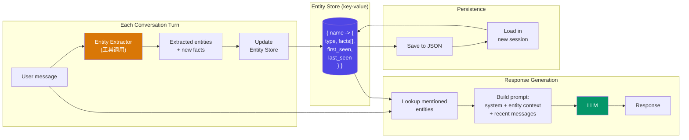

# 实体记忆（Entity Memory）

  

## 📖 速览

| 难度 | 时长 | 前置要求 |
|------------|------|---------------|
| 中级 | 约 30 分钟 | Python 3.8+、`LLM_API_KEY`，建议先了解 01 对话缓冲记忆（Conversation Buffer Memory） |

这个技术面向这样的开发者：你的智能体需要在对话之间跟踪并更新特定人物、组织或概念的信息。

## TL;DR

- **它是什么：**实体记忆（Entity Memory）从对话中抽取命名实体，并为每个实体维护一份持续更新的知识库。
- **什么时候需要：**你的智能体要长期跟踪并更新特定人物、组织或项目的结构化信息。
- **代价是什么：**实体抽取并不完美，名字相近实体的合并与消歧是个难题。
- **仓库中最接近的替代：**08 知识图谱记忆（Knowledge Graph Memory）用「主体-谓词-宾语」三元组记录实体之间的关系。

## 描述

想象一个私人助理，为你提到的每个人、每个地点、每个项目都保留一张联系人卡片。每当你分享新信息（「Sarah 升职了」），他就更新对应的卡片。实体记忆给你的 LLM 智能体同样的能力。这个智能体记忆技术用实体抽取（entity extraction，在文本中找出人物、地点和事物的名字）来构建结构化知识库。智能体在新事实出现时创建或更新记录，所以不会把同一个问题问两遍。它对个人助理聊天机器人和跨会话跟踪用户详情的客服智能体特别有用。

实体记忆的工作方式就是这样。它不存储原始消息历史，而是抽取关于命名事物（人物、组织、项目、偏好）的结构化信息，维护一份持续更新的知识库。当用户提到「我的经理 Sarah」或「Q3 预算项目」时，系统会创建或更新一条记录，写入相关细节。

在后面的轮次中，智能体检索实体记录，把它们注入提示词（prompt）。这让智能体对用户关心的人和事拥有持久的、结构化的了解。它对个人助理和 CRM 类智能体特别有用。

**关键词：**智能体记忆、LLM 智能体、实体记忆、实体抽取、命名实体识别、结构化知识库、个人助理、客户支持、跨会话记忆

## 核心概念

- **实体抽取（NER）：**用命名实体识别（Named Entity Recognition，NER，通过 LLM 提示词或 NER 模型）识别每条消息中的实体：人物、地点、组织、日期、概念。NER 指发现专有名词并对它们分类的任务。
- **实体 schema：**为每种实体类型定义要跟踪的属性。人物实体可以有姓名、角色、关系、最近提及日期等字段。项目实体可以有状态、截止日期、利益相关者。
- **实体更新与合并：**已有实体出现新信息时，系统更新记录。合并逻辑处理冲突（比如更正过的电话号码）和消歧（比如两个叫「Alex」的人）。
- **实体上下文注入：**每次调用 LLM 前，系统检索当前消息中提到的实体的记录，把它们作为结构化上下文注入提示词。
- **结构化与非结构化实体存储：**实体信息可以存成结构化记录（JSON、数据库行），也可以存成自由文本描述。结构化存储支持精确查询，非结构化存储更灵活。

## 架构

  

Mermaid 源码

---

## 工作原理

1. 用户发送一条消息。
2. 系统从消息中抽取实体（通过 LLM 或 NER 模型）。
3. 对每个抽到的实体，检索或创建一条实体记录。
4. 实体的新信息合并进已有记录。
5. 构建下一条提示词时，系统把相关实体记录作为上下文纳入。
6. LLM 结合对话和实体知识生成回答。

## 何时使用

- 需要跨会话记住用户偏好、联系人和项目的个人助理智能体。
- 跟踪客户详情、历史问题和账户信息的客户支持系统。
- 任何需要智能体对对话中讨论的「世界」保持结构化理解的应用。

## 局限

- 实体抽取并不完美。系统可能漏掉实体，也可能抽出无关实体。
- 合并与消歧是难题，常见名字或指代含糊时尤其如此。
- 维护实体 schema 需要前期设计和持续维护。
- 更新触发器配置不当时，实体存储会变得陈旧。

## Notebook

[entity_memory.ipynb](entity_memory.ipynb) - 用 Claude 工具使用（函数调用）构建实体抽取器，实现按实体积累结构化事实的键值实体存储，并演示跨会话持久化。包含一个 30 轮的受控实验，对比实体记忆与滑动窗口基线的召回能力。

## FAQ

### 问：智能体记忆中的实体记忆是什么？

**答：**实体记忆从每一轮对话中抽取命名实体（人物、组织、产品、地点），并为每个实体维护一个结构化知识库。新信息出现时，系统更新实体描述，为每个实体建立一份动态档案。LangChain 把它实现为 `ConversationEntityMemory`，用 LLM 抽取并更新实体摘要。它让智能体跨轮次记住「Alice 是一名偏好 Python 的软件工程师」。

### 问：什么时候该用实体记忆而不是知识图谱记忆？

**答：**当你只关心每个实体的事实、不关心实体之间的关系时，用实体记忆。知识图谱记忆（技术 08）存储「主体-谓词-宾语」三元组，支持多跳查询，比如「谁和 Alice 在同一家公司工作？」实体记忆为每个实体存储扁平描述，实现更简单，运行更便宜。如果你的场景是跟踪用户偏好的个人助理，实体记忆就够了。需要关系推理时，再升级到图。

### 问：实体记忆有哪些局限或失败模式？

**答：**实体抽取依赖 LLM 的质量。模型可能漏掉实体、把名字相近的不同实体合并，或把一个实体拆成重复项。不做修剪时，实体描述会无限增长。抽取用的 LLM 调用会增加延迟（每轮 200-500 毫秒）。矛盾事实（用户先说「我住在纽约」，再说「我搬到洛杉矶了」）可能无法干净地覆盖，除非提示词显式处理更新。常见名字的消歧是一个持续的挑战。

### 问：实体记忆可以和其他记忆技术组合吗？

**答：**可以。一个强力组合是搭配技术 03（摘要记忆，Summary Memory）。摘要跟踪对话流程和话题演进，实体记忆保留关键实体的结构化事实。智能体生成回答时，同时拿到叙事上下文和具体的实体细节。你也可以搭配技术 06（向量库记忆，Vector Store Memory），对实体描述做语义检索，适合实体很多的场景。

### 问：有什么库或框架能省掉实现工作？

**答：**LangChain 提供 `ConversationEntityMemory`，内置基于 LLM 的抽取，实体存储可以用内存或 Redis。Mem0（技术 25）在记忆流程中自动做实体抽取。Zep（技术 27）自动抽取实体和关系，同时给你实体记忆和图边。想自定义方案，spaCy NER 提供快速实体抽取，结果可以存进任何键值数据库。

## 参考资料

- [LangChain ConversationEntityMemory](https://python.langchain.com/docs/modules/memory/types/entity_summary_memory?utm_source=nirdiamant&utm_medium=github&utm_campaign=agent_memory_techniques)
- [spaCy 命名实体识别](https://spacy.io/usage/linguistic-features?utm_source=nirdiamant&utm_medium=github&utm_campaign=agent_memory_techniques#named-entities)
- [Mem0 - 自我改进的记忆层](https://github.com/mem0ai/mem0)
- Park et al., "Generative Agents: Interactive Simulacra of Human Behavior," 2023

## 相关技术

- [**08 知识图谱记忆**](../08_knowledge_graph_memory/) - 捕捉实体之间的关系，不只是关于实体的事实。
- [**06 向量库记忆**](../06_vector_store_memory/) - 按含义而非实体名检索相关对话历史。
- [**10 语义记忆**](../10_semantic_memory/) - 存储从对话中蒸馏出的通用事实，是实体记忆的近亲。
- [**25 Mem0 模式**](../25_mem0_patterns/) - Mem0 内置实体抽取和记忆管理。

---

