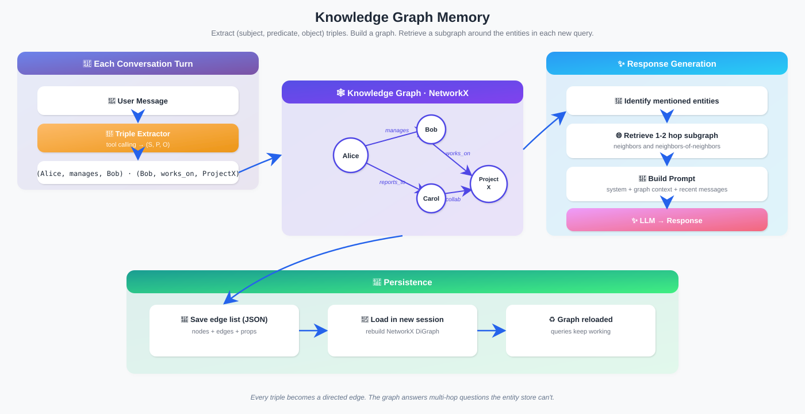
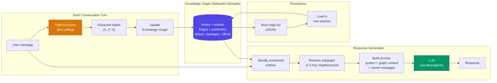

# 知识图谱记忆（Knowledge Graph Memory）

  

## 📖 速览

| 难度 | 耗时 | 前置要求 |
|------------|------|---------------|
| 中级 | 约 35 分钟 | Python 3.11+、`LLM_API_KEY`（任意 OpenAI 兼容端点）、建议先理解 07 实体记忆 |

这项技术面向这样的开发者：你需要智能体理解实体之间的关系，而不只是孤立的事实。

## TL;DR

- **是什么：** **知识图谱记忆**从对话中抽取主谓宾三元组，把实体和关系构建成一张有向图。
- **什么时候需要：** 你的智能体需要在互相关联的事实之间做多跳推理，比如「谁管理 Alice 的团队主管？」
- **代价：** 三元组抽取有噪声，图的维护需要去重和修剪，把图序列化进提示词也很费 token。
- **本仓库中最接近的替代：** 07 实体记忆存储关于实体的事实，但不建模实体之间的关系。

## 描述

想想家谱：它不孤立地存放事实，而是展示人与人如何连接。知识图谱记忆把这种结构带进 LLM 智能体记忆。它用三元组抽取（从文本中抽出主谓宾关系）构建知识图谱，记录实体及其连接。智能体在这张图上遍历，做跨多条关系的多跳推理。这让它天然适合项目管理工具、组织助手，以及需要处理复杂关系网的客服智能体。

知识图谱记忆把这个想法带给 AI 智能体。它从对话中抽取实体间的关系，构建成图。实体记忆存储*关于*单个事物的事实，知识图谱记忆捕捉的是它们*之间*的关系。

知识图谱是一张有向图。节点表示实体（人、项目、地点）。边表示有类型的关系（manages、depends_on、located_in）。每条关系存成一个三元组：(主体, 谓词, 客体)。例如：(Alice, manages, Bob)。

这种图结构支持基于遍历的推理。智能体沿着关系链回答多跳问题。例如：「所有在 Alice 管理的项目上工作的人都有谁？」

**关键词：** 智能体记忆、LLM 智能体、知识图谱记忆、三元组抽取、图遍历、多跳推理、知识图谱、Neo4j、NetworkX、关系抽取

## 关键概念

- **三元组（subject-predicate-object，主谓宾）：** 知识图谱的基本单位。每条关系变成一条有向边：(Alice, manages, Bob) 或 (Project Alpha, uses, Python)。
- **图数据库（NetworkX、Neo4j）：** 知识图谱的存储后端。NetworkX 轻量、在内存中运行。Neo4j 是生产级图数据库，有自己的查询语言（Cypher）。
- **图遍历：** 沿着边在节点之间穿行来访问图。这使多跳推理成为可能，比如「找出工程部门的人管理的所有项目」。
- **关系类型：** 给边打上语义标签（manages、depends_on、prefers、located_in）。这些标签支持带类型的查询和推理。
- **子图检索：** 针对给定查询，只抽取图中相关的部分。不用把整张图塞进提示词，只取被提及实体的邻域。

## 架构

  

Mermaid source

---

## 工作原理

1. 用户发送一条消息。
2. 系统用 LLM 提示词抽取三元组（例如「把所有关系抽取为主谓宾三元组」）。
3. 三元组加入知识图谱。已有的边被更新，新的节点被创建。
4. 用户提问时，系统识别相关实体，取回它们在图中的邻域。
5. 子图被序列化（成文本或结构化数据）并注入提示词。
6. LLM 借助图上下文生成理解关系的回答。

## 何时使用

- 涉及复杂关系网的应用（组织层级、项目依赖、社交网络）。
- 需要回答连接不同实体的多跳推理问题的智能体。
- 理解事物*如何*关联与知道单个实体的事实同样重要的场景。

## 局限

- 三元组抽取有噪声。LLM 可能产出不一致或错误的三元组。
- 图维护（去重、冲突解决、修剪）需要持续投入。
- 把图结构序列化成文本喂给 LLM，需要仔细设计，也可能很费 token。
- 扩展到超大图需要专用图数据库和仔细的查询优化。

## Notebook

[**knowledge_graph_memory.ipynb**](knowledge_graph_memory.ipynb) - 完整实现：用 NetworkX 做内存图后端，聊天走 deepagents，用工具调用抽取三元组。包含 `TripleStore`（实体和谓词组成的有向图）、`TripleExtractor`（基于 LLM 的关系解析器），以及 `KnowledgeGraphMemory` 编排器，它增量构建图、取回相关子图、把关系上下文注入提示词。内含多跳推理演示、图可视化、跨会话持久化，以及一项受控实验：在关系密集的回忆任务上对比知识图谱记忆与滑动窗口。

## 常见问题

### 问：智能体记忆中的知识图谱记忆是什么？

**答：** 知识图谱记忆从对话数据构建一张实体及其关系的有向图。每条事实存成主谓宾三元组（例如「Alice-works_at-Acme Corp」）。智能体可以沿这些边遍历，回答跨越多条关系的多跳问题。LangChain 把它实现为 `ConversationKGMemory`，用 LLM 抽取三元组。Neo4j 和 NetworkX 是常见的图存储与遍历后端。

### 问：什么时候该用知识图谱记忆而不是实体记忆？

**答：** 当你的应用需要关系推理或多跳查询时，用知识图谱记忆。实体记忆（技术 07）存储关于单个实体的事实，但无法回答「还有谁在 Alice 的公司工作？」，因为它没有实体之间的边。如果你的场景涉及组织架构、社交网络、依赖链，或任何概念之间连接很重要的领域，图表示值得多花这份复杂度。

### 问：知识图谱记忆有哪些局限或失败模式？

**答：** 三元组抽取容易出错。LLM 可能产生不一致的谓词名（「works_at」vs.「employed_by」），造成重复边。图遍历查询需要仔细的提示词工程，或 Cypher/SPARQL 技能。不修剪的话图会越长越大，拖慢查询。相互矛盾的三元组（先来一句「Alice works_at Acme」，再来一句「Alice left Acme」）需要显式的冲突解决。搭建成本比平铺记忆高，生产使用通常需要 Neo4j 或类似的图数据库。

### 问：知识图谱记忆能和其他记忆技术组合吗？

**答：** 能。和技术 06（向量库记忆）组合可以做混合检索：模糊的宽泛查询走向量搜索，精确的结构化查询走图遍历。Graphiti（技术 24）和 Zep（技术 27）原生实现了这个模式。也可以和技术 09（情景记忆）搭配：图存储提炼后的事实，情景保留事实在何时、如何被学到的完整上下文。

### 问：有什么库或框架能省掉自己实现的工作？

**答：** LangChain 提供 `ConversationKGMemory`，做基本的三元组抽取和基于 NetworkX 的存储。生产级图记忆方面，Graphiti（技术 24）在 Neo4j 上构建时序知识图谱，带自动实体消解。Zep（技术 27）提供托管图记忆和异步抽取。Cognee 能从文档构建知识图谱。自托管方案里，Neo4j 加 LangChain 的图集成是最常见的组合。

## 参考文献

- [LangChain ConversationKGMemory](https://python.langchain.com/docs/modules/memory/types/kg?utm_source=nirdiamant&utm_medium=github&utm_campaign=agent_memory_techniques)
- [Neo4j 图数据库](https://neo4j.com/?utm_source=nirdiamant&utm_medium=github&utm_campaign=agent_memory_techniques)
- [NetworkX - Python 图库](https://networkx.org/?utm_source=nirdiamant&utm_medium=github&utm_campaign=agent_memory_techniques)
- [Microsoft GraphRAG](https://github.com/microsoft/graphrag)
- Ji et al., "A Survey on Knowledge Graphs: Representation, Acquisition, and Applications," IEEE TNNLS, 2022

## 相关技术

- [**07 实体记忆**](../07_entity_memory/) - 存储关于单个实体的事实，没有关系结构。
- [**24 图记忆（Graphiti）**](../24_graph_memory_graphiti/) - 从对话构建时序知识图谱的生产级框架。
- [**06 向量库记忆**](../06_vector_store_memory/) - 按语义相似度而非图遍历取回过往交流。
- [**20 记忆检索模式**](../20_memory_retrieval_patterns/) - 讲解可组合图搜索与向量搜索的混合检索策略。

---

