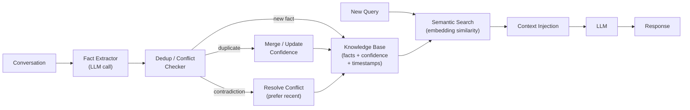

# 语义记忆（Semantic Memory）

  

## 📖 速览

| 难度 | 耗时 | 前置要求 |
|------------|------|---------------|
| 中级 | 约 30 分钟 | Python 3.8+、`LLM_API_KEY`、建议先理解 06 向量库记忆 |

这项技术面向这样的开发者：你想让智能体按类别和语义组织和检索事实知识，而不受学习时间的影响。

## TL;DR

- **是什么：** **语义记忆**从对话中提取泛化的、不受时间影响的事实，存入知识库，并带去重和矛盾检测。
- **什么时候需要：** 你的智能体需要召回自己关于某个话题的知识，而不管它是何时何地学到的。
- **代价：** 事实提取可能把观点误当成事实；没有衰减机制，知识库会积累过时条目。
- **本仓库中最接近的替代：** 09 情景记忆记录带时间上下文的具体经历，而不是与情境无关的事实。

## 描述

你知道巴黎是法国的首都，但多半不记得自己是什么时候知道的。这就是语义记忆：把经验蒸馏成稳定、与情境无关的事实知识。LLM 智能体的语义记忆也是如此。这项智能体记忆技术从对话中提取泛化事实，存入持久知识库，并处理去重（发现重复事实）和矛盾检测（解决新旧信息的冲突）。它非常适合个人助理聊天机器人、客服智能体，以及任何需要跨会话积累用户偏好的长期智能体。

语义记忆存储的是蒸馏后的事实本身（「用户的生日是 3 月 15 日」），而不是具体经历（情景记忆会记住「用户是周二告诉我生日的」）。*什么时候*、*怎么知道的*都不重要，事实本身才重要。

把它想象成给用户建一份档案。每次对话都往档案里添几行：偏好、工具、习惯，以及用户世界的各种事实。多个会话之后，这份档案长成一个丰富、个性化的知识库。智能体不再把同一个问题问两遍，还能根据已知信息预判需求。

**关键词：** 智能体记忆、LLM 智能体、语义记忆、事实提取、知识库、去重、矛盾检测、用户偏好、长期记忆、持久知识

## 关键概念

- **事实提取（fact extraction）：** 从对话文本中识别陈述式事实。LLM 提示词扫描消息，找出表达持久事实或偏好的语句。「哦对了，我上个月换成 Mac 了」变成「用户使用 macOS」。
- **嵌入与余弦相似度：** 嵌入是捕捉语义的向量（数字列表）。余弦相似度衡量两个向量有多接近。我们用它们按语义比较事实，而不是按字面措辞。
- **去重（deduplication）：** 发现新事实和已存储的事实表达同一个意思。「我用 Mac」和「我的笔记本跑 macOS」是同一个事实。
- **矛盾检测（contradiction detection）：** 发现新事实与已有事实冲突。「我用 Windows」与已存的「用户使用 macOS」矛盾。系统保留较新的陈述来解决冲突。
- **置信度打分（confidence scoring）：** 给事实赋予置信度。反复提及提升置信度，推断出的事实置信度较低。

## 架构

  

Mermaid source

---

## 工作原理

1. 每次对话结束后，智能体把消息发给 LLM，提取陈述式事实（如「用户偏好深色模式」）。
2. 每条事实被转换成嵌入（捕捉语义的数字向量）。
3. 智能体把新事实的嵌入与所有已存事实比较。相似度很高（高于 0.85）就是重复；相似度中等（高于 0.50）就调用 LLM 检查是否矛盾。
4. 重复提升已有事实的置信度分数。矛盾则归档旧事实、存储新事实。全新的事实加入知识库。
5. 用户提问时，智能体把查询转成嵌入，用余弦相似度检索最相关的事实。
6. 这些事实被格式化进系统提示词，供 LLM 生成回答时使用。

## Notebook 涵盖的内容

1. **事实数据结构**，带置信度分数、时间戳和嵌入。
2. **基于 LLM 的事实提取**，从对话消息中提取事实。
3. **去重**，基于嵌入的余弦相似度。
4. **矛盾检测**，用一次 LLM 调用完成。
5. **语义检索**，为新查询找出相关事实。
6. **带注入知识的聊天**，知识来自事实库。
7. **多会话示例**，展示事实积累、去重和矛盾解决。
8. **持久化**，通过 JSON 序列化实现。

## 何时使用

- 在多个会话中积累用户偏好的个人助理智能体。
- 智能体从交互中积累领域知识的知识管理系统。
- 任何长期存活的智能体：一次对话中得到的事实，之后的对话都应可用。
- 与情景记忆互补。两者一起用，记忆覆盖才完整。

## 局限

- 事实提取并不精确。LLM 可能把观点当成事实，或漏掉隐含知识。
- 矛盾检测是困难的 NLP 问题。微妙的矛盾可能漏检。
- 没有时间衰减机制，知识库会积累过时事实。
- 扩展需要近似最近邻搜索。暴力比较对每条事实都是 O(n)。

## Notebook

完整的代码讲解见[配套 notebook](./semantic_memory.ipynb)。

## 常见问题

### 问：智能体记忆中的语义记忆是什么？

**答：** 语义记忆从对话中提取泛化的、不受时间影响的事实，独立于学习的时间和方式来存储。像「用户偏好 Python 而不是 JavaScript」或「API 限流是每分钟 100 次请求」这样的事实，会带着去重和矛盾检测存起来。这就像人类把一般知识和具体经历分开存储。智能体因此不必回放完整的过往对话，也能召回事实。

### 问：什么时候该用语义记忆而不是情景记忆？

**答：** 当你需要召回可复用的事实、不需要周边上下文时，用语义记忆。情景记忆（技术 09）保留完整的交互记录，适合「上次发生了什么」这类问题。语义记忆更适合「我对这位用户知道什么」。如果你的智能体是个人助理，要在数周的交互中积累用户偏好，语义记忆能把事实存得更紧凑。调试或审计过往交互时，情景记忆更合适。

### 问：语义记忆有哪些局限或失败模式？

**答：** 事实提取的质量取决于 LLM。模型可能提取错误事实、漏掉隐含信息，或检测不出新旧事实之间的矛盾。去重也不完美：「用户喜欢 Python」和「用户偏好 Python」可能被当成两条事实分别存储。没有衰减或更新机制，事实库会随时间积累陈旧信息。提取步骤还带来每轮 200 到 500 毫秒的延迟和成本。

### 问：语义记忆能和其他记忆技术组合吗？

**答：** 可以。最强的搭配是技术 09（情景记忆），组成双记忆系统：情景记录完整经历，语义记忆蒸馏出可复用的事实。再加技术 14（记忆巩固），定期合并重复事实、解决矛盾、修剪陈旧条目。这三层组合（情景捕获、语义提取、定期巩固）是大多数生产级记忆系统的基础。

### 问：有什么库或框架可以省去自己实现？

**答：** Mem0（技术 25）就建立在语义记忆之上：它自动从对话中提取事实并去重。Zep（技术 27）提供托管的事实提取和矛盾检测。Letta/MemGPT（技术 26）把语义事实存进核心记忆块。LangChain 没有专门的语义记忆类，但你可以把 LLM 提取链、向量库和去重逻辑组合起来实现。Cognee 也支持事实提取流程。

## 参考文献

- Tulving, Endel, "Episodic and Semantic Memory," Organization of Memory, 1972
- Park et al., "Generative Agents: Interactive Simulacra of Human Behavior," UIST 2023 (arXiv:2304.03442)
- [OpenAI Embeddings Guide](https://platform.openai.com/docs/guides/embeddings)
- [Mem0: Long-Term Memory for AI Agents](https://github.com/mem0ai/mem0?utm_source=nirdiamant&utm_medium=github&utm_campaign=agent_memory_techniques)
- [Zep: Long-Term Memory for AI Assistants](https://github.com/getzep/zep?utm_source=nirdiamant&utm_medium=github&utm_campaign=agent_memory_techniques)

## 相关技术

- [**09 情景记忆**](../09_episodic_memory/) - 存储带时间上下文的完整经历，语义记忆则存储蒸馏后的事实。
- [**07 实体记忆**](../07_entity_memory/) - 围绕命名实体组织事实，而不是独立存在的知识。
- [**14 记忆巩固**](../14_memory_consolidation/) - 把原始记忆转化为稳定、泛化知识的过程。
- [**25 Mem0 模式**](../25_mem0_patterns/) - Mem0 实现语义记忆，内置去重和矛盾处理。

---

