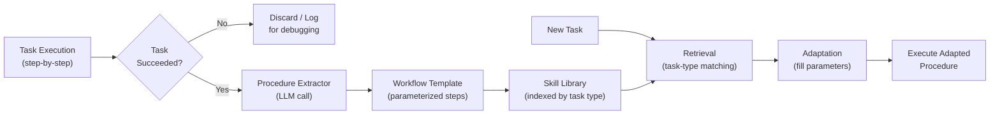

# 程序性记忆（Procedural Memory）

  

## 📖 速览

| 难度 | 耗时 | 前置要求 |
|------------|------|---------------|
| 中级 | 约 35 分钟 | Python 3.8+、`LLM_API_KEY`、建议先理解 09 情景记忆和 10 语义记忆 |

这项技术面向这样的开发者：你在构建能学习并改进自身工作流的智能体，需要存储可复用的过程和技能。

## TL;DR

- **是什么：** **程序性记忆**把可复用的分步工作流存进技能库，让智能体检索经过验证的过程，而不是从零推理。
- **什么时候需要：** 你的智能体反复执行相似的多步任务，你希望它学会并复用成功的工作流。
- **代价：** 从一个情境抽出的过程未必能泛化，技能库变大后需要持续维护。
- **本仓库中最接近的替代：** 09 情景记忆记录发生了什么，程序性记忆记录怎么做事。

## 概述

想想做一道新菜。第一次你步步对照，到第十次，双手已经自动运转。程序性记忆就是给 LLM 智能体这种「做中学」能力的智能体记忆技术。它捕捉可复用的工作流（一步步的动作序列），存进技能库。相似任务出现时，智能体检索经过验证的过程，而不是从零推理。对反复执行多步任务的智能体（数据管道、API 集成、代码部署）来说，它尤其好用。

程序性记忆把这种能力带给 AI 智能体。它捕捉智能体在经验中发现的分步策略和工作流（能达成目标的一串动作）。大多数记忆技术存储*发生了什么*或*什么为真*，程序性记忆存储*怎么做事*。

它解决的问题很明确。没有程序性记忆，智能体每次遇到相似任务都要从头推导解法。有了程序性记忆，它检索学到的过程并加以适配。Voyager（Wang et al., 2023）这类系统已经证明了这一点：那个 Minecraft 智能体编写可复用的代码化技能，存进技能库（skill library，有条理的过程集合），后续任务直接取用。

工程挑战有三个。第一，**过程抽取（procedure extraction）**：把可复用的动作序列从一次具体运行的噪声里分离出来。第二，**泛化（generalization）**：让过程足够灵活，能用于新情境。第三，**检索（retrieval）**：把新任务匹配到库里正确的过程。

**关键词：** 智能体记忆、LLM 智能体、程序性记忆、技能库、工作流模板、工具使用模式、可复用过程、任务自动化、多步智能体

## 关键概念

- **过程抽取**：从成功的任务完成中识别并分离出可复用的步骤序列。
- **步骤序列（step sequence）**：共同达成一个目标的有序动作列表。你把它们存成可执行模板（带占位符的可复用蓝图）。
- **工作流模板（workflow template）**：参数化的过程。文件名、API 端点这类具体值都变成占位符。整体策略不变，工作流却能套用新输入。
- **工具使用模式（tool-use pattern）**：学到的工具调用序列，包括如何构造参数、如何解析输出。
- **技能库（skill library）**：按任务类型、领域或能力索引、有条理的过程集合。
- **过程泛化（procedure generalization）**：把具体过程抽象成更通用的形式。比如「把应用 X 部署到服务器 Y」变成「把 {app} 部署到 {server}」。

## 架构

  

Mermaid source

---

## 工作原理

1. 智能体用分步推理或工具调用完成一个任务。
2. 过程抽取器识别出成功的动作序列，把它变成模板。
3. 模板进入技能库，按任务类型和相关元数据（帮助后续检索的描述性标签）索引。
4. 之后的任务中，智能体检索匹配的过程，并适配到当前情境。
5. 过程根据成败反馈不断打磨。

## 何时使用

- 智能体反复执行相似的多步任务（如数据管道、API 集成）。
- 工具调用序列复杂、值得一次学会反复使用的场景。
- 需要把学到的技能跨会话、跨智能体迁移的系统。

## 局限

- 从一次成功运行抽出的过程未必能泛化。操作系统或 API 版本不同，存好的步骤可能悄无声息地失败。
- 基于 LLM 的检索可能匹配到错误的过程，库变大后尤其如此。你需要置信度阈值，以及从零解决的回退方案。
- 工具和 API 在变，存储的过程会过时。没有失效或更新机制，库里会积累不可靠的知识。
- 如果每个任务都是独一无二的，技能库永远用不上，抽取成本变成纯开销。

## Notebook

[程序性记忆 notebook](./procedural_memory.ipynb) 带你用 deepagents 和任意 OpenAI 兼容端点从零搭建一个完整的程序性记忆系统。你将实现：

1. 一个 `Procedure` dataclass，捕捉参数化的工作流。
2. 用 LLM 做抽取，把执行轨迹蒸馏成可复用的模板。
3. 一个技能库，带基于 LLM 的检索和适配。
4. 三个端到端场景：学习一个部署过程、为新任务检索并适配它、再用一个数据管道过程扩充技能库。

## 常见问题

### 问：智能体记忆中的程序性记忆是什么？

**答：** 程序性记忆把可复用的分步工作流（也叫「技能」或「过程」）存在技能库里。智能体不用每次从零推理，而是为手头任务检索一个经过验证的过程。每个过程包含步骤、前置条件和预期结果。这对应人类记忆的分工：「怎么骑自行车」和「某次从自行车上摔下来」是分开存的。它减少重复推理，让相似任务的表现更稳定。

### 问：什么时候该用程序性记忆而不是情景记忆？

**答：** 当智能体执行可重复、模式固定的任务时，用程序性记忆，比如部署代码、提交报告、处理订单。情景记忆（技术 09）记录某次交互中发生了什么，但不把它泛化成可复用的工作流。程序性记忆回答「怎么做 X」，情景记忆回答「上次做 X 时发生了什么」。两者结合，覆盖最全。

### 问：程序性记忆有哪些局限或失败模式？

**答：** 底层系统一变，过程就会过时。为 v1 写的部署过程，到 v2 可能就跑不通。智能体可能检索到一个部分匹配、但不适配当前情境的过程。过程抽取需要仔细的提示词工程或人工筛选。时间一长，如果没有版本管理或巩固机制，技能库会积累相互冲突或冗余的过程。

### 问：程序性记忆能和其他记忆技术组合吗？

**答：** 能。与技术 16（自我反思记忆）结合，智能体根据成败更新过程：执行之后反思结果，修订步骤。也可以搭配技术 17（记忆路由），按任务分类自动挑选正确的过程。这样就有了一个越用越强的自适应技能库。

### 问：有什么库或框架能省掉自己实现的工作？

**答：** 截至 2025 年底，还没有主流框架提供专门的程序性记忆类。Letta/MemGPT（技术 26）可以把过程存进它的归档记忆层。LangChain 的工具和智能体抽象可以当基础：把每个过程定义成一个工具或链，让智能体自己选。Voyager（面向 Minecraft 智能体）开创了技能库模式。生产环境中，你通常要在过程文档的向量库之上自建检索层。

## 参考文献

- Sumers, T. R., et al. (2023). "Cognitive Architectures for Language Agents." arXiv:2309.02427.
- Wang, G., et al. (2023). "Voyager: An Open-Ended Embodied Agent with Large Language Models." arXiv:2305.16291.
- Anderson, J. R. (1982). "Acquisition of Cognitive Skill." *Psychological Review*, 89(4), 369-406.
- Park, J. S., et al. (2023). "Generative Agents: Interactive Simulacra of Human Behavior." arXiv:2304.03442.

## 相关技术

- [**09 情景记忆**](../09_episodic_memory/) - 记录发生了什么，程序性记忆记录怎么做事。两者结合，才能完整刻画智能体的经历。
- [**10 语义记忆**](../10_semantic_memory/) - 存储事实知识（「什么为真」）。和程序性记忆搭配，智能体既有知识也有技能。
- [**12 工作记忆与上下文窗口管理**](../12_working_memory_context_window/) - 过程要装进上下文窗口才能执行。这项技术决定装什么、淘汰什么。
- [**23 工具化记忆**](../23_memory_with_tools/) - 智能体调用外部工具时，程序性记忆最能发挥价值。这项技术讲工具与记忆的集成模式。

---

