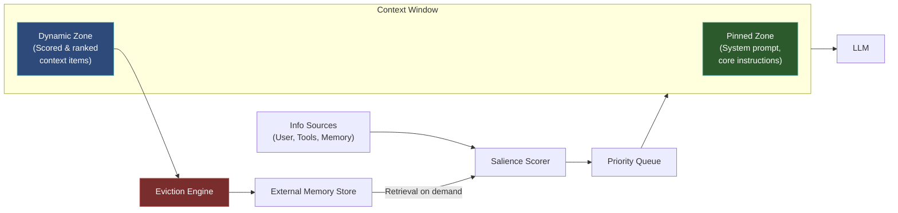

# 工作记忆与上下文窗口管理

  

## 📖 速览

| 难度 | 时间 | 前置要求 |
|------------|------|---------------|
| 高级 | 约 45 分钟 | Python 3.8+、`LLM_API_KEY`，建议先了解技术 02 滑动窗口记忆和技术 05 token 缓冲记忆 |

这项技术面向构建长时间运行智能体的开发者：用显著性评分（salience scoring）和淘汰策略（eviction policy），智能地管理什么留在上下文窗口里。

## TL;DR

- **它是什么：** **工作记忆（Working Memory）**用显著性评分和动态淘汰策略管理什么留在上下文窗口里。
- **什么时候需要：** 你运行的智能体存活很久，朴素的 FIFO 淘汰会过早丢掉高价值信息。
- **代价是什么：** 基于嵌入的显著性评分给每一轮增加延迟，而且它度量的是相似度，不是逻辑重要性。
- **本仓库里最接近的替代：** 技术 02 滑动窗口记忆用朴素的 FIFO 淘汰，不打分，也不固定。

## 概述

想象你在抛接四个球。有人又扔来第五个，你必须放下一个。诀窍在于选哪个放下。工作记忆与上下文窗口管理就是替 LLM 智能体做这个选择的技术。它用显著性评分和淘汰策略（移除低价值条目的规则）控制什么留在上下文窗口（模型一次能「看到」的文本）里。长时间运行的聊天机器人或研究助手要在紧张的 token 预算下追踪大量事实，你需要这项技术。

LLM 的上下文窗口（模型一次能「看到」的文本）道理相同。无论 4000 还是 100 万 token，总有上限。窗口里装着什么，决定智能体推理的好坏。朴素做法把窗口当队列：最旧的消息从队尾掉出去。这是个糟糕的策略。对话开头的关键指令可能消失，无关的闲聊却还留着。

这项技术源自认知心理学。Baddeley 的人类工作记忆模型描述了一个容量有限、带注意控制器的系统。控制器决定什么留在主动意识里，什么淡出。智能体需要同样的东西：一个管理层，按新近度、相关性和重要性对上下文条目打分、排序、固定（保护）和淘汰（移除）。

**关键词：** 智能体记忆、LLM 智能体、工作记忆、上下文窗口管理、显著性评分、淘汰策略、token 预算、注意力管理、上下文优先级排序

## 核心概念

- **上下文窗口（context window）**：LLM 一次能「看到」的文本，受最大 token 数限制。
- **注意力管理（attention management）**：控制任意时刻哪些信息占据上下文窗口，而不是让它被动累积。
- **上下文优先级排序（context prioritization）**：按相关性、新近度和重要性给条目排序，决定什么留下。
- **固定上下文（pinned context）**：无论如何都不被移除的关键条目（系统指令、用户偏好、进行中的目标）。
- **动态淘汰策略（dynamic eviction policy）**：窗口满了以后移除低优先级条目的规则。常见做法有 LRU（最近最少使用）和按重要性加权淘汰。
- **显著性评分（salience scoring）**：给每个上下文元素打一个数值相关性分。「显著性」指「它现在有多要紧」。
- **外部记忆库（external memory store）**：归档被淘汰条目的地方，之后仍可检索。

## 架构

  

Mermaid 源码

---

## Notebook 内容

[notebook](./working_memory_context_window.ipynb) 用 deepagents 和任意 OpenAI 兼容端点从零构建一个完整的上下文窗口管理系统：

1. **`ContextItem` 数据模型**：把文本和元数据（token 数、显著性得分、时间戳、固定状态）包在一起。
2. **`SalienceScorer`**：融合嵌入相似度、指数新近度衰减和来源重要性权重。
3. **`EvictionEngine`**：两种策略（LRU 和重要性加权 LRU），移除价值最低的条目。
4. **`ExternalMemoryStore`**：连同嵌入一起归档被淘汰条目，供日后检索。
5. **`ContextWindowManager`**：统筹打分、插入、淘汰、检索和提示词组装。
6. **端到端示例**：一段多轮旅行规划对话，token 预算很紧，会触发淘汰并展示检索回路。
7. **策略比较**：并排展示 LRU 与重要性加权 LRU 的结果。

## 工作原理

1. 每段上下文都带元数据：优先级、插入时间、最后访问时间和显著性得分。
2. 新信息到来时，管理器给它打分并插入动态区。
3. 上下文窗口接近容量上限时，淘汰策略移除得分最低的条目。
4. 固定条目受保护，不会被淘汰。只有显式操作才能改变它们的优先级。
5. 被淘汰的条目移入外部记忆库。它们重新变得相关时可以取回。

## 什么时候用

- 长时间运行的智能体会话，超出模型的上下文窗口。
- 多轮对话，早期上下文可能过时，或需要刷新。
- 复杂任务，智能体要同时追踪多个子目标、文档或数据源。
- 对成本敏感、需要可预测 token 预算的应用。

## 局限

- 评分开销拖慢速度。每条新消息都触发嵌入调用和重新打分，增加每轮延迟。
- 嵌入度量语义相似度，不是逻辑重要性。一条消息可能语义上离当前查询很远，逻辑上却至关重要（比如一边讨论晚饭计划，一边说「我的航班早上 6 点起飞」）。
- 被淘汰的消息在对话历史里留下空隙。模型看不到完整脉络，回复可能显得前后脱节。
- 这个方案比朴素缓冲复杂。评分、淘汰、归档和检索带来更多出 bug 的地方。

## FAQ

### 问：智能体记忆里的工作记忆是什么？

**答：** 工作记忆管理任意时刻哪些信息留在 LLM 的上下文窗口里。它用显著性评分、动态淘汰策略和优先级固定，决定哪些记忆、指令和检索到的内容占据有限的 token 预算。和朴素滑动窗口不同，它评估每个条目与当前任务的相关性。把它想成上下文窗口的智能调度器：最重要的信息留下，最不重要的被淘汰或压缩。

### 问：什么时候该用工作记忆，而不是滑动窗口记忆？

**答：** 当上下文窗口里装着异构内容（指令、检索到的事实、对话历史、工具结果）时，用工作记忆。滑动窗口记忆（技术 02）做盲目的 FIFO 淘汰，可能为了留下一条低价值闲聊而丢掉关键指令。工作记忆按相关性和新近度给每个条目打分，保证高价值内容留存。对使用工具、RAG 和多步推理的智能体，这种智能优先级排序能明显提升输出质量。

### 问：工作记忆有哪些局限或失败模式？

**答：** 显著性评分增加每轮的计算开销。评分模型可能误判相关性，淘汰重要上下文或留下无关数据。固定条目（系统提示词、关键指令）会挤占动态内容的预算。固定太多条目，工作记忆就变得僵硬、无法适应。这个方案还需要仔细调整评分权重和淘汰阈值，不同场景取值不同。

### 问：能把工作记忆和其他记忆技术结合吗？

**答：** 可以。工作记忆是其他记忆类型天然的编排层。搭配技术 06（向量库记忆），按需把相关的长期记忆拉进上下文窗口。加上技术 13（分层记忆），组成热/温/冷层系统，工作记忆就是热层。用技术 17（记忆路由），在填充工作记忆之前决定查询哪个记忆库。

### 问：有什么库或框架能省掉自己实现？

**答：** Letta/MemGPT（技术 26）通过固定 token 预算、可自我编辑的核心记忆块，直接实现了工作记忆管理。LangChain 没有专门的工作记忆类，但你可以用会打分、会淘汰的自定义记忆类近似实现。OpenAI 的 Assistants API 在内部处理一部分上下文管理。要精细控制，通常还是自己写一层代码，以程序化方式管理上下文窗口的内容。

## 参考文献

- Liu, N. F., et al. (2023). "Lost in the Middle: How Language Models Use Long Contexts." [arXiv:2307.03172](https://arxiv.org/abs/2307.03172).
- Baddeley, A. (2000). "The Episodic Buffer: A New Component of Working Memory?" [*Trends in Cognitive Sciences*](https://doi.org/10.1016/S1364-6613%2800%2901538-2), 4(11), 417-423.
- Mu, J., et al. (2023). "Learning to Compress Prompts with Gist Tokens." [arXiv:2304.08467](https://arxiv.org/abs/2304.08467).
- Modarressi, A., et al. (2023). "RET-LLM: Towards a General Read-Write Memory for LLMs." [arXiv:2305.14322](https://arxiv.org/abs/2305.14322).

## 相关技术

- [**02 滑动窗口记忆**](../02_sliding_window_memory/) - 更简单的窗口方案，丢掉最旧的轮次。加显著性评分前的好基线。
- [**05 token 缓冲记忆**](../05_token_buffer_memory/) - 按严格的 token 数修剪上下文。不需要逐条打分时的轻量替代。
- [**13 分层记忆**](../13_hierarchical_memory_layers/) - L1 热层本质上就是工作记忆。这项技术在其下再加温层和冷层。
- [**15 记忆压缩**](../15_memory_compaction/) - 把记忆压缩成更短的形式，同样的 token 预算装下更多语义内容。

---

