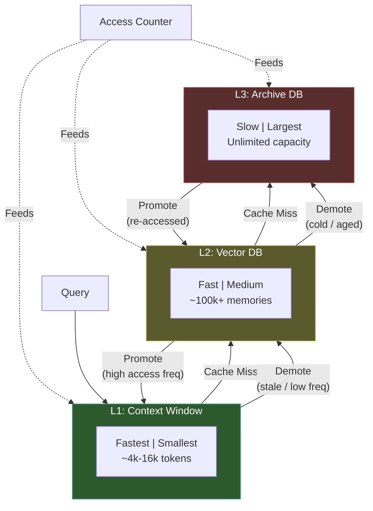

# 分层记忆（Hierarchical Memory Layers）

  

## 📖 速览

| 难度 | 时间 | 前置要求 |
|------------|------|---------------|
| 高级 | 约 50 分钟 | Python 3.8+、`LLM_API_KEY`，建议先了解 06 向量库记忆和 12 工作记忆 |

这项技术面向这样的开发者：需要把智能体记忆组织成热、温、冷三层存储，并自动升级和降级。

## TL;DR

- **它是什么**：**分层记忆（Hierarchical Memory Layers）** 把记忆组织成热、温、冷三层，并根据访问模式自动升级和降级。
- **什么时候需要**：你的智能体积累的记忆超过了任何单一存储的容量，需要按访问频率做分层检索。
- **代价**：管理三层，加上升级和降级逻辑，实现复杂度显著增加。
- **本仓库中最接近的替代**：12 工作记忆只管理上下文窗口这一层，没有温和冷存储层。

## 概述

想想厨房。常用的香料放在台面上（快，空间有限），不常用的放进橱柜，很少用的堆在储藏室。分层记忆把同样的分层存储思路用到 LLM 智能体记忆上。它把记忆组织成热、温、冷三层。温层通常用向量数据库（按含义匹配条目的数据库）。记忆被频繁访问就升级到更快的层，变得陈旧就降级。对于会积累成千上万条记忆的长期助手或客服智能体，这种智能体记忆技术非常合适。

分层记忆就是把这个思路应用到智能体记忆上。它把存储组织成速度、容量、成本各不相同的层。典型配置是三层。L1（热层）把最相关的记忆直接放在上下文窗口里。L2（温层）把最近使用的记忆放在快速的向量数据库（按含义查找相似条目的数据库）中。L3（冷层）把归档记忆放在更便宜、更慢的存储里。

记忆会在层之间移动。智能体频繁访问一条记忆时，它被升级（promotion，移到更快的层）。一条记忆变得陈旧时，它被降级（demotion，移到更慢的层）。这让智能体管理的记忆总量远超扁平存储。同时，最重要的信息检索依然很快。

**关键词**：智能体记忆、LLM 智能体、分层记忆、分层存储、记忆层、向量数据库、升级与降级、级联检索、长期智能体、上下文窗口

## Notebook

[配套 notebook](./hierarchical_memory_layers.ipynb) 用 deepagents 和任意 OpenAI 兼容端点从零搭建一个三层记忆系统，内容包括：

1. **TieredMemory 数据模型**：包含内容、嵌入、层标签和访问跟踪元数据。
2. **HierarchicalMemoryManager**：L1/L2/L3 存储、级联检索和层间移动逻辑。
3. **升级和降级策略**：在智能体轮次之间根据访问频率和陈旧度运行。
4. **HierarchicalMemoryAgent**：把记忆管理器接入对话智能体，自动提取事实。
5. **持久化**：用 JSON 序列化保存和恢复整个层级结构。

## 关键概念

- **L1/L2/L3 记忆层**：热层（上下文内）、温层（向量库）和冷层（归档数据库）。每一层的速度和容量都不同。
- **升级策略（promotion policies）**：访问频率超过阈值时，把记忆移到更快的层。
- **降级/淘汰（demotion/eviction）**：活跃度低于阈值或快层满员时，把记忆推到更慢的层。
- **访问频率跟踪**：统计每条记忆被检索的次数，为升级和降级决策提供依据。
- **级联检索（cascading retrieval）**：先搜 L1，未命中再搜 L2，最后搜 L3。模仿 CPU 缓存未命中在硬件层级间的逐级下落。

## 架构

  

Mermaid source

---

## 工作原理

1. 新记忆带着嵌入和访问跟踪元数据进入 L2（温层）。
2. 智能体查询记忆时，先搜 L1，再搜 L2，最后搜 L3。这叫级联检索。
3. 每次命中都会增加访问计数，并更新最近访问时间戳。
4. 维护周期在智能体轮次之间运行，把访问频繁的 L2 记忆升到 L1（热层）。
5. 陈旧的 L1 记忆（一段时间未访问）降回 L2。冷清的 L2 记忆沉到 L3。
6. 用户再次访问已归档的 L3 记忆时，它自动升回 L2。

## 何时使用

- 生产环境的智能体记忆量很大，全部放进向量数据库成本太高。
- 系统既需要关键记忆的低延迟检索，也需要深度归档搜索。
- 在数周或数月里不断积累记忆的长期智能体。

## 何时避免

- 短对话（20 轮以内），扁平存储就够用。
- 原型项目，调升级阈值只会平添复杂度。
- 所有记忆同等重要的系统（没有天然的热/冷之分）。

## 局限

- 升级阈值、陈旧度窗口和 L1 容量都需要校准。参数不当会导致层间抖动（记忆在层间来回移动），或让陈旧数据一直占着 L1。
- 新智能体没有访问历史。在积累足够查询驱动升级之前，所有记忆都停留在 L2。这就是冷启动问题（cold start）。
- 每条记忆都需要嵌入和访问元数据。这给每次存储操作增加延迟和成本。
- 内存中的实现无法扩展。生产系统需要真实后端（例如 L1 用 Redis，L2 用向量数据库，L3 用 PostgreSQL）。
- 维护周期如果不在后台异步运行，会阻塞响应路径。

## FAQ

### 问：智能体记忆中的分层记忆（Hierarchical Memory）是什么？

**答**：分层记忆按访问模式和重要性，把记忆组织成热、温、冷三层。热层（上下文窗口）存放活跃的工作数据。温层（Redis 这类快速缓存）存放最近访问的条目。冷层（向量数据库或磁盘）归档其余所有内容。记忆被访问就上移，闲置就下移。这模仿了 CPU 缓存层级：常用数据放在近处，少用数据放在更便宜的存储里。

### 问：什么时候该用分层记忆，而不是工作记忆？

**答**：当数据量大到任何单层都装不下，且访问模式不均匀时，用分层记忆。工作记忆（技术 12）只管理上下文窗口。分层记忆在它下面增加温和冷层，构成完整的存储栈。如果你的智能体跨会话积累成千上万条记忆，而每次对话只访问其中一小部分，分层方案既能避免把所有内容装进昂贵的上下文，又能让热门条目保持快速访问。

### 问：分层记忆有哪些局限或失效模式？

**答**：升级和降级策略需要针对具体场景调参。阈值不对会导致缓存抖动（thrashing，条目在层间来回移动）或温缓存陈旧。这套系统增加基础设施复杂度：你至少需要两种存储后端（上下文 + 持久存储，通常是三种）。冷层检索增加延迟（50-500 毫秒，取决于后端）。要监控哪一层存放哪些数据，需要可观测性工具，而多数轻量记忆系统没有这些工具。

### 问：分层记忆能和其他记忆技术组合吗？

**答**：能。分层记忆是一个结构性模式，可以包裹其他技术。用技术 06（向量库记忆）做冷层，技术 12（工作记忆）做热层，Redis 或快速键值存储做温层。再加上技术 14（记忆巩固），定期清理和合并冷层内容。技术 19（遗忘与衰减）可以基于时间衰减分数，触发从温层到冷层的降级。

### 问：有什么库或框架能省掉自己实现的工作？

**答**：Letta/MemGPT（技术 26）实现了三层结构：核心记忆（core memory，热）、召回记忆（recall memory，温）和归档记忆（archival memory，冷）。Zep（技术 27）采用两层方案：会话内记忆加持久图存储。其他主流框架没有现成的分层记忆类。自己搭建时，可以用 Redis（温层）配合 Chroma 或 Pinecone（冷层），热层用 LangChain 的记忆封装。

## 参考文献

- Patterson, D. A., & Hennessy, J. L. (2017). *Computer Organization and Design*. Morgan Kaufmann.
- Packer, C., et al. (2023). "MemGPT: Towards LLMs as Operating Systems." arXiv:2310.08560.
- Zhang, Z., et al. (2024). "A Survey on the Memory Mechanism of Large Language Model Based Agents." arXiv:2404.13501.
- Nuxoll, A. M., & Laird, J. E. (2007). "Extending Cognitive Architecture with Episodic Memory." *AAAI*, 1560-1564.

## 相关技术

- [**12 工作记忆与上下文窗口管理**](../12_working_memory_context_window/) - L1 热层就是工作记忆。该技术深入讲解如何管理上下文窗口的内容。
- [**06 向量库记忆**](../06_vector_store_memory/) - 温层通常用向量存储。想先理解嵌入和相似度检索，从这里开始。
- [**14 记忆巩固**](../14_memory_consolidation/) - 巩固通过合并重复、解决矛盾，让每一层随记忆积累保持干净。
- [**15 记忆压缩**](../15_memory_compaction/) - 压缩把记忆缩成更短的形式，让每层用更少空间装更多信息。

---

