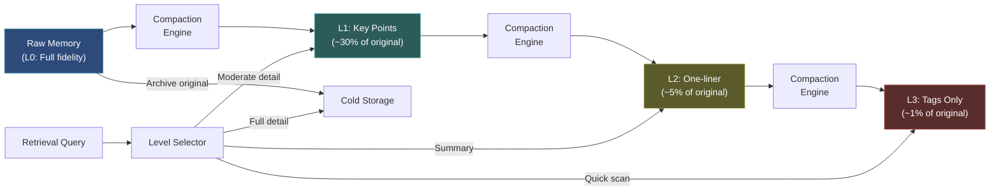

# 记忆压缩（Memory Compaction）

  

## 📖 速览

| 难度 | 用时 | 前置要求 |
|------------|------|---------------|
| 中级 | 约 30 分钟 | Python 3.8+、`LLM_API_KEY`，建议先了解技术 03 摘要记忆 |

这项技术面向需要在固定 token 预算内装入更多知识的开发者：把已存储的记忆压缩成更短的形式。

## TL;DR

- **它是什么：** **记忆压缩**通过渐进式多级摘要压缩已存储的记忆，从完整文本一路压缩到标签。
- **什么时候需要它：** 你要在固定 token 预算里装下更多知识，并且希望在检索时再选择详细程度。
- **代价：** 每条记忆最多需要 3 次 LLM 调用才能达到最终压缩级别，而且激进压缩会丢失细节。
- **仓库里最接近的替代：** 技术 03 摘要记忆只生成一份摘要，压缩则产出多个渐进级别，方便灵活检索。

## 概述

想象你把工作中的每场会议都逐字记录下来。一年后你会有几千页内容，但真正的决策大概只占全文的 10%。记忆压缩就是为 LLM 智能体解决这个问题的智能体记忆技术，核心是渐进式摘要（Progressive Summarization，分阶段压缩文本）。原始记忆被转换成多个级别上更紧凑的版本：完整文本、要点、一句话摘要、标签。智能体按当前任务的需要检索某一级别的细节。对 token 受限的系统，或长期运行、积累大量对话历史的助手来说，这一点尤其有价值。

具体到智能体的记忆库：记忆压缩通过渐进式摘要（分阶段压缩）降低存储体积和 token 成本（把文本放进提示词的开销）。原始记忆，比如完整对话记录和冗长的工具输出，非常占空间。压缩把它们转换成更紧凑的版本，保留关键信息，丢弃填充内容。

核心难点是存储与保真度的权衡。激进压缩省 token 也省钱，但可能丢失日后有用的细节。设计良好的压缩系统使用多个压缩级别。记忆随时间越来越短，但原始版本始终保留在冷存储（便宜但较慢的存储）中，需要时可以取回。

实际收益相当可观。在同样的存储预算下，压缩后的记忆库能容纳 10 到 100 倍的语义内容。条目更小、信息密度更高，检索也随之加快。

**关键词：** 智能体记忆（agent memory）、LLM 智能体、记忆压缩（memory compaction）、渐进式摘要（progressive summarization）、token 预算（token budget）、压缩级别（compression levels）、存储与保真度权衡（storage-fidelity tradeoff）、提示词压缩（prompt compression）、长期记忆（long-term memory）

## 核心概念

- **渐进式摘要级别**：多阶段压缩。L0 是原始文本，L1 提取要点，L2 把要点蒸馏成一句话，L3 把一切缩减为标签。
- **有损与无损压缩**：无损保留全部信息（例如结构化抽取），有损为省篇幅丢弃细节（例如摘要）。压缩两者并用。
- **详细级别**：检索时可配置的粒度。你可以根据查询需要，请求压缩程度更高或更低的版本。
- **压缩调度**：规定记忆何时有资格被进一步压缩的规则（例如 N 天未访问后，或存储压力升高时）。
- **可逆性**：把原始记忆与压缩版本放在一起保留。需要时你可以找回完整细节。
- **存储与保真度的权衡**：通过压缩节省资源和为将来保留信息之间的核心矛盾。

## 架构

  

Mermaid 源码

---

## 工作原理

1. 新记忆以完整保真度（L0）存入，同时抽取元数据（标签、实体、时间戳）。
2. 经过设定的老化时间，或当存储压力升高时，压缩引擎挑出候选记忆。
3. 每条候选记忆被压缩到下一个级别，方式是基于 LLM 的摘要或实体抽取（抽出姓名、日期、决策这类结构化事实）。
4. 压缩后的版本成为主要的检索对象。原始版本可以留在冷存储，也可以丢弃。
5. 检索时可以指定期望的详细级别，系统返回对应的压缩级别。

## 何时使用

- token 受限的系统：检索到的上下文必须塞进紧张的预算。
- 长期运行的智能体：会积累大量原始记忆。
- 对成本敏感的部署：存储和推理成本随记忆量增长。

## 局限

- 摘要是有损的。如果智能体之后需要过去某一轮的原话，压缩级别里没有。取回冷存储会增加延迟。
- 一条记忆到达 L3 最多需要 3 次 LLM 调用。高吞吐智能体（每小时数百条记忆）花在压缩上的钱可能超过省下的存储费。
- 对小记忆库（少于 100 条），多级别压缩徒增开销，没有实际收益。缓冲或滑动窗口更合适。
- 压缩调度本身也有权衡。按时间触发会压缩仍有用的旧记忆；按存储压力触发会推迟压缩，但会造成流量尖峰。

## Notebook

[notebook](./memory_compaction.ipynb) 完整演示了一遍实现：

1. **数据结构**：`CompactionLevel` 枚举和 `CompactedMemory` 数据类，在四个保真度级别（L0 原文、L1 要点、L2 一句话、L3 标签）上保存内容。
2. **压缩引擎**：用 LLM 调用（OpenAI `gpt-4o-mini`）配合针对每个级别定制的提示词，把记忆从上一级压缩到下一级。
3. **记忆存储**：管理活跃记忆和冷存储，支持按级别检索，让你为每次查询选择合适的分辨率。
4. **压缩调度器**：基于存留时间和空闲时间策略挑选待压缩的记忆。
5. **运行示例**：三条贴近实际的智能体记忆被端到端压缩，并测量每个级别的存储节省。

## FAQ

### 问：智能体记忆里的记忆压缩是什么？

**答：** 记忆压缩通过渐进式多级摘要压缩已存储的记忆，让固定 token 预算装下更多知识。与单次摘要不同，压缩会生成一个多层次的摘要体系：详细版、中等摘要、一句话主旨。系统根据可用上下文空间选择合适的保真度级别。这样，用较短的表示存放不太重要的条目，同样的 token 预算就能多装 10 倍的记忆。

### 问：什么时候该用记忆压缩而不是摘要记忆？

**答：** 当很多记忆争夺有限的上下文空间，而且你想要灵活的保真度控制时，用记忆压缩。摘要记忆（技术 03）为整段对话生成一份摘要；压缩为每条记忆生成多个压缩级别，所以你可以在同一个上下文窗口里放 50 条一句话主旨和 5 条详细记忆。当智能体积累了成百上千条事实，又需要以不同详细程度展示最相关的那些时，选压缩。

### 问：记忆压缩有哪些限制或失败模式？

**答：** 每一级压缩都会丢信息。复杂记忆的一句话主旨可能有误导性或不完整。为每条记忆生成多个保真度级别会让 LLM 成本翻倍（要 3 个级别就得 3 次调用）。存储也会增加，因为要保留多个版本。如果选择算法挑错了保真度级别，智能体拿到的细节不是太少就是太多。压缩最适合事实性内容，对微妙或带条件的信息效果差。

### 问：记忆压缩能和其他记忆技术组合吗？

**答：** 可以。与技术 13（分层记忆）组合，把不同保真度级别放进不同层级：主旨放热层，中等摘要放温层，完整记忆放冷层。与技术 20（记忆检索模式）组合，先按相关性检索，再根据剩余上下文预算选择合适的保真度级别。这能搭出一条非常省 token 的检索流程。

### 问：有什么库或框架可以直接用，跳过自己实现？

**答：** 截至 2025 年底，还没有主流框架提供专门的多级别压缩类。Letta/MemGPT（技术 26）在把核心记忆归档到归档存储时实现了某种形式的压缩。你可以在 LangChain 之上构建压缩：写一个自定义 memory 类，为每个条目保存多个摘要版本。实现大约需要 100-200 行 Python：每个压缩级别一条 LLM 链，外加一个按可用 token 预算选择保真度的选择器。

## 参考文献

- Forte, T. (2017). "Progressive Summarization: A Practical Technique for Designing Discoverable Notes." Forte Labs.
- Xu, Z., et al. (2023). "RECOMP: Improving Retrieval-Augmented LMs with Compression and Selective Augmentation." arXiv:2310.04408.
- Chevalier, A., et al. (2023). "Adapting Language Models to Compress Contexts." arXiv:2305.14788.
- Jiang, H., et al. (2023). "LongLLMLingua: Accelerating and Enhancing LLMs in Long Context Scenarios via Prompt Compression." arXiv:2310.06839.

## 相关技术

- [**14 记忆巩固**](../14_memory_consolidation/) - 巩固负责合并和去重记忆，压缩负责缩短记忆。两者配合，记忆库既干净又省空间。
- [**03 摘要记忆**](../03_summary_memory/) - 摘要是压缩最简单的形式，一次性作用于整段对话。
- [**04 摘要缓冲记忆**](../04_summary_buffer_memory/) - 把近期消息的缓冲和旧轮次的摘要结合起来。是完整多级别压缩的轻量替代。
- [**13 分层记忆**](../13_hierarchical_memory_layers/) - 压缩天然适配记忆分层。记忆移向更冷的层时，压缩可以更激进。

---

