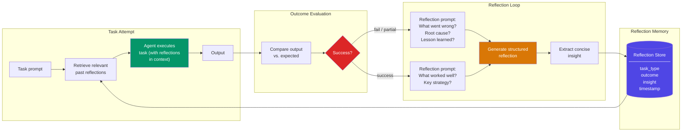

# 自我反思记忆（Self-Reflection Memory）

  

## 📖 速览

| 难度 | 时间 | 前置要求 |
|------------|------|---------------|
| 进阶 | 约 50 分钟 | Python 3.8+、`LLM_API_KEY`，建议先了解 06 向量库记忆 |

这项技术面向这样的开发者：你在构建能评估自己过去行为并从中学习的智能体，用自我评估来改进后续响应。

## TL;DR

- **它是什么：** **自我反思记忆**让智能体在任务结束后分析自己的表现，提取经验教训，存储起来供日后检索。
- **什么时候需要：** 你的智能体反复执行相似任务，你希望它从过往的错误和成功中学习，持续进步。
- **权衡：** 反思质量取决于模型的推理能力，而且每个任务都会多出一次 LLM 调用用于分析。
- **本仓库中最接近的替代技术：** 09 情景记忆记录发生了什么，自我反思记忆记录智能体从中学到了什么。

## 概述

想想一位棋手，每场比赛后都会复盘。他们不只记录棋步。他们会问：「我为什么会丢掉那颗子？我漏看了什么模式？」自我反思记忆就是把这种元认知（meta-cognition，对自己的思考进行思考）带给 LLM 智能体的记忆技术。每个任务结束后，智能体会分析哪些地方做得好、哪些不好，提取可复用的经验，存起来供日后检索。它建立在 Reflexion 框架的语言强化学习（verbal reinforcement learning）思路上。代码生成智能体、研究助手和其他多步系统都用它来跨会话提升表现，而且不需要重新训练模型。

自我反思记忆在实践中是这样工作的。每次任务尝试之后，智能体会停下来分析*为什么*顺利或失败。它找出自己决策中反复出现的模式，提取可复用的经验。这些反思进入一个专门的记忆库。之后的任务开始前，智能体检索相关的过往反思来指导规划。

这项技术借鉴了认知科学中的元认知研究。它也建立在 Reflexion 框架（Shinn et al., 2023）之上：智能体用语言层面的自我反思，把稀疏的反馈变成丰富的学习信号。最终得到的智能体能跨会话从错误中学习、强化成功的策略，无需重新训练模型。

**关键词：** 智能体记忆（agent memory）、LLM 智能体、自我反思、元认知、Reflexion 框架、语言强化学习、自我改进、洞见提取、任务失败分析

## 核心概念

- **反思提示词（reflection prompt）**：引导智能体评估近期行动的结构化问题。例如：「哪些做得好？哪里可以改进？下次你会怎么做？」
- **元认知（meta-cognition）**：智能体对自身推理进行推理的能力。它能识别自己方法中的长处和短板。
- **结果评估（outcome evaluation）**：把实际结果和预期目标对比。智能体判定成功、部分成功或失败。
- **行为模式（behavioral patterns）**：智能体行为中反复出现的倾向。例如：总是低估任务复杂度，或过度依赖某个工具。
- **反思触发学习（reflection-triggered learning）**：用反思的输出来更新策略、修改提示词或调整记忆检索偏好。
- **洞见提取（insight extraction）**：把反思提炼成简洁、可复用的原则或经验法则，供未来决策使用。
- **Reflexion 框架**：Shinn et al.（2023）提出的方法，智能体用语言反馈迭代改进自己的行为。

## 架构

  

Mermaid 源码

---

## 工作原理

1. 完成一个任务（或失败）后，智能体收到一个结果信号（成功、失败、部分成功）。
2. 反思提示词让智能体分析发生了什么、为什么、要提取哪些教训。
3. 智能体生成一条结构化反思，包含观察、根本原因和可行动的洞见。
4. 反思进入一个专门的记忆库，按任务类型和结果建立索引。
5. 之后的任务开始前，智能体检索相关的过往反思，注入规划上下文。

## 何时使用

- 执行复杂任务的智能体，失败分析能避免重复犯错。
- 奖励信号稀疏、但可以对结果做语言推理的系统。
- 应该随时间可证明地提升表现的长期运行智能体。

## 局限

- 反思质量取决于模型的推理能力。肤浅或错误的反思会被存储，可能误导后续尝试。
- 没有内置的矛盾检测。两条反思给出冲突建议时，都会留在库里。
- 每次失败都触发一次额外的 LLM 调用来生成反思。高失败率场景下，API 成本明显增加。
- 这项技术需要清晰、可评估的成功标准。开放式任务（创意写作、设计决策）无法触发有意义的反思。
- 基于关键词的检索在当前任务措辞不同时会漏掉相关的过往反思。生产系统应改用基于嵌入的检索。

## Notebook

完整可运行的实现见 [**self_reflection_memory.ipynb**](self_reflection_memory.ipynb)。

notebook 实现了一个 `ReflectiveAgent`，它用 Claude 的工具调用（tool use）API 在任务失败后生成结构化反思，存入 `ReflectionStore`，并在后续尝试前检索相关的过往洞见。6 个任务的基准测试跑 3 轮，可以观察到：随着反思积累，智能体的表现确实在提升。它从错误中学习，全程没有任何参数更新。

## FAQ

### 问：智能体记忆中的自我反思记忆是什么？

**答：** 自我反思记忆让智能体在完成任务后分析自己的表现。智能体回顾哪些有效、哪些失败、为什么，然后把这些反思存成可检索的经验教训。面对新任务时，它检索相关的过往反思，避免重蹈覆辙。灵感来自 Reflexion 论文（Shinn et al., 2023）：智能体通过反思失败实现迭代改进。它存的是元知识：关于智能体自身行为和推理模式的知识。

### 问：什么时候该用自我反思记忆，而不是情景记忆？

**答：** 当你的智能体需要在不重新训练的前提下随时间进步时，用自我反思记忆。情景记忆（技术 09）记录发生了什么，但不分析为什么会发生，也不提取教训。自我反思多加了一层分析，从经历中提炼可行动的洞见。如果你的智能体反复犯同一类错误，自我反思记忆能帮它识别并纠正这个模式。需要原始回忆时用情景记忆；需要学习时用自我反思。

### 问：自我反思记忆有哪些局限或失效模式？

**答：** 反思质量取决于 LLM 能否准确诊断自己的失败。模型可能给出肤浅或错误的分析，归因到错误的因素。不加筛选地存储大量反思会产生噪音，淹没有用的教训。反思步骤在每个任务后增加延迟（300-1000ms）和成本。如果智能体检索到一条来自不同上下文的反思，可能套用一条不适合当前情况的教训，反而制造新错误。

### 问：自我反思记忆能和其他记忆技术组合吗？

**答：** 可以。和技术 11（程序性记忆）组合，反思就能更新已存储的流程。当反思发现流程中某一步会失败，智能体会修订那个流程供以后使用。也可以搭配技术 09（情景记忆）：情景提供原始数据，自我反思提取教训。再加上技术 14（记忆巩固），定期合并和去重积累的反思。

### 问：有什么库或框架能省掉自己实现的工作？

**答：** LangGraph 和 LangChain 通过带自我批评步骤的自定义智能体循环支持反思模式。论文里的 Reflexion 模式在任何 LLM 框架之上大约 50-100 行代码就能实现。Letta/MemGPT（技术 26）可以把反思存进它的核心记忆或归档记忆。没有主流框架提供专门的反思记忆类。自己造的话，写一条任务后反思链，把结构化的教训写进向量库供日后检索。

## 参考文献

- Shinn, N., et al. (2023). "Reflexion: Language Agents with Verbal Reinforcement Learning." arXiv:2303.11366.
- Madaan, A., et al. (2023). "Self-Refine: Iterative Refinement with Self-Feedback." arXiv:2303.17651.
- Flavell, J. H. (1979). "Metacognition and Cognitive Monitoring." *American Psychologist*, 34(10), 906-911.
- Yao, S., et al. (2023). "ReAct: Synergizing Reasoning and Acting in Language Models." arXiv:2210.03629.

## 相关技术

- [**09 情景记忆**](../09_episodic_memory/) - 反思是一种特殊的情景。情景记忆提供了自我反思赖以构建的存储层。
- [**14 记忆巩固**](../14_memory_consolidation/) - 反思会随时间累积。巩固负责合并和去重，保持库的整洁。
- [**12 工作记忆与上下文窗口**](../12_working_memory_context_window/) - 检索到的反思进入智能体的工作记忆用于规划。这项技术决定什么东西能装进那个窗口。
- [**26 Letta/MemGPT 模式**](../26_letta_memgpt_patterns/) - Letta 实现了类似反思的循环：智能体基于自我评估编辑自己的记忆。

---

