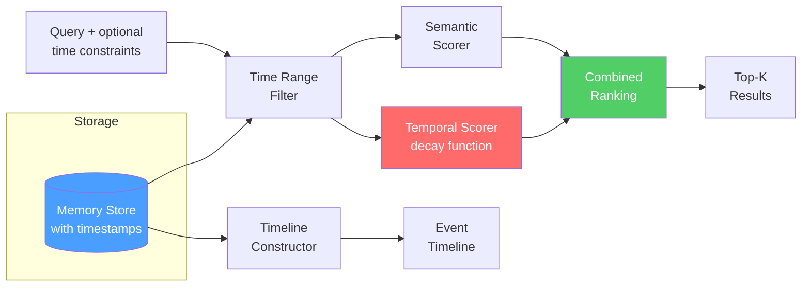

# 时序记忆（Temporal Memory）

  

## 📖 速览

| 难度 | 耗时 | 前置要求 |
|------------|------|---------------|
| 中级 | 约 35 分钟 | Python 3.8+、`LLM_API_KEY`、建议先理解 06 向量库记忆 |

这项技术面向这样的开发者：你需要智能体记住事实是何时学到的，识别过时的信息，并进行和时间有关的推理。

## TL;DR

- **是什么：** **时序记忆**给记忆打上时间戳，用可配置的衰减函数做新近度加权检索。
- **什么时候需要：** 你的智能体要优先采用较新的事实，还要支持时间范围查询和时点查询。
- **代价：** 选对衰减半衰期需要反复实验；对全部候选记忆评分，在 10 万条以上时会增加延迟。
- **本仓库中最接近的替代：** 19 遗忘与衰减用衰减做生命周期修剪，时序记忆则在检索评分时使用衰减。

## 描述

想想一本什么都标着日期的笔记本。有人问「项目进展如何？」时，你不会读完整个本子，而是直接翻到最近的一页。时序记忆就是给 LLM 智能体这种时间感知的智能体记忆技术。它给每条存储的记忆打上时间戳，加入新近度加权检索（在相关性相近时给较新的记忆更高得分），还支持时间范围查询和重建过去知识状态的时点查询。项目跟踪智能体、客服机器人，以及任何事实会随时间变化的系统，都需要它。

标准的基于向量的检索（按语义相似度搜索）把所有记忆当作同样「新」。这会让智能体引用过时的信息，或者看不出局势是如何演变的。

时序记忆解决了这个问题。它支持时间范围查询（「上周发生了什么？」）、新近度加权检索（在相关性得分接近时优先较新的信息），以及时点查询（重建智能体在过去某个时刻知道什么）。对动态环境中的智能体来说，这些能力必不可少：事实在变，时间顺序本身就携带信息。

**关键词：** 智能体记忆、LLM 智能体、时序记忆、时间戳元数据、新近度加权检索、时间衰减、时间范围查询、时序化记忆、事件时间线

## 关键概念

- **时间戳元数据（timestamp metadata）**：每条记忆都带有创建时间、最近访问时间，以及可选的事件时间（所描述事件实际发生的时间）。
- **时间衰减函数（temporal decay function）**：随记忆变旧而降低其检索得分的数学函数（指数、线性）。用半衰期参数化，即得分降到 50% 所需的时间。
- **新近度评分（recency scoring）**：把语义相关性和时间新鲜度结合起来。当两条记忆与查询匹配得一样好时，较新的那条排名更高。混合权重可配置。
- **时间范围查询（time-range query）**：检索落在指定时间窗口内的记忆。例如「过去 24 小时的对话」。
- **时序排序（temporal ordering）**：保持记忆的时间先后顺序。这帮助智能体理解因果关系。
- **时点检索（"as of" retrieval）**：过滤掉某时间戳之后创建的记忆，重建智能体在过去某个时刻知道什么。
- **事件时间线（event timeline）**：从记忆中构建按时间排序的相关事件序列，可以用 LLM 生成叙事式摘要。

## 架构

  

Mermaid source

---

## 工作原理

1. 每条记忆以结构化时间戳字段存储（`created_at`、`event_time`、`last_accessed`）。
2. 查询时，时间衰减函数根据每条记忆的年龄调整它的基础相关性得分。
3. 衰减函数可配置：指数衰减适合强烈偏好新信息的场景，线性衰减让记忆逐渐变旧，不衰减则适合对时间不敏感的查询。
4. 时间范围过滤器先约束结果的时间区间，再跑语义搜索。
5. 时点查询排除在目标时间戳之后创建的记忆。
6. 时间线构建按时间顺序聚合相关记忆，支持叙事式回忆。

## 你将构建什么

[notebook](./temporal_memory.ipynb) 完整走了一遍实现：

- 一个带结构化时间戳元数据的 `TemporalMemory` 数据类（dataclass）。
- 一个支持指数衰减和线性衰减的 `TemporalDecay` 类。
- 一个 `TemporalMemoryStore`，提供四种检索模式：标准查询、时间范围、时点查询和时间线。
- 一个用 LLM 生成叙事式摘要的时间线摘要器。
- 一个完整的示例：跟踪一个软件项目 30 天，演示全部检索模式。

## 何时使用

- 智能体跟踪不断变化的局势，信息会过时（项目状态、市场行情）。
- 系统需要回答「什么时候」类问题，或给出按时间排序的摘要。
- 同一实体的属性随时间变化，而最新状态最重要的环境。

## 局限

- 常青事实（数学公式、API 文档、公司政策）会被衰减不公平地惩罚。你要么把它们排除在衰减之外，要么把半衰期设得很长。
- 选对半衰期和新近度权重需要实验。太短会忘掉重要上下文，太长则让时间感知失去意义。
- 每次查询都要为所有候选记忆计算衰减得分。存储规模大（10 万条以上）时，比纯向量检索增加延迟。
- 系统假设时间戳准确。分布式部署中的乱序到达或时钟偏差会产生误导性的新近度得分。

## 常见问题

### 问：智能体记忆中的时序记忆是什么？

**答：** 时序记忆给每条存储的记忆打上时间戳，用新近度加权检索让较新的信息排在较旧的信息前面。可配置的衰减函数（指数、线性或阶梯式）降低旧记忆的检索得分。例如半衰期设为 7 天时，上周的记忆得分只有今天记忆的 50%。当信息随时间演变（比如项目状态或用户偏好）时，这能帮智能体优先采用当前的事实。

### 问：什么时候该用时序记忆而不是遗忘与衰减？

**答：** 当你想在检索时获得时间感知、又不想永久删除记忆时，用时序记忆。遗忘与衰减（技术 19）会永久修剪低于重要性阈值的记忆。时序记忆把所有东西都留在存储里，只是在搜索结果中降低旧条目的排名。如果以后可能还需要旧记忆（用于审计或重新激活），时序评分更安全。当存储成本是主要顾虑、想腾出空间时，再用遗忘与衰减。

### 问：时序记忆有哪些局限或失败模式？

**答：** 时间加权可能把永不过时的事实埋掉。如果用户几个月前说过一个永久偏好，衰减可能把它压到较新但不重要的消息之下。选对衰减函数和半衰期需要实验。半衰期太短，智能体会变得健忘；太长则几乎带不来时间上的收益。这个方法还假设「更新就意味着更相关」，对稳定事实或长期偏好来说并不总成立。

### 问：时序记忆能和其他记忆技术组合吗？

**答：** 能。和技术 06（向量库记忆）组合时，在检索时给相似度得分乘一个时间衰减系数，就得到「相关性 × 新近度」的排序。也可以搭配技术 10（语义记忆），给事实打上「稳定」或「易变」标签，让稳定事实（比如用户的名字）绕过衰减，易变事实（比如项目截止日期）正常衰减。这种选择性衰减能防止永久信息被埋掉。

### 问：有什么库或框架能省掉自己实现的工作？

**答：** Zep（技术 27）在检索流程中原生应用时间评分。Graphiti（技术 24）给所有图的边打时间戳，支持在知识图谱上做时间查询。LangChain 没有内置的时序记忆类，但你可以在任何检索器上包一层得分函数，加上时间衰减系数。在已有的向量检索方案上，这个实现大约只需 20-30 行代码。Mem0（技术 25）记录事实的创建和更新时间，可做时间过滤。

## 参考文献

- Park, J. S., et al. (2023). ["Generative Agents: Interactive Simulacra of Human Behavior."](https://arxiv.org/abs/2304.03442) arXiv:2304.03442。
- Zhong, W., et al. (2024). ["MemoryBank: Enhancing Large Language Models with Long-Term Memory."](https://arxiv.org/abs/2305.10250) arXiv:2305.10250。
- Tulving, E. (2002). ["Episodic Memory: From Mind to Brain."](https://doi.org/10.1146/annurev.psych.53.100901.135114) *Annual Review of Psychology*, 53, 1-25。
- Hassabis, D., & Maguire, E. A. (2007). ["Deconstructing Episodic Memory with Construction."](https://doi.org/10.1016/j.tics.2007.05.001) *Trends in Cognitive Sciences*, 11(7), 299-306。

## 相关技术

- [**19 遗忘与衰减**](../19_forgetting_and_decay/) - 用类似的衰减函数，但重点是修剪过时记忆，而不是给它们评分。
- [**09 情景记忆**](../09_episodic_memory/) - 情景天然带有时间顺序。时序记忆补上利用它的检索数学。
- [**20 记忆检索模式**](../20_memory_retrieval_patterns/) - 时间评分可以和语义、关键词检索一起集成进多阶段检索流程。
- [**06 向量库记忆**](../06_vector_store_memory/) - 基础的基于嵌入的检索，时序记忆在它之上加入时间感知。

---

