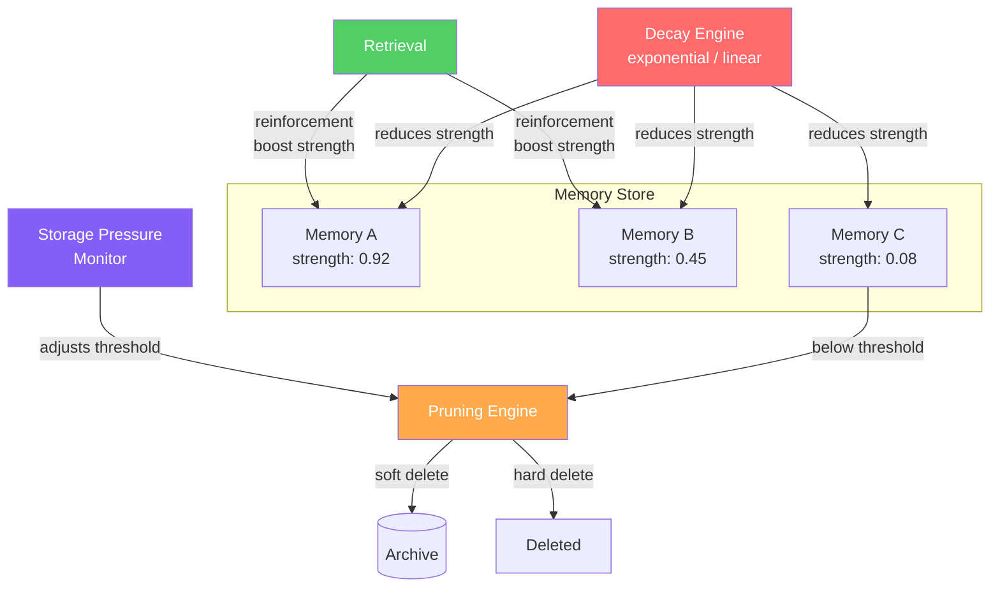

# 遗忘与衰减（Forgetting & Decay）

  

## 📖 速览

| 难度 | 时长 | 前置要求 |
|------------|------|---------------|
| 中级 | 约 35 分钟 | Python 3.8+、`LLM_API_KEY`，建议先了解 06 向量库记忆 |

这项技术面向想让智能体随时间自然遗忘低价值信息的开发者。它模拟人类的记忆衰减。

## TL;DR

- **它是什么：** **遗忘与衰减**用指数衰减随时间降低记忆的重要性，在访问时强化记忆，并修剪低于阈值的记忆。
- **何时需要：** 你的记忆存储无限增长，你需要一种自动清理机制，让频繁访问的记忆存活下来。
- **权衡：** 所有记忆都按年龄同等衰减。如果没有保护机制，过敏史或法律约束这类关键事实也可能被修剪。
- **本仓库中最接近的替代：** 18 时序记忆在检索时按时间打分，但不从存储中删除记忆。

## 概述

想想你的厨房储物间。如果什么都不扔，它会被过期食品塞满，找需要的东西越来越难。最后，你花在翻找上的时间比做饭还多。遗忘与衰减（Forgetting and Decay）就是把这种受控清理应用到 LLM 智能体记忆上的技术。它用数学衰减函数（如 Ebbinghaus 1885 年研究中的指数遗忘曲线）随时间降低记忆的重要性分数。经常被访问的记忆通过间隔重复（以越来越长的间隔复习）得到强化。跌破阈值的记忆会被修剪。对长期运行的聊天机器人、客服智能体和其他成本敏感系统来说，这能让检索质量保持在高水平。

主动遗忘看似违背直觉，但记忆无限累积会带来三个真实问题：检索质量退化、成本增长、噪声淹没相关信息。

目标不是丢失有价值的信息，而是让记忆存储保持高信噪比。智能体记住的应该都是真正有用的东西。神经科学现在把生物遗忘视为记忆的适应性特征，而不是缺陷。本技术把同样的原则带进 AI 系统。

**关键词：** agent memory, LLM agent, forgetting curve, exponential decay, spaced repetition, memory pruning, storage pressure, memory lifecycle, access-based reinforcement

## 关键概念

- **Ebbinghaus 遗忘曲线**：实验观察到的规律：没有强化时，记忆保持量随时间按指数衰减。它是衰减函数的数学基础。
- **指数衰减**：一种衰减函数，记忆强度按 `S(t) = S_0 * e^(-lambda * t)` 下降。衰减率 lambda 可配置，lambda 越大遗忘越快。
- **间隔重复**：以递增的间隔强化记忆，减慢衰减。借自学习科学（Leitner 系统、SM-2 算法）。
- **基于访问的打分**：记忆每被检索一次，保持分数就提升一次。这保证经常有用的记忆活得更久。
- **修剪阈值**：最低分数线，低于它的记忆成为删除或归档（移入长期冷存储）的候选。
- **记忆生命周期**：一条记忆的完整旅程：创建、活跃使用、衰减，最终修剪或归档。
- **存储压力管理**：当记忆存储逼近容量上限时，触发更激进的遗忘。

## 架构

  

Mermaid source

---

## 工作原理

1. 每条记忆根据预估重要性获得一个初始强度分数。
2. 衰减函数随距上次访问的时间不断降低强度分数。
3. 记忆被检索时，强度得到提升（强化）。这会重置或减缓衰减。
4. 后台进程定期找出分数低于修剪阈值的记忆。
5. 低于阈值的记忆按策略软删除（移入归档存储）或硬删除。
6. 存储压力可以动态调整修剪阈值，在需要时触发更激进的遗忘。

## 何时使用

- 长期运行的智能体累积了数千条记忆，检索质量开始退化。
- 成本敏感的系统，存储和嵌入成本随记忆量增长。
- 信息更替频繁的环境，旧数据经常迅速失效。

## 局限

- 关键信息（用户过敏、法律要求、安全规则）如果不设豁免，也会衰减并被修剪。衰减函数对所有记忆按年龄一视同仁。
- 访问稀少但重要的记忆（年度合规流程、一年一次的事件）会在下次使用前很久就衰减。访问频率不总等于重要性。
- 半衰期、强化增益和修剪阈值以不明显的方式相互作用。每个用例都要迭代调参。
- 信息过时后，旧版本和新的更正在记忆中并存。仅靠衰减无法解决版本冲突。过时条目要等自然衰减才会消失。
- 分布式系统的时钟偏差会导致意外的遗忘。所有衰减计算都依赖「当前时间」和「最后访问时间」之差。

## Notebook

[完整 notebook](./forgetting_and_decay.ipynb) 带你走完整个实现。你会构建：

- 一个 `DecayableMemory` 数据类，跟踪强度、访问次数和时间戳。
- 一个 `DecayEngine`，用可配置的半衰期应用指数衰减，并在检索时强化记忆。
- 一个 `ForgettingMemoryStore`，把基于嵌入的搜索与强度加权排序、自动修剪和存储压力管理结合起来。
- 一个端到端的智能体演示，展示记忆如何在模拟时间中淡出并被修剪。

notebook 使用 OpenAI SDK 做嵌入和聊天补全。

## FAQ

### 问：智能体记忆中的遗忘与衰减是什么？

**答：** 遗忘与衰减用指数衰减随时间降低记忆的重要性分数，并永久修剪跌破阈值的记忆。被访问或强化的记忆分数会提升，有用的记忆得以存活。这模仿了认知科学中的 Ebbinghaus 遗忘曲线。净效果是一个自清洁的记忆存储：常用记忆留存，被忽视的记忆消失。典型实现按领域使用 1 到 30 天的衰减半衰期。

### 问：什么时候用遗忘与衰减，而不是时序记忆？

**答：** 当你需要通过永久删除陈旧记忆来控制存储规模和成本时，用遗忘与衰减。时序记忆（技术 18）保留全部记忆，只在检索时降低旧记忆的排名。如果你的智能体运行数月、累积了数万条记忆，衰减加修剪能防止存储无限增长。如果出于合规或审计必须保留全部数据，但仍偏好新结果，就只用时序记忆。

### 问：遗忘与衰减有哪些局限或失败模式？

**答：** 被修剪的记忆永久消失，除非你另建归档。阈值或半衰期设置不当，会删掉重要但很少访问的记忆。一条只说过一次、再没被访问过的用户偏好会衰减并消失。衰减函数对领域敏感：7 天半衰期适合新闻，不适合病史。访问即强化会形成反馈循环：热门记忆越来越强，同样有效的备选记忆却被饿死。

### 问：遗忘与衰减可以和其他记忆技术组合吗？

**答：** 可以。与技术 14（记忆巩固）搭配，让巩固在修剪之前运行。这样，相关记忆先合并成更强的条目，弱的单条记忆再被修剪。与技术 10（语义记忆）组合，用「置顶」标志保护特定类别的事实（如用户身份或合规数据）不被衰减。再加上技术 13（分层记忆），把衰减中的记忆降级到冷存储而不是删除。

### 问：有什么库或框架可以省去自己实现？

**答：** Zep（技术 27）在其托管记忆服务中实现了基于时间的衰减和重要性打分。Mem0（技术 25）通过自动相关性打分支持记忆生命周期管理。没有主流框架提供独立的衰减加修剪类。自己实现的话，给记忆存储加上 `importance` 字段和 `last_accessed` 时间戳，再跑一个定期任务：应用衰减公式、删除低于阈值的条目。大约需要 30-50 行 Python。

## 参考文献

- Ebbinghaus, H. (1885). *Memory: A Contribution to Experimental Psychology*. (Translated by Ruger & Bussenius, 1913).
- Zhong, W., et al. (2024). "MemoryBank: Enhancing Large Language Models with Long-Term Memory." arXiv:2305.10250.
- Richards, B. A., & Frankland, P. W. (2017). "The Persistence and Transience of Memory." *Neuron*, 94(6), 1071-1084.
- Wozniak, P. A., & Gorzelanczyk, E. J. (1994). "Optimization of Repetition Spacing in the Practice of Learning." *Acta Neurobiologiae Experimentalis*, 54, 59-62.

## 相关技术

- [**18 时序记忆**](../18_temporal_memory/) - 时间感知的姊妹技术。时序记忆按新近度打分，遗忘与衰减按年龄修剪。
- [**14 记忆巩固**](../14_memory_consolidation/) - 另一种记忆生命周期技术。它合并和去重，而不是删除。
- [**15 记忆压缩**](../15_memory_compaction/) - 压缩记忆以节省空间。修剪的互补手段：先压缩，再删除。
- [**30 生产级记忆模式**](../30_production_memory_patterns/) - 衰减策略是生产部署的必备项。该技术展示如何把它落地。

---

