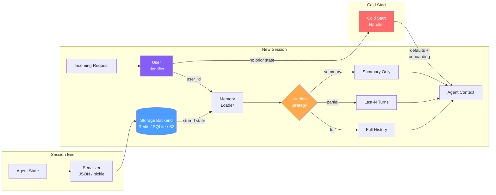

# 跨会话记忆（Cross-Session Memory）

  

## 📖 速览

| 难度 | 时长 | 前置要求 |
|------------|------|---------------|
| 中级 | 约 35 分钟 | Python 3.8+、`LLM_API_KEY`，建议先了解 06 向量库记忆 |

本技术面向这样的开发者：你在构建能跨会话记住用户的智能体，让连续性维持数天甚至数周。

## TL;DR

- **它是什么：** **跨会话记忆**用序列化和一个按用户 ID 索引的存储后端，在独立会话之间持久化智能体状态。
- **何时需要：** 你的智能体要记住的用户，两次对话可能相隔几小时、几天甚至几周。
- **代价：** 增加序列化逻辑和存储成本，还需要一个用户识别层，能区分回访用户和新用户。
- **本仓库中最接近的替代：** 22 多智能体共享记忆也持久化状态，但它协调的是多个智能体，而不是单个智能体跨会话。

## 简介

想象一个同事，一夜之后忘掉所有对话。每天早上，你都得重新解释你的项目、你的偏好、昨天的决定。没有跨会话记忆的 LLM 智能体就是这个感觉。这项智能体记忆技术解决这个问题：把状态（对话历史、学到的事实、偏好）在独立会话之间持久化。智能体把记忆序列化到持久存储（数据库或文件），等你回来时再加载对应的部分。对长期运行的聊天机器人、个人助理，以及任何需要会话持久化和跨访问用户识别的智能体，这都是必备能力。

**关键词：** 智能体记忆、LLM 智能体、跨会话记忆、会话持久化、状态序列化、对话历史、用户识别、记忆加载策略、冷启动处理、个人助理

跨会话记忆让 AI 智能体在独立会话之间保留内部状态。「会话」指一段从头到尾的对话。「状态」包括对话历史、用户偏好、学到的事实和任务进展。没有这项技术，每个会话都从零开始。

这项技术覆盖会话状态的完整生命周期。会话结束时，智能体序列化自己的状态。「序列化」指把内存中的数据转换成可以存到磁盘的格式，比如 JSON。序列化后的状态进入持久存储（文件、数据库或云对象存储）。用户回来时，系统识别出他，并加载对应的记忆部分。它还处理冷启动场景，也就是没有任何历史记忆的情况。当存储的历史变大时，它还提供选择加载哪些记忆的策略。

## Notebook 内容

[notebook](./cross_session_memory.ipynb) 用 deepagents 和任意 OpenAI 兼容端点从零构建一个完整的跨会话记忆系统：

1. **SessionState** 数据类，承载可序列化的智能体状态（事实、摘要、消息、偏好）。
2. **SQLiteBackend**，在会话之间持久化状态。
3. **基于 LLM 的抽取**：会话结束时用 `gpt-4o-mini` 抽取用户事实，并把对话压缩成摘要。
4. **CrossSessionManager**，管理完整的会话生命周期：恢复、冷启动，以及三种加载策略（完整、最近 N 条、仅摘要）。
5. **CrossSessionAgent**，把持久化记忆接入对话循环。
6. **多会话演示**：会话 1（冷启动）、会话 2（智能体记得），以及一个新用户的冷启动。

## 关键概念

- **会话序列化（session serialization）**：把智能体的内存状态（消息、元数据、抽取的事实）转换成可以存盘的便携格式。JSON 人类可读。Pickle 处理复杂的 Python 对象。Protobuf（Protocol Buffers）提供紧凑的二进制编码，并支持模式随时间演进。
- **状态持久化后端（persistence backend）**：序列化状态在会话之间的存放位置。可选本地文件、关系数据库（PostgreSQL、SQLite）、键值存储（Redis），或云存储（S3、GCS）。选择取决于速度、可靠性和规模需求。
- **会话恢复（session resumption）**：系统通过用户 ID、API key 或会话 token 识别回访用户，然后在新会话的第一个轮次之前加载正确的记忆快照。
- **用户识别（user identification）**：把每个进来的请求映射到一个持久的用户身份。这保证智能体检索到正确的记忆，不会混淆用户。
- **记忆加载策略（loading strategy）**：决定重新加载多少历史状态。可选完整历史、最近 N 个轮次、仅摘要，或按相关性排序的检索（找出与当前问题最相关的记忆）。这些策略帮你留在上下文限制之内。
- **冷启动处理（cold start）**：当没有任何历史会话时，初始化智能体状态。包括默认人设设置和初始偏好问题。

## 架构

  

Mermaid 源码

---

## 工作原理

1. 会话结束时，智能体用 LLM 抽取关键事实并生成对话摘要。
2. 一个 `SessionState` 对象把这些事实、摘要、用户偏好和最近的消息打包在一起。
3. 序列化器把状态转成 JSON，写入存储后端（SQLite、Redis 或 S3）。
4. 用户回来时，系统按用户 ID 识别他，并加载其存储的状态。
5. 加载策略（完整历史、最近 N 个轮次或仅摘要）裁剪状态，让它适配上下文窗口。
6. 如果没有历史状态，冷启动处理器创建默认状态并开始引导。

## 何时使用

- 你在构建一个个人助理，用户会在几天或几周后回访。
- 你的智能体管理跨多个会话的长周期任务（比如持续多天的研究）。
- 用户每次开始新对话都要重复交代背景。
- 你需要随时间累积的按用户个性化（偏好、项目、目标）。

## 局限

- 存储的事实会陈旧。用户的职位、城市或项目可能变化，但旧记忆会一直留着，除非你加过期逻辑。
- 跨会话存储个人数据带来隐私问题（GDPR、CCPA）。你需要明确的保留和删除策略。
- 即便有加载策略，多个会话累积的状态也可能超出 LLM 的上下文窗口。
- 存储成本随用户量线性增长。百万级用户需要合适的数据库基础设施和备份方案。

## FAQ

### 问：智能体记忆中的跨会话记忆是什么？

**答：** 跨会话记忆在独立会话之间持久化智能体状态，让智能体在数天、数周甚至数月之后还记得用户。它把对话历史、抽取的事实和用户偏好序列化到按用户或会话 ID 索引的存储后端（数据库、文件系统或云服务）。新会话开始时，智能体加载相关状态，带着完整上下文继续。这是任何要维护长期用户关系的智能体的基础。

### 问：什么时候用跨会话记忆，而不是多智能体共享记忆？

**答：** 当单个智能体一次服务一个用户、且需要跨会话保持连续性时，用跨会话记忆。多智能体共享记忆（技术 22）协调多个智能体并发读写同一个记忆库。如果你的架构是每个用户一个智能体、智能体之间不通信，跨会话持久化就足够了。只有当多个智能体必须协作完成任务，或共享同一批实体的事实时，才加共享记忆。

### 问：跨会话记忆有哪些限制或失败模式？

**答：** 除非你应用遗忘与衰减（技术 19）或记忆巩固（技术 14），记忆库会随每个会话增长。序列化格式锁定会让迁移很痛苦。如果存储后端慢（高延迟数据库），会话启动会太慢。陈旧数据是风险：几个月前存的事实可能已不再成立。你还需要可靠的用户 ID 方案。密钥管理不当的话，一个用户的记忆可能泄漏进另一个用户的会话。

### 问：跨会话记忆能和其他记忆技术组合吗？

**答：** 能。跨会话持久化是一个存储层，可以包住其他记忆技术。搭配技术 10（语义记忆），把抽取的事实跨会话保存。加技术 14（记忆巩固），在会话之间清理和合并事实。用技术 19（遗忘与衰减），在每次加载会话时修剪陈旧条目。这样得到一个自我维护的长期记忆系统，保持新鲜，也不会无限增长。

### 问：有什么库或框架能省掉自己实现的工作？

**答：** Mem0（技术 25）开箱即提供跨会话持久化，带自动的按用户记忆管理。Zep（技术 27）在服务端持久化会话和事实数据，内置用户隔离。Letta/MemGPT（技术 26）把整个智能体状态（核心记忆、召回记忆和归档记忆）跨会话序列化。LangChain 通过 `RedisChatMessageHistory`、`PostgresChatMessageHistory` 和类似后端支持持久化。这四个选项都替你处理序列化和键管理。

## 参考资料

- Packer et al. (2023). "MemGPT: Towards LLMs as Operating Systems."
  [https://arxiv.org/abs/2310.08560](https://arxiv.org/abs/2310.08560)
- LangChain Memory 文档：
  [https://python.langchain.com/docs/modules/memory/](https://python.langchain.com/docs/modules/memory/?utm_source=nirdiamant&utm_medium=github&utm_campaign=agent_memory_techniques)
- Letta (MemGPT) 持久化模型：
  [https://docs.letta.com](https://docs.letta.com?utm_source=nirdiamant&utm_medium=github&utm_campaign=agent_memory_techniques)
- 用于本地智能体状态的 SQLite：
  [https://www.sqlite.org/whentouse.html](https://www.sqlite.org/whentouse.html?utm_source=nirdiamant&utm_medium=github&utm_campaign=agent_memory_techniques)
- Redis 持久化文档：
  [https://redis.io/docs/latest/operate/oss_and_stack/management/persistence/](https://redis.io/docs/latest/operate/oss_and_stack/management/persistence/)

## 相关技术

- [**14 记忆巩固**](../14_memory_consolidation/) - 随时间压缩和合并记忆，与跨会话持久化天然搭配。
- [**20 记忆检索模式**](../20_memory_retrieval_patterns/) - 介绍存储历史变大时选择加载哪些记忆的策略。
- [**26 Letta (MemGPT) 模式**](../26_letta_memgpt_patterns/) - 一个把跨会话持久化作为核心功能的框架，带分层记忆管理。
- [**01 对话缓冲记忆**](../01_conversation_buffer_memory/) - 最简单的会话内记忆。理解它有助于看清跨会话记忆在上面加了什么。

---

