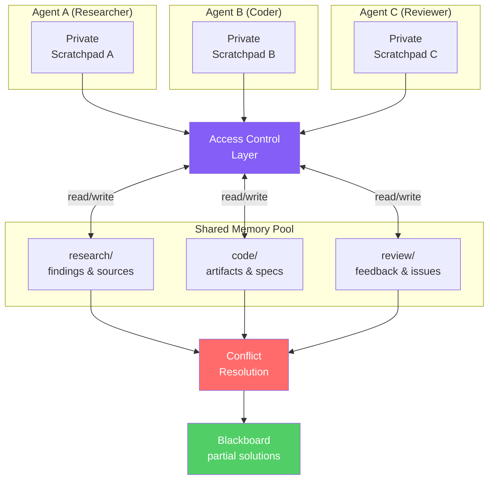

# 多智能体共享记忆（Multi-Agent Shared Memory）

  

## 📖 速览

| 难度 | 耗时 | 前置要求 |
|------------|------|---------------|
| 中级 | 约 40 分钟 | Python 3.8+、`LLM_API_KEY`，建议先了解技术 21 跨会话记忆 |

本技术面向需要协调多个智能体的开发者：这些智能体要在合适的访问控制下读写同一块共享记忆空间。

## TL;DR

- **它是什么：** **多智能体共享记忆**为多个协作智能体提供一个共享记忆空间，带命名空间划分和冲突解决。
- **何时需要：** 你在运行多智能体流程，各智能体需要读取彼此的发现，避免重复劳动。
- **代价：** 需要访问控制、命名空间管理和冲突解决逻辑，而单智能体系统完全用不到这些。
- **本仓库中最接近的替代：** 技术 21 跨会话记忆处理单个智能体的持久化，不涉及多智能体协调。

## 描述

想象厨房里的一组厨师。每位厨师都有自己的砧板（私人工作区），但大家共用台面上的一本食谱。多智能体共享记忆对 LLM 智能体来说就是同样的东西。这项智能体记忆技术给多个协作智能体一个共享记忆存储，他们可以在其中读写发现、决策和部分结果。它用命名空间划分（namespace scoping，即 `research/` 或 `code/` 这类逻辑分区）和冲突解决规则来保持数据井然有序。这个方法建立在分布式 AI 的经典黑板架构之上。多智能体流程、协作编程工作流，以及任何需要智能体通过共享状态来协调的系统，都会用到它。

**关键词：** 智能体记忆、LLM 智能体、多智能体共享记忆、黑板架构、共享记忆存储、命名空间划分、冲突解决、多智能体协作、分布式 AI、协作智能体

当多个 AI 智能体协作完成一个任务时，他们需要一个共享记忆层。想一个研究员智能体、一个程序员智能体和一个审查员智能体一起工作：研究员的发现要传达给程序员，程序员的产出要传达给审查员。共享记忆让这种交换成为可能。

本技术覆盖让智能体共享信息的数据结构、访问模式和一致性规则。它包括所有智能体都能读写的共享键值存储；讲解如何用划分规则把智能体的私人记忆和集体记忆分开；还处理冲突解决：两个智能体同时更新同一事实时会发生什么。这个方法建立在分布式 AI 的经典黑板架构上。「黑板」是一个共享工作区，智能体把部分结果张贴上去，供其他智能体完善。

## 核心概念

- **共享记忆存储（shared memory store）**：一个集中式数据存储（Redis、数据库或内存字典），多个智能体在协作任务中读写它。
- **访问控制（access control）**：决定哪些智能体可以读写每个命名空间的规则，防止未授权修改。
- **命名空间（namespace）**：共享记忆中的逻辑分区（例如 `research/`、`code/`、`review/`）。它们按领域组织信息，减少写冲突。
- **私人草稿本（private scratchpad）**：智能体的内部笔记，其他智能体看不见。只有完成的结果才进入共享记忆。
- **黑板系统（blackboard system）**：一种经典 AI 架构，智能体把部分解张贴到共享工作区，其他智能体读取、完善或扩展这些解。
- **冲突解决（conflict resolution）**：处理并发更新的策略，包括后写胜出（last-write-wins）和乐观锁（带版本检查的写入，冲突时失败）。

## 架构

  

Mermaid source

---

## 工作原理

1. 每个智能体有一个私人草稿本，存放其他智能体看不到的内部笔记。
2. 访问控制层按智能体、按命名空间授予读或写权限（比如 `research/` 或 `code/`）。
3. 智能体完成子任务后，把结果写入共享记忆池中自己的命名空间。
4. 其他智能体从记忆池读取，获得自己子任务所需的上下文。
5. 冲突解决策略（后写胜出或版本检查）处理对同一个键的并发写入。
6. 黑板视图聚合所有共享条目，任何智能体（或人）都能看到全貌。

## 何时使用

- 你的多智能体流程中每个智能体角色分明（研究员、程序员、审查员）。
- 智能体需要互相传递结构化结果，而不想直接对话。
- 你想要一条审计线索，记录哪个智能体在何时写了什么。
- 你的工作流需要迭代完善，一个智能体的输出是另一个的输入。

## 局限

- 很多智能体高频写入相同的键时，线程锁会变成瓶颈。
- 共享记忆变大后，每个智能体每轮读取更多上下文，token 成本上升。
- 权限模型只运行在应用代码里。一个 bug 就可能把私人草稿本数据泄漏进共享记忆。
- 对需要实时来回交互的紧耦合智能体，直接消息传递比共享记忆更快。

## 配套 Notebook

[配套 notebook](./multi_agent_shared_memory.ipynb) 带你用 deepagents 和任意 OpenAI 兼容端点从零构建一个完整的共享记忆系统。你会创建三个智能体（研究员、程序员、审查员），通过带命名空间的共享记忆协作完成一个编程任务。notebook 包含：

- `Permission`、`MemoryEntry` 和 `AccessControl` 数据类型。
- 线程安全的 `SharedMemoryPool`，带后写胜出和版本检查两种冲突解决。
- `Agent` 类，带私人草稿本和共享记忆访问。
- `Blackboard` 类，聚合所有共享条目。
- 一个端到端示例，演示权限强制执行和冲突解决。

## FAQ

### 问：智能体记忆中的多智能体共享记忆是什么？

**答：** 多智能体共享记忆给多个协作智能体一块公共记忆空间，他们可以在其中读写共享知识。每个智能体贡献自己的发现并从记忆池读取，无需直接消息传递就能协调。系统处理命名空间划分（智能体因此可以同时拥有私人和共享记忆区域）和冲突解决（两个智能体更新同一事实时）。对研究团队或流水线式智能体这类多智能体架构，这是必备能力。

### 问：什么时候用多智能体共享记忆，而不是跨会话记忆？

**答：** 当两个或更多智能体处理同一个任务、或共享同一个领域的知识时，用多智能体共享记忆。跨会话记忆（技术 21）处理单个智能体跨时间持久化自己的状态。共享记忆处理多个智能体的实时协调。如果研究智能体和写作智能体需要共享发现，或者专职子智能体分工处理一个复杂任务，共享记忆能避免重复劳动并保证一致性。

### 问：多智能体共享记忆有哪些限制或失效模式？

**答：** 并发写入会产生竞态条件。两个智能体可能同时更新同一事实，没有冲突解决时，一个更新会覆盖另一个。命名空间设计需要仔细规划：共享区域太多会产生噪声，太少会形成孤岛。很多智能体同时查询存储时，读取争用会增加延迟。共享记忆还是单点故障：它一挂，所有智能体都失去集体知识。

### 问：可以把多智能体共享记忆和其他记忆技术组合吗？

**答：** 可以。搭配技术 17（记忆路由），把每个智能体的贡献分类并路由到正确的共享存储（事实进语义记忆，经历进情景记忆）。加上技术 14（记忆巩固），定期清理共享池中的重复项。还可以把技术 22 和技术 07（实体记忆）结合，让智能体共建一个实体知识库，每个智能体贡献不同实体的事实。

### 问：有什么库或框架可以省去自己实现？

**答：** LangGraph 支持带共享状态对象的多智能体工作流。CrewAI 为智能体团队提供共享记忆。AutoGen 支持可对话智能体之间的共享上下文。想要更底层的实现，可以用 Redis 或共享数据库作记忆后端，在其上构建命名空间划分。Zep（技术 27）可以作为多智能体系统的共享记忆后端。Letta/MemGPT（技术 26）支持同一组织内智能体之间的共享归档记忆。

## 参考资料

- Nii, H. P. (1986). ["Blackboard Systems."](https://doi.org/10.1609/aimag.v7i2.537) *AI Magazine*, 7(2), 38-53。
- [LangGraph 多智能体模式](https://langchain-ai.github.io/langgraph/?utm_source=nirdiamant&utm_medium=github&utm_campaign=agent_memory_techniques)
- [CrewAI 共享记忆](https://docs.crewai.com/concepts/memory?utm_source=nirdiamant&utm_medium=github&utm_campaign=agent_memory_techniques)
- [AutoGen 多智能体对话](https://microsoft.github.io/autogen/?utm_source=nirdiamant&utm_medium=github&utm_campaign=agent_memory_techniques)
- [Redis 作为共享状态后端](https://redis.io/docs/?utm_source=nirdiamant&utm_medium=github&utm_campaign=agent_memory_techniques)

## 相关技术

- [**21 跨会话记忆**](../21_cross_session_memory/) - 跨会话持久化单个智能体的状态。共享记忆把这个想法扩展到多个智能体。
- [**12 工作记忆与上下文窗口**](../12_working_memory_context_window/) - 讲解每个智能体如何管理自己的上下文窗口，它是共享记忆的私人对应物。
- [**24 图记忆（Graphiti）**](../24_graph_memory_graphiti/) - 基于图的存储，当智能体需要关系推理时，可以用它作共享后端。
- [**30 生产级记忆模式**](../30_production_memory_patterns/) - 覆盖并发、一致性等部署问题，多个智能体写同一个存储时这些问题很关键。

---

