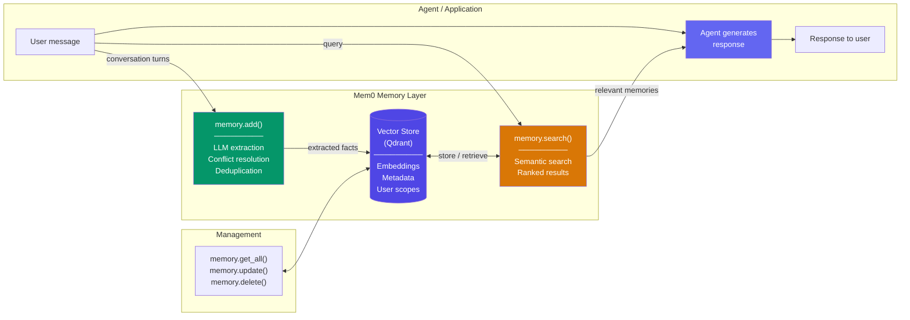

# Mem0 集成模式

  

## 📖 速览

| 难度 | 时长 | 前置要求 |
|------------|------|---------------|
| 进阶 | 约 50 分钟 | Python 3.8+、`LLM_API_KEY`、`mem0ai` 包；建议先了解技术 06「向量库记忆」 |

本技术面向想用 mem0 SDK 获得托管记忆层的开发者：自动抽取、存储和检索用户知识。

## TL;DR

- **它是什么：** **Mem0 集成模式**提供一层托管记忆，自动从对话中抽取事实，并按用户 ID 检索。
- **什么时候需要：** 你想用最少的搭建拿到生产可用的记忆，且能接受第三方依赖。
- **代价是什么：** 供应商锁定（vendor lock-in）到 Mem0 服务；用抽取逻辑的控制权，换取搭建成本的下降。
- **本仓库中最接近的替代：** 技术 23「工具化记忆」让智能体显式做增删改查，而不是自动抽取。

## 简介

想象一位私人助理，每次开会都做笔记。每场谈话结束后，他会记下关于你的关键事实：你的偏好、你的日程、你的人脉。下一次会面前，他会先翻一遍笔记，以便更好地帮到你。Mem0 集成模式教你把 Mem0 用作 LLM 智能体的托管记忆层。Mem0 自动从对话中抽取事实，存入向量库（vector store，一种按语义相似度查找条目的数据库），并按用户 ID 检索相关记忆。个性化聊天机器人、客服智能体，以及任何需要给每个用户一份持久记忆画像的应用，都很适合它。

**关键词：** 智能体记忆（agent memory）、LLM 智能体、Mem0、自动记忆抽取、向量库、按用户隔离的记忆、语义搜索、记忆 API、个性化、自我改进的记忆

Mem0 为 AI 智能体提供托管记忆层。它自动从对话中抽取、存储和检索用户专属的记忆。「抽取流程」（extraction pipeline）指从原始文本中提炼结构化事实的一系列步骤。「向量库」是一种按含义而非精确关键词查找相似条目的数据库。这两件事 Mem0 都替你做了。

你不必自建抽取流程和向量库，直接用 Mem0 的 API。调用 `add()` 从对话文本存入记忆；调用 `search()` 按查询找相关记忆；调用 `get_all()` 取回某用户的完整记忆画像。所有操作都按用户 ID 划分范围，每个人得到专属的个性化体验。

本技术覆盖实用的集成方式。你将学会初始化 Mem0 客户端，在每轮对话后添加记忆，并在生成回复前搜索相关上下文。还会学到按类型（偏好、事实、指令）给记忆分类，以及把 Mem0 与 LangChain 等编排框架结合。Mem0 的自我改进记忆会随时间打磨已存内容：解决矛盾、合并相关事实。

## 核心概念

- **Mem0 API**：用于添加、搜索、检索和删除记忆的 REST 与 Python SDK（软件开发工具包）接口。可用托管服务，也可自托管。
- **记忆的 add/search/get**：三个主要操作。`add()` 从文本中抽取并存储记忆；`search()` 按语义查询找相关记忆；`get_all()` 取回某用户的全部记忆。
- **按用户隔离的记忆**：按用户 ID 划分记忆，每个用户有独立的记忆库。这样既能个性化，又不会在用户之间串数据。
- **自动抽取**：Mem0 内置的 LLM 流程，从原始对话文本中识别值得记住的事实、偏好和指令。无需人工标注或自定义抽取逻辑。
- **记忆类别**：按类型组织记忆（个人偏好、事实知识、行为指令）。便于过滤检索，也便于按优先级装入上下文窗口。
- **Mem0 与 LangChain**：把 Mem0 作为记忆后端接进 LangChain 的链和智能体，替代或增强 LangChain 内置的记忆类，获得更丰富的记忆管理。
- **自我改进的记忆**：Mem0 会随时间自动更新、合并和去重记忆。新信息到来或出现矛盾时，记忆库会自行打磨。

## 架构

  

Mermaid 源码

---

## 工作原理

1. 用一份配置初始化 Mem0 客户端，指定 LLM、嵌入模型和向量库（默认 Qdrant）。
2. 每轮对话结束后，带着消息和 `user_id` 调用 `memory.add()`。
3. Mem0 的 LLM 流程抽取事实，检测与已有记忆的矛盾，去重后存入。
4. 生成回复之前，用用户的查询调用 `memory.search()`，检索相关记忆。
5. 智能体把检索到的记忆放进 system 提示词，再调用 LLM 生成个性化回复。
6. 所有记忆都按 `user_id` 划分范围。每个用户有隔离的记忆画像，互不串数据。

## 何时使用

- 你想快速得到一层可用的记忆，不想自建抽取流程或管理向量数据库。
- 你的应用服务多个用户，每个人都需要个性化、持久的记忆。
- 你在给聊天机器人做原型，需要从对话中自动抽取事实。
- 你想要内置的冲突解决（conflict resolution），比如用户搬了城市，旧记忆被更新，而不是多出一条重复记忆。

## 局限

- 你对 Mem0 抽取什么算「值得记」的控制有限。关键事实可能被漏掉，无关细节可能被存进来。
- 每次 `add()` 都触发一次 LLM 调用。高吞吐应用（每分钟超过 1000 条消息）成本可观。
- 记忆会永久保留，除非你手动删除。没有内置的 TTL（到期自动删除的规则）或衰减机制。
- 语义搜索适合模糊查询，但结构化过滤（比如「category = dietary 且创建于一月之后」）能力有限。

## Notebook

完整可运行的实现见 [**mem0_patterns.ipynb**](mem0_patterns.ipynb)。

notebook 演示了安装和配置 Mem0、从对话中添加记忆，以及语义搜索。它还覆盖自动冲突解决（比如用户搬了城市就更新所在地）。你还会看到显式的更新 / 删除操作，以及一个 `Mem0Agent` 类：每次回复前检索相关记忆，每轮结束后存入新事实。多用户隔离演示确认了记忆始终按 `user_id` 隔离。

## 常见问题

### 问：在智能体记忆里，Mem0 是什么？

**答：** Mem0 是一层托管记忆：自动从对话中抽取事实，存入按用户隔离的记忆库。你把对话消息交给 Mem0 的 API，它负责实体抽取、事实去重、矛盾检测和检索。记忆以用户 ID 为键，用很少的代码就能实现跨会话个性化。Mem0 既有云服务，也有开源自托管版本。它是最流行的记忆框架之一，主打简单易接、快速集成。

### 问：什么时候该用 Mem0 而不是工具化记忆？

**答：** 想要自动记忆管理、搭建成本最低时，用 Mem0。工具化记忆（技术 23）要求智能体显式决定存什么、搜什么，控制力更强，但需要仔细的提示词工程。Mem0 自动完成抽取和去重。快速原型、个人助理，以及你信任系统自行判断「什么值得记」的场景，选 Mem0。需要显式、可审计的控制时，选工具方案。

### 问：Mem0 有哪些限制或失效方式？

**答：** Mem0 的自动抽取可能漏掉隐含事实，也可能抽错。不做自定义配置的话，你对存什么控制有限。云服务会引入网络延迟（每次调用 50-200 毫秒）。自托管 Mem0 需要自己管理依赖（向量库、可选的图库）。对同义改写的事实，去重可能失效。它的记忆格式为事实抽取优化，处理程序性知识或复杂的多步骤经历就差一些。

### 问：能把 Mem0 和其他记忆技术结合吗？

**答：** 可以。把 Mem0 当作语义记忆层（技术 10），再单独加技术 09（情景记忆）保存完整的会话记录。也可以把 Mem0 与技术 04（摘要缓冲记忆）搭配：会话内上下文交给摘要缓冲，跨会话的事实持久化交给 Mem0。如果你需要超出 Mem0 内置实体存储的关系型图查询，还可以配合技术 24（Graphiti）。

### 问：有没有能省掉实现工作的库或框架？

**答：** Mem0 本身就是那个框架。开源版用 `pip install mem0ai` 安装，或使用 Mem0 Platform 云 API。它通过官方适配器集成 LangChain、LlamaIndex 和 CrewAI。想要类似的自动抽取，还有 Zep（技术 27），提供带图能力的托管记忆。Letta/MemGPT（技术 26）提供更有主见的分层记忆架构。如果 Mem0 的抽取不合你的需求，技术 23（工具化记忆）给你手动控制。

## 参考资料

- Mem0 文档：
  [https://docs.mem0.ai](https://docs.mem0.ai?utm_source=nirdiamant&utm_medium=github&utm_campaign=agent_memory_techniques)
- Mem0 GitHub 仓库：
  [https://github.com/mem0ai/mem0](https://github.com/mem0ai/mem0)
- Mem0 Python SDK：
  [https://pypi.org/project/mem0ai/](https://pypi.org/project/mem0ai/?utm_source=nirdiamant&utm_medium=github&utm_campaign=agent_memory_techniques)
- Mem0 + LangChain 集成：
  [https://docs.mem0.ai/integrations/langchain](https://docs.mem0.ai/integrations/langchain?utm_source=nirdiamant&utm_medium=github&utm_campaign=agent_memory_techniques)
- Mem0 平台：
  [https://app.mem0.ai](https://app.mem0.ai?utm_source=nirdiamant&utm_medium=github&utm_campaign=agent_memory_techniques)

## 相关技术

- [**06 向量库记忆**](../06_vector_store_memory/) - Mem0 所依赖的底层存储模式。想理解语义搜索的底层原理，可以读它。
- [**23 工具化记忆**](../23_memory_with_tools/) - 自己动手实现 Mem0 自动化的那套存 / 搜 / 改 / 删流程。
- [**24 用 Graphiti 做图记忆**](../24_graph_memory_graphiti/) - 需要跟踪实体之间的关系、而不只是扁平记忆记录时，可以选这条图路线。
- [**27 Zep 记忆**](../27_zep_memory/) - 另一个托管记忆平台。对比 Mem0 和 Zep 有助于为你的场景选对工具。

---

