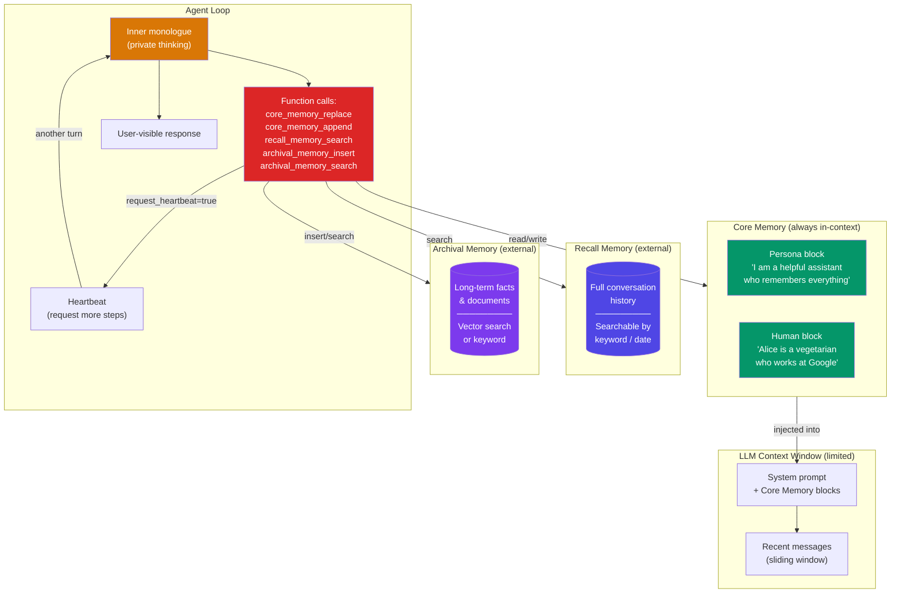

# Letta（MemGPT）模式

  

## 📖 速览

| 难度 | 耗时 | 前置要求 |
|------------|------|---------------|
| 高级 | 约 55 分钟 | Python 3.8+、`LLM_API_KEY`、建议先理解 12 工作记忆与上下文窗口 |

这项技术面向这样的开发者：你需要 MemGPT 风格的记忆管理，让智能体通过函数调用自己控制记忆的读写。

## TL;DR

- **是什么：** **Letta（MemGPT）模式**实现分层记忆（核心记忆、归档记忆、召回记忆），智能体通过函数调用自己管理记忆。
- **什么时候需要：** 你的智能体要处理成千上万轮对话，需要操作系统式的虚拟内存和自管理的换页。
- **代价：** 需要心跳机制和内心独白逻辑，给每一轮都增加了协调开销。
- **本仓库中最接近的替代：** 23 工具化记忆提供更简单的智能体驱动 CRUD，但没有分层记忆和换页模型。

## 描述

想想你电脑的内存（RAM）。它小而快，但装满时操作系统会把数据换出到硬盘，之后再取回来。Letta（前身是 MemGPT）模式把同样的想法用在 LLM 智能体记忆和上下文窗口管理上。上下文窗口（模型一次调用能看到的所有文本）就是智能体的「内存」。Letta 给智能体一套可自编辑的分层记忆系统。核心记忆留在提示词里，归档记忆放进向量数据库，召回记忆保存完整对话历史。这让 Letta 特别适合个人 AI 助理，以及要跨成千上万轮记住用户的长期运行聊天机器人。

Letta 用三层记忆解决这个问题。**核心记忆**始终留在上下文窗口内。**归档记忆**是可搜索的长期存储（像一块硬盘）。**召回记忆**保存完整对话历史。智能体主动管理什么留在上下文、什么被移进存储。

智能体用内心独白（一个用户看不到的私有推理步骤）决定记什么、忘什么、查什么。心跳机制让智能体在一轮里串联多条记忆操作，不用等用户输入。记忆压力信号告诉智能体上下文快满了，促使它总结或归档信息。

这项技术造出的智能体能与用户保持连贯的长期关系，跨越成千上万次交互。

**关键词：** 智能体记忆、Letta、MemGPT、分层记忆架构、自编辑记忆、上下文窗口管理、LLM 智能体、虚拟内存、个人 AI 助理、长期运行聊天机器人

## 关键概念

- **MemGPT 架构**：三层记忆系统（核心记忆、归档记忆、召回记忆），配有显式的记忆管理函数。智能体调用这些函数在层与层之间搬运信息。
- **核心记忆（persona + human 块）**：两个始终在上下文中的记忆块。一个描述智能体的角色设定。另一个保存当前用户的关键事实。智能体通过 `core_memory_replace` 和 `core_memory_append` 函数调用编辑这两个块。
- **归档记忆**：由向量数据库（按含义而非精确关键词查找相似内容的数据库）支撑的可搜索长期存储。智能体把放不进上下文窗口的信息插进去，之后再查询。
- **召回记忆**：存储在外部的完整对话历史。智能体可以搜索它，找回已滑出当前上下文的对话内容。
- **内心独白**：一个私有推理通道。智能体在回复用户之前，先思考自己知道什么、需要记住什么、要执行哪些记忆操作。
- **心跳机制**：一种控制流特性，让智能体请求额外的处理步骤。它把多个工具调用串联起来，不用等用户输入。
- **记忆压力**：表示上下文窗口接近容量的信号。它促使智能体总结、归档或丢弃低优先级信息。
- **自编辑记忆**：MemGPT 的标志性特性。随着对话演进，智能体自主重写自己的核心记忆块，让它们始终保持最新、准确、相关。

## 架构

  

Mermaid source

---

## 工作原理

1. 系统把智能体当前的核心记忆块和最近消息组装成提示词。
2. 智能体产生内心独白（用户永远看不到的私有推理），规划记忆操作。
3. 智能体调用记忆工具：编辑核心记忆、搜索召回或归档记忆，或插入新的归档条目。
4. 如果智能体设置 `request_heartbeat=true`，循环从第 2 步重复，不等用户输入。
5. 准备就绪后，智能体调用 `send_message` 向用户发出可见回复。
6. 系统检查记忆压力（上下文窗口的占用程度），必要时提示智能体归档或总结。

## 何时使用

- 你在构建个人助理，需要跨数百甚至数千个会话记住用户的事实。
- 用户情况变化时（新工作、新城市、新偏好），智能体需要更新自己的知识。
- 你想完整看到智能体的推理来调试，因为内心独白暴露每一次记忆决策。
- 对话长度超过上下文窗口，智能体不能悄悄丢掉较早的信息。

## 局限

- token 开销高。记忆工具、系统提示词和核心记忆块在对话开始前就占掉上下文窗口的一大部分。
- 智能体必须正确决定何时以及如何使用记忆工具。LLM 有时会忘记更新核心记忆、替换出错，或者把不重要的细节过度归档。
- 每次心跳都是一次额外的 LLM 调用。多步记忆操作给每轮增加延迟和成本。
- 新智能体的核心记忆很少。要积累出有用的上下文需要好几轮（冷启动问题）。
- 从零实现用关键词搜索，会漏掉语义匹配。生产使用需要向量检索才能可靠地找回信息。

## Notebook

[**letta_memgpt_patterns.ipynb**](letta_memgpt_patterns.ipynb)：只用 deepagents 和任意 OpenAI 兼容端点从零构建一个最小的 MemGPT 风格智能体循环。它实现全部三层记忆（核心、召回、归档）、内心独白、心跳串联和记忆压力处理。你会看到智能体在用户事实变化时自编辑核心记忆，把详细信息归档以备后取，并管理上下文溢出。notebook 最后给出在生产环境使用 Letta SDK 的参考。

## 常见问题

### 问：智能体记忆中的 Letta（MemGPT）是什么？

**答：** Letta（前身是 MemGPT）实现分层记忆，智能体通过函数调用自己管理记忆。它定义三层：核心记忆（在上下文中，可由智能体编辑）、召回记忆（可搜索的对话历史）和归档记忆（长期向量存储）。智能体读写自己的核心记忆块，决定哪些事实留在有限的上下文窗口里。这种受操作系统启发的「虚拟内存」方法让智能体能处理超过任何上下文窗口长度的对话。

### 问：什么时候该用 Letta 而不是工具化记忆？

**答：** 当你想要一套完整、有明确主张、开箱即用的分层记忆架构时，用 Letta。工具化记忆（技术 23）给你一张白纸：工具和存储都由你定义。Letta 提供架构（核心记忆/召回记忆/归档记忆）、换页机制和智能体循环。如果它的三层模型符合你的用例，选 Letta 能开发得更快。如果你需要不符合 Letta 模型的自定义记忆架构，就选基于工具的方案。

### 问：Letta 有哪些局限或失败模式？

**答：** 核心记忆的 token 预算是固定的（通常 2,000-8,000 token）。如果智能体的编辑决策不佳，可能把重要事实从核心记忆中淘汰出去。智能体要靠提示词学会管理自己的记忆，在较弱的模型上这不太可靠。归档记忆检索会增加延迟。这个框架有学习曲线，而且比 LangChain 这类可组合库更强势。相比更简单的进程内记忆，运行 Letta 服务还增加了基础设施开销。

### 问：Letta 能和其他记忆技术组合吗？

**答：** 能。Letta 的归档记忆可以用技术 06（向量库记忆）或技术 24（Graphiti）做后端。把技术 14（记忆巩固）加成周期性任务，清理归档记忆。让智能体把反思写进核心记忆块，就能用上技术 16（自我反思记忆）。Letta 的架构可扩展：你可以添加自定义工具连接任何外部记忆系统，同时保留核心记忆/召回记忆/归档记忆的结构。

### 问：有什么库或框架能省掉自己实现的工作？

**答：** Letta 就是那个框架。用 `pip install letta` 安装并启动 Letta 服务。它提供 Python SDK 和 REST API。替代方案方面，Mem0（技术 25）提供更简单的自动记忆，架构复杂度更低。Zep（技术 27）提供带图能力的托管记忆。如果你只想要 Letta 的虚拟内存概念而不要整个框架，可以参考技术 23 的思路，在任何支持工具调用的 LLM 上用大约 100-200 行代码实现核心记忆编辑模式。

## 参考文献

- Packer, C., Wooders, S., Lin, K., Fang, V., Patil, S., Stoica, I., & Gonzalez, J. (2023).
  "MemGPT: Towards LLMs as Operating Systems." arXiv:2310.08560.
- Letta 文档：
  [https://docs.letta.com](https://docs.letta.com?utm_source=nirdiamant&utm_medium=github&utm_campaign=agent_memory_techniques)
- Letta GitHub 仓库：
  [https://github.com/letta-ai/letta](https://github.com/letta-ai/letta)
- Letta Python SDK：
  [https://pypi.org/project/letta/](https://pypi.org/project/letta/?utm_source=nirdiamant&utm_medium=github&utm_campaign=agent_memory_techniques)
- MemGPT 论文：
  [https://arxiv.org/abs/2310.08560](https://arxiv.org/abs/2310.08560)

## 相关技术

- [**12 工作记忆与上下文窗口**](../12_working_memory_context_window/) - Letta 的核心记忆块是工作记忆思路的直接实现。想了解背后的理论，从这里开始。
- [**25 Mem0 模式**](../25_mem0_patterns/) - 另一个记忆框架。对比 Mem0 的自动方式和 Letta 显式的自编辑风格。
- [**14 记忆巩固**](../14_memory_consolidation/) - Letta 从上下文到归档存储的流程是记忆巩固的一种形式。
- [**24 图记忆（Graphiti）**](../24_graph_memory_graphiti/) - Graphiti 专注基于图的长期记忆，Letta 用基于向量的归档存储。

---

