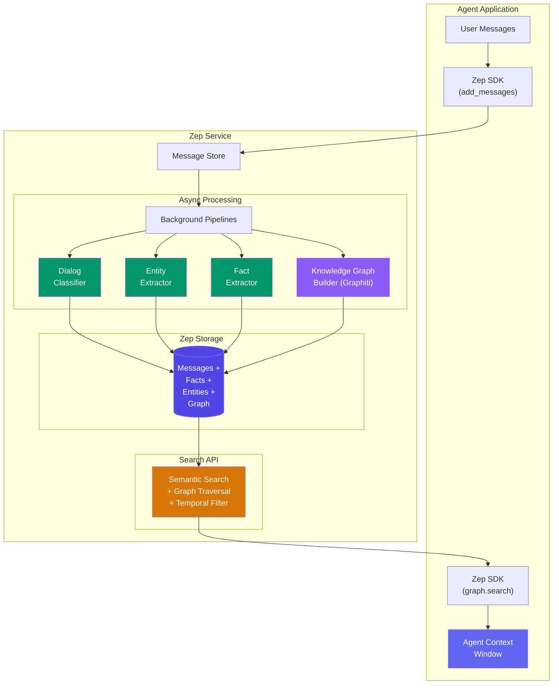

# Zep 记忆（Zep Memory）

  

## 📖 速览

| 难度 | 耗时 | 前置要求 |
|------------|------|---------------|
| 高级 | 约 50 分钟 | Python 3.8+、`ZEP_API_KEY`、`ANTHROPIC_API_KEY`、Zep Cloud 账号 |

这项技术面向这样的开发者：你需要一个生产可用的记忆服务，自带事实自动提取、时序追踪和按用户隔离的会话。

## TL;DR

- **是什么：** **Zep 记忆**是一项托管记忆服务，自动抽取实体和事实，构建时序知识图谱，并异步检索。
- **什么时候需要：** 你想要一个支持多模式检索的生产级记忆后端，但不想自己维护基础设施。
- **代价：** 需要 Zep Cloud 账号，自动抽取可能虚构出需要人工校验的事实。
- **本仓库中最接近的替代：** 24 Graphiti 图记忆提供类似的时序图能力，但要配合 Neo4j 自行部署。

## 描述

想象雇一位私人助理。他做笔记、按类别整理、找出提到的人、提取关键事实，再画出一切之间的关联。Zep 记忆为你的 AI 智能体的对话做的就是这件事。Zep 是一个生产级智能体记忆服务，远不止存储聊天记录。它运行后台流程（自动化处理过程）来抽取实体、提炼结构化事实，并构建一张记录关系随时间变化的时序知识图谱。客服智能体、研究助理，或任何需要跨会话记起用户细节的 LLM 智能体，都适合用它。

Zep 是面向 AI 助手的生产级记忆服务。它不只存储对话。当你把消息添加到 Zep，后台流程（每条消息之后自动运行的处理过程）随即启动。对话分类器给对话标注意图和主题。实体抽取器识别人物、组织和项目。事实提取器提炼结构化陈述，比如「用户偏好 Python 而非 JavaScript」。知识图谱构建器（由 Graphiti 驱动）带时间戳地记录实体之间的关系。

这一切都异步发生。你的智能体不必等抽取完成才回复。最终你得到一个支持三种检索模式的记忆层：对已提取事实的语义检索、对实体关系的图遍历，以及带对话分类标签的原始消息历史。

Zep 既有云托管服务，也有可自行部署的开源版本。

**关键词：** agent memory, Zep, temporal knowledge graph, entity extraction, fact extraction, LLM agent, Graphiti, memory service, customer support agent, session management

## 关键概念

- **Zep Cloud/OSS**：两种部署方式。托管的云服务自动处理扩缩容和维护。开源版本让你在自己的基础设施上完全掌控数据。
- **会话管理（session management）**：Zep 中的对话组织成会话。每个会话有 ID，并关联到一个用户。会话记录消息历史、元数据，以及抽取出的全部知识。
- **对话分类（dialog classification）**：Zep 对对话轮次的自动分析。它分类意图、主题、情感等属性，无需人工标注或自定义模型。
- **实体抽取（entity extraction）**：跨对话识别并追踪命名实体（人物、地点、组织、产品）。实体会被去重并跨会话关联，形成一份持久的登记表。
- **事实提取（fact extraction）**：从非结构化对话中提炼结构化的事实陈述（例如「用户的预算是 5 万美元」）。这些陈述以可查询、带时间戳的记录形式存储。
- **时序知识图谱（temporal knowledge graph）**：Zep 的图层（由 Graphiti 驱动）带时间元数据地记录实体之间的关系。「时序」指它追踪事物*在什么时候*为真。这让你能做时间感知的查询和变化追踪。
- **记忆搜索（memory search）**：用自然语言查询 Zep 的记忆。结果按语义相关性排序（即查询与已存事实在含义上的接近程度）。你可以按时间范围、实体或会话过滤。
- **Zep SDK 集成**：Python 和 TypeScript SDK，可接入 LangChain、LlamaIndex 或自定义智能体框架。给现有智能体加上 Zep 记忆通常只需不到 20 行代码。

## 架构

  

Mermaid source

---

## 工作原理

1. 你的智能体通过 SDK 的 `add_messages()` 方法，把用户和助手消息发给 Zep。
2. Zep 存储消息并启动后台流程（自动运行、不阻塞代码的处理过程）。
3. 对话分类器给每个轮次标注意图和主题。实体抽取器识别人物、组织和项目。
4. 事实提取器从非结构化文本中提炼结构化陈述（比如「用户的预算是 20 万美元」）。
5. 知识图谱构建器（由 Graphiti 驱动）带时间戳地绘制实体之间的关系。
6. 回复之前，你的智能体调用 `graph.search()` 或 `get_user_context()`，取回排好序的事实和实体，放进提示词。

## 什么时候用

- 你需要跨会话记忆：一段对话中的事实能带入下一段，而不用自己写持久化代码。
- 你想从原始消息中自动抽取事实、实体和关系，不搭自定义 NLP 流程。
- 你的智能体必须追踪事实在何时为真（时间感知），比如区分一份过去的工作和现在的工作。
- 你偏好托管服务，让扩缩容、索引和模型更新都交给别人，团队专注智能体逻辑。

## 局限

- 后台流程用 LLM 提取事实，可能漏掉细微差别、虚构事实，或把实体归错类。抽取模型不容易调优。
- 抽取是异步的。消息添加后，事实不会立刻可查。新知识出现前有一小段延迟。
- 每条消息都会触发基于 LLM 的抽取。消息量大时，单条消息的抽取成本会累积，比缓冲或窗口记忆这类简单方案更贵。
- 云版本需要 Zep 账号和 API 密钥。开源版本需要用特定基础设施自行部署。无论选哪种，你都要接受 Zep 的数据模型。

## Notebook

[notebook](./zep_memory.ipynb) 会端到端带你走一遍 Zep：

1. **环境准备**：安装 `zep-cloud` SDK，配置 API 密钥。
2. **创建用户和线程**：在 Zep 中注册用户，开一个对话线程。
3. **添加消息**：发送一段多轮对话，让后台流程抽取事实、实体和图关系。
4. **搜索事实**：用自然语言查询知识图谱中已提取的事实。
5. **检索组装上下文**：拿到一份预格式化的上下文字符串，可直接注入 LLM 提示词。
6. **构建智能体循环**：把 Zep 接进一个可复用的 `ZepMemoryAgent` 类，跨会话存取记忆。
7. **对比检索模式**：用同一个查询测试边搜索、节点搜索和自动搜索。

## FAQ

### 问：智能体记忆里的 Zep 记忆是什么？

**答：** Zep 是面向 AI 智能体的托管记忆服务，从对话中自动抽取实体、事实和关系。它构建时序知识图谱，执行异步摘要，并提供混合检索（向量搜索加图遍历）。Zep 以云服务或自托管服务器运行，替你承担记忆管理的基础设施复杂度。它异步处理数据，记忆抽取不会阻塞对话流程。Zep 基于与 Graphiti（技术 24）相同的技术构建。

### 问：什么时候该用 Zep 而不是 Graphiti 图记忆？

**答：** 想要托管基础设施、把运维负担降到最低，就用 Zep。Graphiti（技术 24）是驱动 Zep 图层的开源库，但你要自己部署 Neo4j、自己管基础设施。Zep 替你处理托管、扩缩容和维护。需要本地部署、自定义图模式，或想避免供应商锁定时，选 Graphiti。想专注构建智能体而不是维护记忆基础设施时，选 Zep。

### 问：Zep 有哪些限制或失败模式？

**答：** Zep 云服务有网络延迟（每次 API 调用约 50-200 毫秒）。不做自定义配置时，自动抽取可能漏掉领域特定实体。异步处理意味着新抽取的事实不会立即可用（通常延迟 1-5 秒）。定价随用量增长，高消息量下成本可能不低。自托管 Zep 要管理多个服务（API 服务器、数据库、图存储）。跨不同表述的实体归一效果不错，但并非完美。

### 问：Zep 能和其他记忆技术组合吗？

**答：** 可以。把 Zep 当长期记忆后端，搭配技术 04（摘要缓冲记忆）或技术 02（滑动窗口记忆）管理会话内上下文。Zep 原生覆盖跨会话持久化（技术 21）和事实提取（技术 10）。再叠加技术 28（记忆评估），针对你的具体场景衡量 Zep 的检索质量。Zep 的 API 兼容大多数智能体框架，可以作为即插即用的记忆后端。

### 问：有什么库或框架能省掉自己实现的工作？

**答：** Zep 本身就是框架。通过 `zep-python` SDK 或 REST API 使用。它通过 `ZepMemory` 和 `ZepRetriever` 类集成 LangChain。LlamaIndex 也有 Zep 集成。替代方案方面，Mem0（技术 25）提供更简单的自动记忆，但没有图能力。Graphiti（技术 24）把 Zep 的图技术以自托管库的形式交给你。Letta/MemGPT（技术 26）则是另一种架构思路，自带分层记忆管理。

## 参考资料

- [Zep 文档](https://docs.getzep.com?utm_source=nirdiamant&utm_medium=github&utm_campaign=agent_memory_techniques)
- [Zep GitHub 仓库](https://github.com/getzep/zep)
- [Zep Python SDK（PyPI）](https://pypi.org/project/zep-cloud/?utm_source=nirdiamant&utm_medium=github&utm_campaign=agent_memory_techniques)
- [Graphiti：时序知识图谱](https://github.com/getzep/graphiti)
- [Anthropic：构建高效智能体](https://www.anthropic.com/engineering/building-effective-agents?utm_source=nirdiamant&utm_medium=github&utm_campaign=agent_memory_techniques)

## 相关技术

- [**24 Graphiti 图记忆**](../24_graph_memory_graphiti/) - Zep 底层用 Graphiti 构建时序知识图谱。这项技术深入讲解 Graphiti。
- [**25 Mem0 模式**](../25_mem0_patterns/) - 另一个一体化记忆框架。对比一下 Mem0 和 Zep 的自动抽取思路。
- [**07 实体记忆**](../07_entity_memory/) - Zep 的实体抽取器建立在这项基础技术的思想之上。
- [**21 跨会话记忆**](../21_cross_session_memory/) - Zep 自动跨会话追踪事实和实体。这项技术讲解该模式的通用形式。

---

