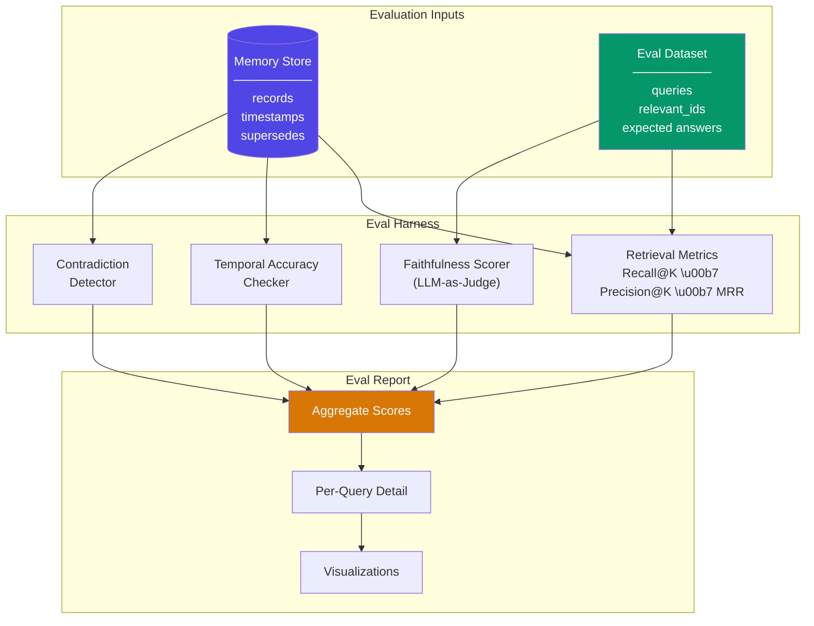

# 记忆评估（Memory Evaluation）

  

## 📖 速览

| 难度 | 用时 | 前置要求 |
|------------|------|---------------|
| 中级 | 约 40 分钟 | Python 3.8+、`LLM_API_KEY`，建议先了解 06 向量库记忆 |

本技术面向需要用查准率、查全率、回答准确率这类定量指标来衡量记忆系统质量的开发者。

## TL;DR

- **它是什么：** **记忆评估**是一个衡量记忆系统质量的框架，覆盖检索查准率、查全率、陈旧度检测和 LLM-as-judge 评分。
- **什么时候需要它：** 你已经有了一套能跑的记忆系统，需要定量的证据，证明它能准确检索到正确的信息。
- **权衡：** 需要构建评估数据集，而且基于 LLM 的评分会在被测系统之上增加 API 开销。
- **本仓库中最接近的替代：** 29 记忆基准测试（LoCoMo）使用标准化的公开数据集，而不是自定义评估集。

## 描述

构建智能体记忆系统只是挑战的一半。你还需要衡量它是否有效。这就像考学生：不测验、不打分，你不知道他们学到了什么。记忆评估给你一套结构化的方法来衡量 LLM 智能体记忆的质量。你会跟踪检索查准率（取回的记忆相关吗？）和查全率（相关的记忆都找到了吗？）。你还会检查陈旧度（智能体是否在用过时的事实？）和矛盾。无论你在做聊天机器人还是研究助理，评估都能把「看起来能用」变成可以比较、可以改进的数字。

记忆评估衡量智能体的记忆系统存储、检索和应用信息的能力。它包括可以跟踪的定量指标，比如检索查准率（取回的记忆相关吗？）和查全率（所有相关记忆都被检索到了吗？）。它还衡量陈旧度检测（存在更新的信息时，智能体是否还在用旧信息？）和矛盾处理（系统能否发现并解决互相冲突的记忆？）。

除检索质量外，评估还应衡量下游影响：更好的记忆能否带来更准确、更个性化、更连贯的智能体回答？

本技术介绍如何从真实或合成的对话构建评估数据集，如何用 LLM-as-judge 模式（由语言模型而不是人来打分）运行自动评估，以及如何为自然度、用户满意度这类主观质量设计人工评估协议。

**关键词：** 智能体记忆（agent memory）、记忆评估（memory evaluation）、检索查准率（retrieval precision）、查全率（recall）、LLM-as-judge、陈旧度检测（staleness detection）、矛盾处理（contradiction handling）、评估框架（evaluation harness）、基准测试（benchmark）、记忆质量（memory quality）

## 关键概念

- **检索查准率/查全率（precision/recall）**：查准率衡量取回的记忆中有多少比例是相关的。查全率衡量所有相关记忆中有多少比例被成功取回。两者结合，能告诉你系统是否找对了东西、有没有混入垃圾。
- **记忆陈旧度（staleness）**：当记忆库中已存在更新的、相矛盾的事实时，检测智能体是否仍在依赖过时信息。
- **矛盾检测（contradiction detection）**：识别记忆系统存储了互相冲突事实的情况（例如「用户住在纽约」与「用户住在旧金山」），并评估系统如何解决或标记这些冲突。
- **记忆覆盖率（coverage）**：评估记忆系统是否捕捉到对话中的全部重要信息。关键事实是否在提取、摘要或存储过程中丢失了？
- **评估数据集（evaluation dataset）**：人工整理的对话集合，配有真值记忆、预期检索结果和正确答案。你用它们可复现地为记忆系统的表现做基准测试。
- **自动评估（automated evaluation）**：用 LLM-as-judge 模式、嵌入相似度分数或基于规则的检查，大规模评估记忆质量。这样每个测试用例都不再需要人工标注。
- **人工评估协议（human evaluation protocol）**：让人工评分员评估主观记忆质量的结构化流程。他们评判相关性、连贯性、个性化准确度和整体用户满意度。

## 架构

  

Mermaid 源码

---

## 工作原理

1. 你构建一个评估数据集：把查询与真值相关记忆 ID 和预期答案配对。
2. 评估框架为每个查询检索记忆，并对照真值标签计算 Recall@K、Precision@K 和 MRR。
3. 对每个查询，评估框架根据检索到的记忆生成回答，再用 LLM-as-judge（给准确性打分的语言模型）为回答的忠实度评分。
4. 时序准确性检查器验证：在检索结果中，较新的事实是否排在被取代的过时事实之上。
5. 矛盾检测器用基于 LLM 的对比扫描所有已存记忆，找出互相冲突的陈述。
6. 评估框架把所有分数汇总成一份报告，包含逐查询明细和可视化。

## 何时使用

- 你在比较两种或多种记忆架构（例如向量检索与图记忆），需要客观的数字。
- 你想做回归测试：每次改动后跑一遍基准测试，确认记忆系统没有变差。
- 你需要诊断失败来自哪里：检索（找错了记忆）、忠实度（记忆对了但回答错了），还是陈旧度（提供了过时事实）。
- 你的团队需要一种共享的、可复现的方式来讨论记忆质量，而不是凭主观印象。

## 局限

- 构建带已知相关记忆 ID 的评估数据集需要人工标注。合成数据集可能无法反映真实对话的分布。
- LLM 评分器可能过于宽松、前后不一致，或与生成模型有同样的盲区。跨模型评分有帮助，但无法彻底消除。
- 矛盾检测有噪声。LLM 可能把正常更新（如换工作）标记为矛盾，也可能漏掉细微的逻辑冲突。
- 这项技术孤立地衡量检索和忠实度。它不衡量端到端的任务成败：更好的记忆是否真的带来更好的智能体表现。

## Notebook

[记忆评估 notebook](memory_evaluation.ipynb)：实现一个轻量级评估框架（evaluation harness，一种测试框架），覆盖检索指标（Recall@K、Precision@K、MRR）、基于 LLM-as-judge 的忠实度评分、时序准确性检查和矛盾检测。内含一个合成评估数据集和结果可视化。

## 常见问题

### 问：智能体记忆中的记忆评估是什么？

**答：** 记忆评估是一个衡量智能体记忆系统运行好坏的框架。它测试检索查准率（正确的记忆返回了吗？）、查全率（有相关记忆被漏掉吗？）、陈旧度检测（是否在提供过时事实？）和回答质量（用 LLM-as-judge 评分）。你从自己的领域构建自定义评估数据集，让记忆系统在上面运行，然后给结果打分。在进入生产环境之前，这就是你证明记忆系统有效的办法。

### 问：什么时候该用记忆评估，而不是记忆基准测试（LoCoMo）？

**答：** 当你需要针对自己的领域和用例的指标时，用自定义记忆评估。LoCoMo 和 LongMemEval（技术 29）提供标准化的公开基准，让不同系统在共同的基础上比较。你的自定义评估测试的是对你产品重要的东西：「智能体记住了用户的饮食禁忌吗？」比一个通用的基准分数更有用。选型初期用 LoCoMo。生产环境中的持续监控和回归测试用自定义评估。

### 问：记忆评估有哪些局限或失败模式？

**答：** 构建高质量的评估数据集既昂贵又耗时。你需要带真值标注的真实对话。LLM-as-judge 评分有用但有噪声：不同运行可能产生不同分数。评估指标可能覆盖不了所有质量维度（比如延迟或成本效率）。对单一指标（如查准率）过度优化会损害另一指标（如查全率）。应用演进时需要定期更新数据集，否则评估本身会过时。

### 问：可以把记忆评估和其他记忆技术结合使用吗？

**答：** 可以。记忆评估是一种元技术，适用于任何记忆系统。你可以用它比较技术 06（向量库记忆）和技术 20（记忆检索模式），量化混合检索带来的提升。测试技术 19（遗忘与衰减），为你的领域找到最优半衰期。评估技术 10（语义记忆）的抽取准确率。本仓库的每一项记忆技术都能靠系统化评估来调参。

### 问：有什么库或框架能省掉自己实现的工作？

**答：** RAGAS 提供适用于记忆检索的检索评估指标（查准率、查全率、忠实度）。DeepEval 提供可自定义标准的 LLM-as-judge 评估。LangSmith（来自 LangChain）支持对记忆增强链路做追踪和评估。记忆专用的基准测试见技术 29（LoCoMo 和 LongMemEval）。自己实现评估通常需要 100-200 行 Python：搭一个测试框架、生成查询、对照真值打分。

## 参考资料

- RAGAS 评估框架：
  [https://docs.ragas.io](https://docs.ragas.io?utm_source=nirdiamant&utm_medium=github&utm_campaign=agent_memory_techniques)
- LangSmith 评估工具：
  [https://docs.smith.langchain.com](https://docs.smith.langchain.com?utm_source=nirdiamant&utm_medium=github&utm_campaign=agent_memory_techniques)
- Maharana et al. (2024). "Evaluating Very Long-Term Conversational Memory of LLM Agents."
  arXiv:2402.17753.
- Wu et al. (2024). "LongMemEval: Benchmarking Chat Assistants on Long-Term Interactive
  Memory." arXiv:2410.10813.
- Zheng et al. (2023). "Judging LLM-as-a-Judge with MT-Bench and Chatbot Arena."
  arXiv:2306.05685.

## 相关技术

- [**29 记忆基准测试（LoCoMo 与 LongMemEval）**](../29_memory_benchmarks_LoCoMo/) - 搭好评估框架后就能运行的标准基准测试。
- [**30 生产级记忆模式**](../30_production_memory_patterns/) - 完成质量度量后，这些模式帮你放心部署。
- [**20 记忆检索模式**](../20_memory_retrieval_patterns/) - 检索模式直接影响你在这里评估的各项指标。

---

