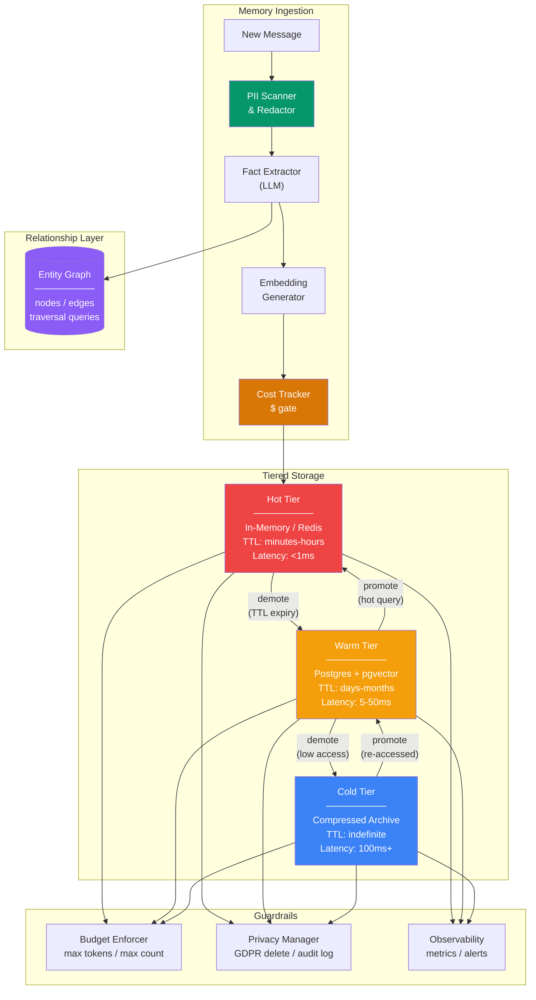

# 生产级记忆模式

  

## 📖 速览

| 难度 | 时间 | 前置要求 |
|------------|------|---------------|
| 高级 | 约 60 分钟 | Python 3.8+、`LLM_API_KEY`，建议先了解 06 向量库记忆和 13 分层记忆 |

本技术面向准备大规模部署智能体记忆的开发者，涵盖缓存、分片、GDPR 合规和可观测性。

## TL;DR

- **它是什么：** **生产级记忆模式**涵盖智能体记忆规模化所需的工程工作：缓存、TTL 策略、分片、GDPR 合规和可观测性。
- **什么时候需要它：** 你要把智能体记忆从能跑的原型变成服务真实用户的生产系统。
- **权衡：** 在缓存、PII 脱敏、成本跟踪和多层级存储管理上引入额外运维复杂度。
- **仓库里最接近的替代：** 21 跨会话记忆能处理基础持久化，但没有生产基础设施层。

## 描述

让智能体记忆在 demo 里跑通是一回事。在规模化之后保持快速、省钱、隐私且可靠，才是真正的挑战。可以想想做饭：给两个人做一顿好菜很有乐趣，但一家每晚服务 500 人的餐厅需要食品安全、稳定质量和严格的成本控制。生产级记忆模式涵盖把 LLM 智能体记忆部署到真实应用所需的工程。你会学到低延迟缓存（缩短响应时间）、TTL 策略（数据到期自动删除）、水平分片（把数据拆到多台服务器）和 GDPR 合规。你还会搭建可观测性（日志和指标），以便尽早发现问题。任何要扩展带持久记忆的聊天机器人、客服智能体或 AI 助手的团队，都离不开这些模式。

把智能体记忆从原型推向生产，会带来超出检索质量的工程挑战。本技术涵盖你需要掌握的架构模式：

- **缓存**：把高频访问的记忆放进 Redis（一种内存数据存储），降低延迟（响应时间）。
- **TTL 策略**（time-to-live，存活时间：到期自动删除）：清理陈旧或低价值记忆。
- **水平分片**（按用户 ID 把数据拆到多个数据库服务器）：应对不断增长的用户规模。
- **备份与恢复**策略：防止数据丢失。
- **GDPR 被遗忘权**（法律要求在用户提出请求后彻底删除其数据），包括嵌入和图关系。
- **可观测性**（日志、指标和告警），在问题影响用户之前发现它们。
- **成本管理**：让嵌入生成、向量存储和 LLM 抽取在大规模下仍然划算。

**关键词：** agent memory, production deployment, caching, TTL, horizontal sharding, GDPR, observability, latency optimization, LLM agent, cost management

## 核心概念

- **记忆缓存（Redis）**：在主记忆存储前面加一层快速缓存。高频访问的记忆以亚毫秒级延迟返回，同时减轻后端数据库的负载。
- **TTL 策略**：给记忆设置存活时间。临时信息（比如「用户正在开会」）到期自动消失，无需人工清理。
- **水平分片**：按用户 ID 或命名空间哈希，把记忆数据分布到多个数据库节点。用户规模超过单节点容量时依然保持性能。
- **备份与恢复**：为记忆存储定期做快照和预写日志（WAL），并演练恢复流程，从硬件故障、数据损坏或误删中恢复。
- **GDPR 被遗忘权**：在所有记忆层（原始对话、抽取的事实、向量嵌入、图的节点和边）上完整删除用户数据，满足隐私法规。
- **记忆可观测性**：为记忆操作接入结构化日志、分布式追踪和仪表盘。你跟踪检索延迟、缓存命中率、存储大小、错误率和抽取质量。
- **成本管理**：控制嵌入生成（批处理、嵌入缓存）、向量存储（分层存储、降维）和 LLM 抽取调用（选择性处理、更小的模型）的成本。
- **延迟优化**：让记忆检索保持在延迟预算内的技术。包括预取可能用到的记忆、连接池、索引调优，以及不阻塞响应路径的异步记忆操作。

## 架构

  

Mermaid 源码

---

## 工作原理

1. 新消息入库前先经过 PII 扫描器（检测邮箱、电话号码等个人身份信息的工具）和脱敏器。
2. 基于 LLM 的事实抽取器从脱敏后的文本中抽取结构化事实和实体关系。
3. 嵌入生成器（把文本转成数值向量以便相似度搜索的模型）为每条记忆创建向量。成本跟踪器记录每一次操作。
4. 系统把新记忆存入热层（亚毫秒级读取的内存缓存）和温层（支持持久搜索的向量数据库）。
5. 检索时先搜热层，再搜温层，最后搜冷层。高频访问的温层记录升级为热层；冷层记录被访问时解压并升级为温层。
6. 定期维护执行每用户预算上限，把陈旧的低重要度记录降级到冷存储，并按每日和每月支出上限跟踪成本。

## 何时使用

- 你要把智能体记忆从单用户原型扩展出去，应对成千上万拥有不同访问模式的用户。
- 你的应用必须遵守 GDPR 或类似隐私法规，需要按请求在所有存储层彻底删除某个用户的数据。
- 你需要成本控制，因为嵌入生成、LLM 抽取和向量存储的成本会随消息量增长。
- 检索延迟很重要：高频记忆要亚毫秒级访问，低频记忆要保持低存储成本。

## 局限

- 分层存储增加工程复杂度。你必须在三个存储层之间管理升级、降级和一致性。
- 基于正则的 PII 检测能抓住常见模式（邮箱、社会安全号），但抓不住依赖上下文的 PII，比如姓名和地址。生产系统需要专门的 PII 服务。
- 重要性分数驱动淘汰决策，分数不准会导致系统丢掉有价值的记忆，或保留低价值记忆。
- 本技术只覆盖单节点模式。水平分片（把数据拆到多台服务器）、分布式缓存和跨区域复制需要额外的基础设施，这里没有展开。

## Notebook

[**production_memory_patterns.ipynb**](production_memory_patterns.ipynb)：实现了一套完整的分层记忆系统，包含热层（类 Redis 缓存，带 TTL/LRU）、温层（类 pgvector 余弦相似度搜索）和冷层（zlib 压缩归档）三层存储。涵盖 PII 检测与脱敏、带跨层删除和审计日志的 GDPR 被遗忘权、按用户执行的记忆预算限制与重要性加权淘汰、带每日/每月支出上限的美元成本跟踪、面向结构化知识的实体关系图存储，以及 LLM 驱动的事实抽取。所有组件由一个 `TieredMemorySystem` 类统一编排。

## FAQ

### 问：智能体记忆里的生产级记忆模式是什么？

**答：** 生产级记忆模式涵盖大规模运行智能体记忆所需的工程实践。包括：用 Redis 缓存热记忆并配置 TTL 策略、跨数据库分区做水平分片、符合 GDPR 的删除流程、成本监控仪表盘，以及可观测性基础设施（日志、追踪、告警）。它不是单一的记忆技术，而是一组运维模式，让任何记忆技术达到生产可用。可以把它看作记忆层之上的「运维层」。

### 问：什么时候该用生产级记忆模式，而不是跨会话记忆？

**答：** 当你从原型阶段走向服务真实用户时，就该用生产级记忆模式。跨会话记忆（技术 21）解决基础持久化。生产模式补上基础持久化缺少的部分：多用户隔离、水平扩展、降低延迟的缓存层、基于 TTL 的清理、PII 处理和监控。如果你有超过 100 个活跃用户、要处理敏感数据，或者需要可用性保证，就需要在所选记忆技术之上加这些运维模式。

### 问：生产级记忆模式有哪些局限或失败模式？

**答：** 过度设计是主要风险。用户还不够多时就加缓存、分片和可观测性，只会浪费开发时间。每层基础设施都带来运维复杂度和潜在故障点。缓存失效 bug 会返回陈旧数据。分片让跨分片查询变得昂贵。跨多个存储（向量库、图数据库、缓存）的 GDPR 删除需要仔细协调。从最简单的生产可用配置开始，规模需要时再逐层加。

### 问：生产级记忆模式能和其他记忆技术组合吗？

**答：** 可以。生产模式就是设计来包裹任何记忆技术的。给技术 06（向量库记忆）加缓存，降低嵌入查询延迟。给技术 19（遗忘与衰减）加 TTL 策略，实现自动清理。给技术 21（跨会话记忆）加分片，按用户 ID 分区。给技术 28（记忆评估）加可观测性，实现持续监控。这些模式是基础设施，不是记忆技术的替代品。

### 问：有什么库或框架能省掉自己实现的工作？

**答：** Zep（技术 27）提供生产可用的托管服务，内置缓存、多用户隔离和异步处理。Mem0 Platform（技术 25）提供自带生产基础设施的云 API。自托管方案里，Redis 负责缓存，PostgreSQL 或 DynamoDB 负责持久化，OpenTelemetry 提供可观测性。LangChain 的 LangSmith 为带记忆的智能体提供追踪和监控。具体选型取决于你的云服务商和规模要求。

## 参考资料

- Redis 文档：[https://redis.io/docs/](https://redis.io/docs/?utm_source=nirdiamant&utm_medium=github&utm_campaign=agent_memory_techniques)
- GDPR 删除权（第 17 条）：[https://gdpr-info.eu/art-17-gdpr/](https://gdpr-info.eu/art-17-gdpr/?utm_source=nirdiamant&utm_medium=github&utm_campaign=agent_memory_techniques)
- Pinecone 生产最佳实践：[https://docs.pinecone.io/guides/getting-started/overview](https://docs.pinecone.io/guides/getting-started/overview?utm_source=nirdiamant&utm_medium=github&utm_campaign=agent_memory_techniques)
- OpenTelemetry 可观测性：[https://opentelemetry.io/docs/](https://opentelemetry.io/docs/?utm_source=nirdiamant&utm_medium=github&utm_campaign=agent_memory_techniques)
- Weaviate 扩展与复制：[https://weaviate.io/developers/weaviate](https://weaviate.io/developers/weaviate?utm_source=nirdiamant&utm_medium=github&utm_campaign=agent_memory_techniques)
- AWS Well-Architected Framework：[https://docs.aws.amazon.com/wellarchitected/latest/reliability-pillar/welcome.html](https://docs.aws.amazon.com/wellarchitected/latest/reliability-pillar/welcome.html?utm_source=nirdiamant&utm_medium=github&utm_campaign=agent_memory_techniques)

## 相关技术

- [**28 记忆评估**](../28_memory_evaluation/) - 部署到生产前后，衡量你的记忆质量。
- [**19 遗忘与衰减**](../19_forgetting_and_decay/) - TTL 策略是遗忘与衰减概念的生产实现。
- [**27 Zep 记忆**](../27_zep_memory/) - Zep 是生产可用的框架，替你处理其中许多模式。
- [**06 向量库记忆**](../06_vector_store_memory/) - 你最常用这些模式来扩展和优化的记忆后端。

---

